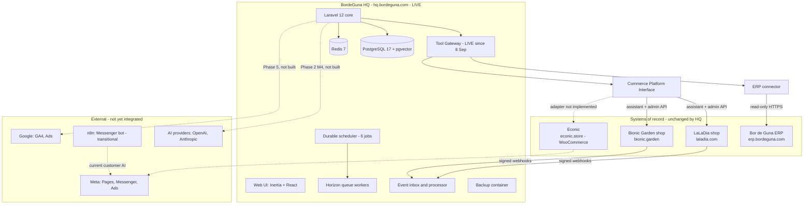
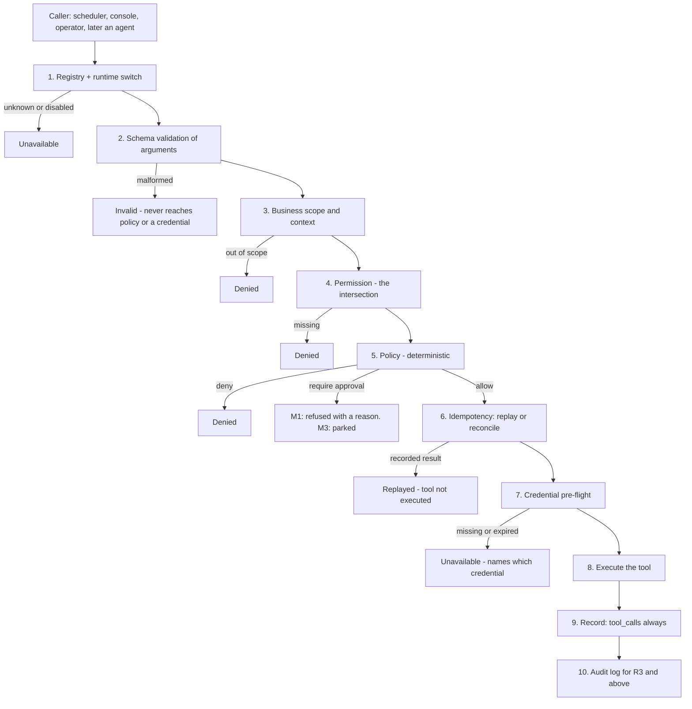
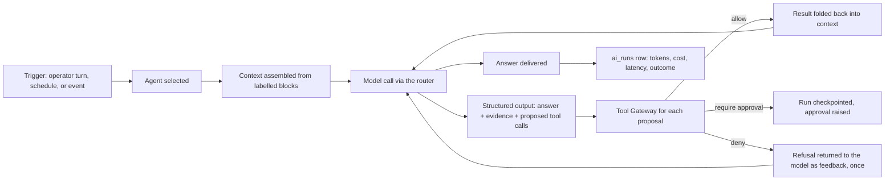
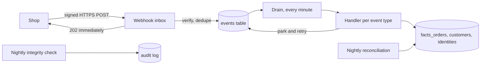
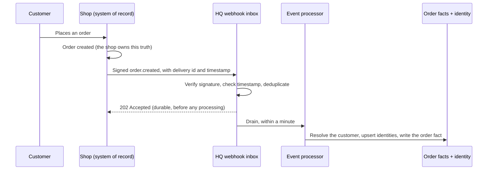
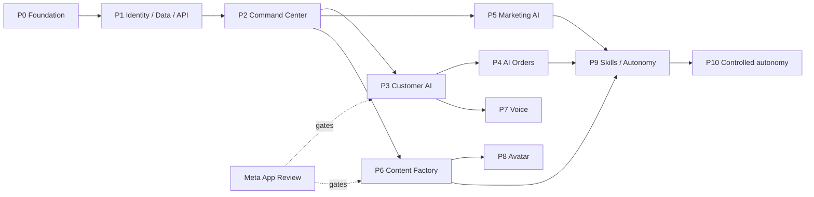

# BordeGuna HQ - Master System Dossier

## Business Vision, Architecture, Roadmap and Current State

| | |
| --- | --- |
| **Document date** | 8 September 2026 |
| **Document version** | 1.0 |
| **Status** | Current and verified against live production on the date above |
| **Prepared by** | Engineering, for the owner and for external technical review |
| **Intended audience** | Company owner and executives; architects and engineers; any AI assistant given this file as its only context on the project |
| **Purpose** | To be a complete, self-contained knowledge base for BordeGuna HQ, so that a reader with no prior exposure can understand what the system is, why it exists, what is genuinely built, what is designed but not built, and what decisions remain |

### Source-of-truth statement

This document was written by inspecting the repository, the deployed code and the running
production systems, not from memory or from older planning documents.

The project has produced roughly fifty design and milestone documents since 5 September 2026. Some
of the earliest ones have been overtaken by what was actually built. **Where documents disagree, the
running code and the latest milestone record win.** Every such conflict found while writing this
dossier is called out explicitly in a subsection titled *Historical assumption superseded by current
design*, rather than quietly corrected, because the history explains why the current design is
shaped as it is.

Status labels are used strictly and mean exactly what they say:

| Label | Meaning |
| --- | --- |
| **Production-proven** | Running in production and verified by observed evidence, not by the existence of code |
| **Built, not yet exercised in production** | Code deployed, tests pass, but no real-world event has exercised it |
| **Approved design / Implementation pending** | The architecture is agreed and recorded; no code exists |
| **Planned / Not implemented** | Intended, but not yet designed to implementation depth |
| **In progress** | Actively being implemented right now |
| **Blocked** | Waiting on an external decision, credential or dependency |
| **Deferred** | Deliberately postponed |
| **Rejected** | Considered and refused |
| **Superseded** | Once planned, later replaced by a different decision |
| **Unknown / Not yet verified** | Genuinely not known; not guessed |

No credentials, tokens, secrets, webhook signing keys or customer personal data appear anywhere in
this document. Where a real order or customer is referenced, only a non-identifying order reference
is used.

---

# ONE-PAGE EXECUTIVE BRIEF

**What it is.** BordeGuna HQ is a new web application that sits *above* the company's existing
operating systems and gives the owner one place to see and run the whole group. It is the control
layer and the intelligence layer. It is not a replacement for anything that already works.

**Why it exists.** The group runs several businesses on several disconnected systems: an ERP for
accounting, inventory, HR and payroll; two Laravel e-commerce shops; a WordPress/WooCommerce shop;
static brand sites; and an n8n automation server running a Messenger chatbot. Before HQ, **no
connection existed between the ERP and the shops, and no customer channel reached the ERP.** Seeing
the state of the group meant opening five admin panels and reconciling them by hand.

**The core architectural rule.** The ERP and the shops remain the systems of record. HQ never becomes
the authoritative store of an order, a price, a stock level or a ledger balance. It keeps rebuildable
read models and acts on the source systems through their own interfaces. This one rule prevents the
most expensive failure mode available to a project like this: two systems disagreeing about the
truth, with no way to say which is right.

**What is genuinely working today (8 September 2026).**

- HQ is live at `hq.bordeguna.com`, release `c341e93`, seven containers healthy.
- The ERP integration is live and read-only. HQ reads the ERP's business overview and low-stock list.
- Both Laravel shops (LaLaDia and Bionic Garden) are integrated end to end: real customer orders
  arrive at HQ by signed webhook within roughly a minute, unattended, and become order facts.
- A nightly reconciliation catches anything a webhook lost, and a nightly integrity checker
  verifies the arithmetic of every stored order fact. Current state: **16 order facts, 16 correct,
  0 discrepancies.**
- A durable scheduler runs six business jobs on a proper job table with retry and history, rather
  than scattered cron lines.
- The **Tool Gateway** shipped on 8 September: a single, mandatory, deterministic door through which
  any AI-initiated or automated action must pass. Every call is validated, permission-checked,
  policy-checked and recorded.

**What is NOT working yet, stated plainly.** There is **no AI agent running in this system.** No
model is called. There is no chat interface, no daily briefing, no approval queue, no marketing
automation, no content generation, no voice. All of that is designed, several parts in considerable
detail, and none of it is built. HQ today is a very well-instrumented integration and control
platform with the AI layer's foundations laid and nothing running on them.

**Where we are in the plan.** Phases 0 and 1 are complete. Phase 2 (the Command Center, which is
where AI actually enters the system) is broken into seven milestones; **milestone 1 of 7 is complete
and deployed.** Milestone 2 is designed and not started. It requires the owner's approval to begin.

**Why it is being built cautiously.** Phase 1 produced a genuine production incident that shaped
everything since: HQ received a real customer order correctly and stored the line prices as 0.00.
Nothing errored, no test failed, and the health check stayed green, because a zero is a valid number
and a missing key raises nothing. The test fixture had been written from the design document instead
of from what the shop actually sends, so the test and the code agreed with each other and both
disagreed with reality. That incident is why the current architecture puts deterministic verification
around everything, and why AI capability is being introduced behind a permission and approval layer
that was built *before* the first agent.

**What the end state looks like.** The owner opens one page in the morning and is told what happened
overnight across every business, what needs a decision, and what is anomalous, with every number
traceable to its source. He can ask questions in plain language, schedule work by describing it, and
approve or refuse anything the AI proposes to do to the outside world. The businesses continue to own
their own operational truth throughout.

**The single most important thing for an executive to understand:** the AI in this system is a
*proposer*, never an *executor*. Everything it can do to the world is a typed, named tool call that a
deterministic layer approves or refuses **after** the model has finished speaking. That is why a
clever or malicious prompt cannot escalate anything: the enforcement is not written in English and
cannot be argued with.

---

# TABLE OF CONTENTS

1. Executive summary
2. The business vision
3. What BordeGuna HQ is and is not
4. Complete system map
5. Complete module catalog
6. Current production state
7. Phase 0 complete
8. Phase 1 complete
9. Important lessons from Phase 1
10. Phase 2: the Command Center
11. M1 detailed technical explanation
12. M2 detailed design
13. AI agent architecture
14. Executive agent
15. Analytics agent
16. Ask HQ
17. Tool Gateway and security model
18. Approval Center
19. Autonomy model
20. Model routing and AI providers
21. Behavior alignment
22. Memory architecture
23. Customer AI
24. AI order-taking
25. Marketing and ads automation
26. Content factory
27. Voice, telephony and avatar
28. Scheduler architecture
29. Data architecture
30. Event architecture
31. Security architecture
32. Observability
33. Testing strategy
34. Deployment and infrastructure
35. Repository and development model
36. Business data flow examples
37. Complete roadmap
38. What is complete right now
39. Current known limitations
40. Current risks
41. Architecture decision (ADR) catalog
42. Important decisions already made
43. Open decisions
44. What the final system looks like
45. Why this architecture is built this way
46. Glossary
47. Questions an executive may ask
48. Executive summary table
49. Source and evidence index

Appendix: One-page current state and next steps

---

# SECTION 1 - EXECUTIVE SUMMARY

## 1.1 What BordeGuna HQ is

BordeGuna HQ ("HQ") is a separate web application, reached at `hq.bordeguna.com`, from which the
whole company can eventually be run. It has four jobs:

1. **The control surface.** One login, one place to see LaLaDia, Bionic Garden, Azmion, Econic and
   the ERP together, and eventually to act on any of them.
2. **The intelligence layer.** AI agents that read live business truth and produce briefings,
   recommendations, drafts, replies, schedules and controlled actions.
3. **The automation layer.** A durable scheduler and workflow engine that turns "every morning brief
   me" into a job that survives restarts, retries on failure, and leaves an execution history.
4. **The memory.** Structured preferences, approved procedures, past decisions, brand knowledge and
   the outcomes of past actions, so that the AI becomes aligned with how the owner actually works.

Only the first, third and a foundational slice of the second exist today. The fourth exists as empty
tables waiting for the first agent to write to them.

## 1.2 What BordeGuna HQ is not

- **Not a second ERP.** Employees, payroll, finance, accounting, inventory valuation, procurement
  and vendors stay in the Bor de Guna ERP, which is live and carries roughly 3,000 of its own tests.
  HQ calls it. HQ does not copy it.
- **Not a second shop.** Products, variants, prices, stock, combos, promotions and orders for
  LaLaDia and Bionic stay in the shop platform. Econic's stay in WooCommerce until a replatform
  decision is taken.
- **Not an unrestricted AI agent.** No AI action reaches a customer, a budget, a payment or a record
  without passing permission, policy and (where required) human approval, and every action is
  recorded in an append-only audit log.

## 1.3 Why HQ is separate from the ERP

It would have been natural to add HQ as a ninth module of the existing ERP. That was considered and
rejected, and the reasoning is recorded as ADR-001:

- HQ's workload is external webhooks, AI model calls, advertising-platform writes, media generation
  and long-running workflows. Putting that in the same process and the same failure domain as
  **payroll** is a bad trade.
- The ERP deliberately has no network route to the open internet beyond its own needs. HQ needs many.
- The ERP's release cadence and large test suite would slow every HQ iteration.
- The ERP runs on MySQL; HQ wants PostgreSQL with vector search for AI memory.

The cost of that decision is a second application, a second database and a second backup stream. That
cost was accepted for the isolation it buys.

## 1.4 Why AI is placed above the operational systems rather than inside them

Putting an AI assistant inside each system would give each one a helpful chatbot and would give the
group nothing. The questions that matter to an owner span systems: *did the money we spent on ads
turn into delivered, profitable orders?* touches the ad platform, the shop, the courier, the payment
gateway and the ERP's cost prices. No single system can answer it.

Equally important, an AI that lives above the systems can be governed in one place. One permission
model, one policy engine, one approval queue, one audit log. An AI inside five systems is five
governance problems.

## 1.5 The eventual AI-native operating model

In the end state, the operating rhythm changes in a specific way:

- **Reporting becomes conversational.** Instead of opening five dashboards, the owner asks a question
  and receives an answer with every figure linked to its source and stamped with how fresh it is.
- **Routine work becomes scheduled and automatic**, but visible: every automated run leaves a record
  of what it did and why.
- **Judgement stays human, and is made cheaper.** The AI's job is to bring a decision to the owner
  fully prepared: what happened, what it means, what it recommends, what it will cost, and what
  happens if it is ignored. The owner approves or refuses.
- **Customer conversation becomes AI-first with a human path**, once Phase 3 exists, with a clean
  handover in both directions.

## 1.6 What has already been accomplished

| Phase | Content | Status |
| --- | --- | --- |
| Phase 0 | Foundation: the HQ application, deployment, security, the domain model, credentials, audit, scheduler skeleton, backups | **Complete** |
| Phase 1 | Identity, data and API: ERP integration, both shop integrations, event pipeline, customer identity, order facts, reconciliation, integrity checking | **Complete and production-proven** |
| Phase 2 M1 | Control-plane foundation: the Tool Gateway, tool descriptors, identity model, business scoping, permissions, tool-call recording, redaction, idempotency | **Complete and deployed 8 September 2026** |
| Phase 2 M2-M7 | Policy engine, approval centre, model router, the first two agents, Ask HQ, natural-language scheduling, daily briefing | **Not started** |
| Phases 3-10 | Customer AI, AI orders, marketing, content, voice, avatar, measured autonomy | **Planned, various depths of design** |

## 1.7 The current development phase and the next milestone

The project is inside **Phase 2, at the boundary between milestone 1 and milestone 2**.

**M2 is the next milestone.** It does two things: it moves the existing scheduler so that its jobs
run *through* the Tool Gateway rather than around it, and it builds the real policy engine. Its
acceptance test is deliberately harsh: the six scheduled jobs that run in production today must
produce **byte-identical output** through the gateway. If the gateway changes what a working job
does, the gateway is wrong.

M2 has not started and requires the owner's approval to begin.

## 1.8 The ultimate end state

A group of businesses whose operational truth continues to live in the systems that own it, with a
single intelligent control layer above them that watches everything, tells the owner what matters,
proposes what to do, executes what it is permitted to execute, asks permission for the rest, and
keeps a complete and tamper-evident record of every action and the reason for it.

---

# SECTION 2 - THE BUSINESS VISION

## 2.1 The group today

| Brand | Domain | What it is | Underlying system |
| --- | --- | --- | --- |
| Bor de Guna | bordeguna.com | Parent company site | Static React single-page app |
| LaLaDia | laladia.com | Food e-commerce | Laravel 12 shop platform (the reference product) |
| Bionic Garden | bionic.garden | Wellness e-commerce | A fork of the LaLaDia platform |
| Azmion | theazmion.com | Technical and agency brand | Static React single-page app |
| Econic | econic.store | Consumer electronics shop | WordPress + WooCommerce |
| Bor de Guna ERP | erp.bordeguna.com | ERP, HRM, accounting, sales and POS, CRM | Laravel 12 + Inertia/React, Docker on a VPS |
| Automation | n8n instance | Bionic Messenger bot, content pipeline | n8n + PostgreSQL |

The two Laravel shops share one codebase lineage: LaLaDia is the product and Bionic is its fork, so
fixes flow upstream into LaLaDia and are then merged down into Bionic. That discipline is why a
change made once during Phase 1 landed correctly on both shops.

## 2.2 The problem HQ solves

**Operational problems that exist today, in the group's own words:**

1. **No system talks to another.** Before HQ, there was literally no flow between the ERP and the
   shops, and no customer channel reached the ERP. A customer who ordered on the website and then
   phoned in existed twice, in two systems, with no link.
2. **Seeing the group means opening five admin panels.** There is no single answer to "how are we
   doing".
3. **Nothing watches for silent failure.** The Phase 1 incident is the proof: an integration can be
   green in every observable way and be storing wrong data.
4. **Automation is scattered.** Business scheduling lived in Laravel schedule entries across three
   applications, n8n triggers, a personal agent's cron job and host crontab lines, with no shared
   history, no interface and no way to ask what is scheduled.
5. **Attribution is impossible.** Whether advertising produced profit cannot be answered, because
   the spend is in one platform, the order in another, the delivery outcome in a third and the cost
   price in a fourth. Cash-on-delivery cancellation, which runs at roughly a third of orders, makes
   platform-reported revenue actively misleading.
6. **Institutional knowledge is in one person's head.** How things are decided, what was tried,
   what worked, why a rule exists.

## 2.3 The intended future operating model

HQ becomes the layer where the group is *operated*, while each business continues to *run* on its own
system:

- **Watch.** HQ continuously receives events from every store and polls the ERP, building read
  models that let it answer cross-system questions.
- **Understand.** Agents turn those read models plus live reads into narrative: what happened, what
  is unusual, what it probably means.
- **Propose.** Agents propose actions as structured, typed tool calls.
- **Govern.** A deterministic layer decides whether each proposal may proceed, needs a human, or is
  refused.
- **Act.** Permitted actions execute through the same interfaces a human would use, and are recorded.
- **Learn.** Every human decision, edit and refusal is captured as data that shapes future proposals,
  without any model being retrained.

## 2.4 What becomes centralized and what stays decentralized

| Centralized in HQ | Stays with the owning system |
| --- | --- |
| Cross-business visibility and reporting | The ledger, payroll, inventory valuation (ERP) |
| Customer identity resolution across channels | The customer record in each shop and the ERP's CRM |
| AI agents, prompts, policies, approvals, audit | Product catalogue, prices, stock, promotions (each shop) |
| Business scheduling and workflows | Order processing and fulfilment (each shop) |
| Marketing intent, experiments and attribution | Ad delivery and spend (the ad platforms) |
| Content drafts, approvals and calendars | Published posts and their platform identifiers |
| Conversation state and human handoff | Message delivery (Meta, WhatsApp) |

## 2.5 The entity model, and why the concepts must not be collapsed

HQ models seven distinct concepts. Collapsing them would be simpler today and would block the
group's stated future.

| Entity | Meaning | Examples |
| --- | --- | --- |
| **Business** | A legal or operating unit that owns things and is accountable for money | Bor de Guna, LaLaDia, Bionic, Azmion; Econic exists in HQ without an ERP business row |
| **Brand** | A market-facing identity with persona and visual rules, owned by exactly one business | LLD, BNC as ERP brand codes; Econic and Azmion as marketing brands |
| **Store** | A commerce storefront operated by a business, reached through one commerce adapter | laladia.com, bionic.garden, econic.store, the ERP counter/POS |
| **Product owner** | The business whose catalogue a product belongs to; cost, FIFO and manufacturing live here | Bor de Guna owns every current product via the ERP |
| **Seller** | The entity of record for an order line on a multi-seller store | Dormant today (see below) |
| **Channel** | Where a customer interaction or order originates | Web, Messenger, Instagram, WhatsApp, phone, POS, landing page |
| **Platform account** | An external account tied to a brand, with its own credentials and capabilities | A Facebook Page, an Instagram account, an ad account |

**Why they must stay separate.** A store is not a business: one store may sell products belonging to
several businesses, and that is a row in a link table rather than a redesign. A brand is not a
business: one business can carry several market-facing identities. A channel is not a store: the same
store takes orders from the web, from Messenger and from a landing page, and attribution depends on
knowing which. A platform account is not a brand: a brand may have a Facebook Page, an Instagram
account and an ad account, each with different permissions and different approval states.

**Historical assumption superseded by current design.** The original design (ADR-010) included a
*seller* concept for a future multi-vendor Econic marketplace. On 6 September the owner clarified
that Econic is not a marketplace: only Bor de Guna publishes, nobody else logs in, and there is no
onboarding, commission or payout. ADR-015 therefore **narrowed** ADR-010: the seller concept is
**dormant**, nothing populates it and nothing branches on it, and because there is one legal company
HQ builds no intercompany logic. The columns remain so that a genuine third-party seller would be a
new decision rather than a migration.

---

# SECTION 3 - WHAT BORDEGUNA HQ IS AND IS NOT

## 3.1 HQ is

| Role | Meaning | Status |
| --- | --- | --- |
| Group-level control and intelligence layer | One place to see and act across businesses | Partially built: visibility yes, action through the gateway yes, intelligence not yet |
| Orchestration layer | Coordinates multi-step work across systems | Scheduler built; workflow engine planned |
| AI control plane | Governs what AI may do | Foundation built (M1); policy engine and approvals not built |
| Integration layer | Typed connectors to every system | Built for the ERP and both Laravel shops |
| Memory and knowledge layer | Preferences, decisions, procedures, brand knowledge | Tables exist and are empty; no writer yet |
| Executive command centre | Briefings, priorities, decisions | Planned (Phase 2 M7) |
| Automation layer | Durable jobs and workflows | Scheduler built; workflow engine planned |
| Scheduling layer | All business scheduling | Built and running six jobs |
| Analytics layer | Cross-system reporting and attribution | Read models built; analytics agent and attribution planned |
| Policy and approval layer | Deterministic governance of every action | Minimal deterministic gate built; full engine and approvals not built |
| Communication and marketing orchestration | Customer conversation, campaigns, content | Planned, Phases 3, 5 and 6 |

## 3.2 HQ is not

- **A replacement ERP.** Rejected explicitly and permanently.
- **A second source of truth for orders.** HQ's order facts are a read model that can be rebuilt
  from the shops at any time. If HQ and a shop disagree, the shop is right by definition.
- **A duplicate accounting system.** HQ reads finance; it may propose journals in a much later
  phase; it never posts them.
- **A generic unrestricted AI agent.** There is no free-form agent with broad system access, and
  there is no plan to create one.
- **A second independent commerce platform for existing stores.** HQ never becomes the storefront.
- **An unrestricted database interface for AI.** No tool accepts a query. No model sees a table name.
- **An unrestricted browser agent.** Explicitly a non-goal.
- **A place where models execute SQL.** Enforced by architecture: no tool takes a query as input.
- **A place where credentials are exposed to models.** There is no tool that returns a secret, and
  the object that carries context into a tool has no field that could hold one.

## 3.3 The governing principle and its implications

> **The ERP and the commerce systems remain the systems of record. HQ maintains read models and acts
> through typed interfaces.**

Implications, each of which shows up concretely in the design:

1. **Every read model must be rebuildable.** A `rebuild` command exists for customer identity, and
   reconciliation rebuilds order facts from the shops. If HQ's database were lost entirely, no
   business truth would be lost with it.
2. **Any fact used in an action is re-read live.** Prices, stock, order status and balances are never
   answered from memory or from a cached fact when an action depends on them.
3. **HQ surfaces disagreement rather than resolving it.** The shops' sellable stock view and the
   ERP's accounting stock view are not synchronised and are not the same number. HQ shows both and
   flags the difference; it does not pick a winner.
4. **HQ writes to a source system only through that system's own public interface**, with the same
   authentication a human integration would use, subject to that system's own rules.
5. **A read must not have side effects.** During the Phase 1 repair, the obvious way to fetch missing
   order line detail was the shop's admin "show" endpoint. It was deliberately not used, because that
   endpoint stamps `admin_viewed_at` on the order and would have marked real customer orders as
   "seen" in the shop's own workspace. A read that writes to the source system is not a read.

# SECTION 4 - COMPLETE SYSTEM MAP

## 4.1 The map as it exists today



Solid lines are live. Dotted lines are planned, transitional or not implemented.

## 4.2 System-by-system

### BordeGuna HQ
- **Owns:** agents, tools, policies, approvals, schedules, workflows, conversations, customer
  identity resolution, memory, assets, marketing intent, content items, audit.
- **Does not own:** any business truth. No product, price, stock level, order, ledger entry,
  employee or payment is mastered here.
- **Status:** Live, release `c341e93`.

### Bor de Guna ERP
- **Owns:** employees, payroll, attendance, accounting and the ledger, inventory valuation and cost,
  procurement, vendors, CRM leads and tickets, counter and dealer sales.
- **HQ interaction:** read-only, over HTTPS, through a purpose-built `/api/hq/v1` surface, with a
  per-business bearer token whose abilities are deliberately narrower than a full user's.
- **Status:** Live and integrated. Production release `1c3ca24`. Answers only on
  `erp.bordeguna.com`.
- **Critical note:** HQ never opens a database connection to the ERP. API only.

### LaLaDia (laladia.com)
- **Owns:** its catalogue, variants, prices, promotions, combos, sellable stock, customers, orders,
  shipments, payments.
- **HQ interaction:** reads through the shop's assistant API and admin API; receives signed webhooks
  for order events; reconciles nightly.
- **Status:** Live and integrated end to end, production-proven with real customer orders.
- **Codebase role:** the reference product. Fixes are authored here and merged down to Bionic.

### Bionic Garden (bionic.garden)
- Same shape as LaLaDia, being a fork of it. Live and integrated, proven with a real customer order
  that reached HQ in 81 seconds unattended.

### Econic (econic.store)
- **Owns:** its own WooCommerce catalogue and orders.
- **HQ interaction:** **none today.** A store row exists in HQ (`econic-store`, adapter
  `woocommerce`, marked active) but **no WooCommerce adapter is implemented**; the commerce registry
  refuses any store whose adapter is not `laladia` or `bionic`. WooCommerce API keys are
  **Unknown / Not yet verified**.
- **Status:** **Not integrated.** The store row is a placeholder, and the fact that it is marked
  active while unusable is a small piece of technical debt recorded in Section 39.
- **Future:** ADR-015 decided that the future custom commerce platform behind the interface is the
  **ERP's own website module**, not a separate Econic application.

### The ERP counter / POS store
- A store row exists (`erp-counter`, adapter `erp_pos`, active). **The adapter is not implemented.**
  Its stored base URL still points at a hostname that was decommissioned on 7 September. This is
  inert because nothing reads it, and it is a known limitation to be fixed in code (never by direct
  database edit) before anything is built on that adapter.

### n8n automation server
- **Role today:** runs the only live customer-facing AI, a Bionic Messenger chatbot, plus proven
  content-stage integrations.
- **Status:** **Transitional** (ADR-006). Nothing new of business significance is built in n8n.
  Each workflow will be replaced by an HQ equivalent only after HQ has run it in shadow mode for a
  week; then the trigger is repointed, the old workflow is deactivated but not deleted for a month,
  and deletion happens only on explicit approval.

### Meta, Google, TikTok, telephony, media providers
- **Status:** **Planned / Not implemented** in HQ. Meta assets exist and are in use by the shops for
  pixel and conversions tracking, and by n8n for the chatbot, but HQ has no adapter to any of them.

### AI providers (OpenAI, Anthropic and others)
- **Status:** **Planned / Not implemented.** There is no model router, no provider driver and no
  model call anywhere in HQ. `ai_runs`, the table designed to record every model call, contains
  **zero rows**.

---

# SECTION 5 - COMPLETE MODULE CATALOG

This is the full intended system, including modules that do not exist yet. Every entry carries an
explicit status.

## 5.1 Core platform

| Module | Purpose | Status | Notes |
| --- | --- | --- | --- |
| Authentication | Password login with session auth | **Production-proven** | |
| Mandatory TOTP two-factor | Every account must enrol; unverified sessions can reach only the challenge and setup screens | **Production-proven** | Enforced by two middleware layers |
| RBAC (roles and permissions) | Role-based access using a standard package | **Production-proven** | 32 permissions, 5 roles as of M1 |
| Business scoping | Restrict a human to specific businesses | **Built, not yet exercised** | Zero scope rows exist; no rows means group-wide, so nobody is restricted today |
| Business / brand / store domain model | The seven-entity model | **Production-proven** | 5 businesses, 5 brands, 4 stores |
| Feature flags | Per-environment and per-business switches for dark launches | **Production-proven** | |
| Audit log | Append-only history of who did what and why | **Production-proven** | 103 rows; immutability enforced by a database trigger |
| Structured logging | JSON logs with secret redaction | **Production-proven** | |
| Correlation IDs | One identifier across a whole chain of work | **Production-proven** | Verified end to end on 8 September |
| Backups | Nightly and pre-release database dumps, verified | **Production-proven** | Local to the VPS only; see limitations |
| Health and monitoring | Dependency-aware health endpoint | **Production-proven** | Reports app, database, Redis, queue and scheduler |

## 5.2 Commerce

| Module | Purpose | Status |
| --- | --- | --- |
| Store registry | Which storefronts exist, their adapter and capabilities | **Production-proven** |
| Commerce Platform Interface | One contract for every store, with platform-neutral data objects | **Production-proven** for the two Laravel shops |
| LaLaDia and Bionic adapters | One adapter class serving both shops | **Production-proven** |
| WooCommerce adapter (Econic) | Legacy integration | **Not implemented; blocked** on API keys |
| Future ERP commerce adapter | The ERP's website module behind the same interface | **Approved design / Implementation pending** |
| Product, variant, price, promotion reads | Live catalogue reads | **Production-proven** (probe confirms all endpoints answer) |
| Availability | Whether a product may be offered | **Production-proven** as a read; policy is status-based |
| Orders | Read order lists and detail | **Production-proven** |
| Order creation | Placing an order through the shop's checkout | **Not implemented.** Registered as a capability the shops support, deliberately never exercised. Phase 4 |
| Order facts (read model) | HQ's rebuildable record of orders | **Production-proven**, 16 facts |
| Reconciliation | Nightly re-read that fills anything a webhook lost | **Production-proven** |
| Fact integrity checking | Arithmetic verification of stored facts | **Production-proven**, reports and never repairs |
| Customer identity resolution | One person across shops and channels | **Production-proven**, 14 customers and 57 identities |

## 5.3 ERP

| Module | Purpose | Status |
| --- | --- | --- |
| ERP connector | Typed, read-only HTTP client | **Production-proven** |
| ERP contract validation | Four assertions that separate "the ERP said nothing" from "the ERP said nothing was there" | **Production-proven** |
| Business overview snapshot | Sales, inventory, purchasing, approvals and tickets summary | **Production-proven**, polled nightly |
| Low stock snapshot | The ERP's low-stock list | **Production-proven**, polled nightly |
| Report runner | Run the ERP's existing report definitions | **Built in the ERP API; not yet used by HQ** |
| Purchasing data | Purchase orders and recommendations | **Blocked by decision.** The ERP always sends the key and fills it only for a token holding a purchasing permission, which HQ's token deliberately lacks. The owner decided on 8 September not to grant it yet |
| Finance, inventory detail, accounting workflows | Deeper ERP reads and proposals | **Planned**, later phases |

## 5.4 Customer and CRM

| Module | Purpose | Status |
| --- | --- | --- |
| Canonical customer | One row per real person per business | **Production-proven** |
| External identities | Phone, email, shop user, shop order, and later channel identifiers | **Production-proven**, 57 rows |
| Merge candidates and merges | Probabilistic matches proposed, never auto-merged | **Built, not yet exercised**; zero merges to date |
| Structured memory | Preferences and attributes | **Approved design / Implementation pending**; table exists, empty |
| Episodic memory | What happened, decisions, outcomes | **Approved design / Implementation pending**; `decision_records` exists, empty |
| Semantic knowledge | Approved procedures and brand knowledge with vector search | **Planned**; pgvector installed, no corpus |
| Conversations and human handoff | Customer conversation state machine | **Planned**, Phase 3 |

## 5.5 AI control plane

| Module | Purpose | Status |
| --- | --- | --- |
| Tool Gateway | The single mandatory door for any action | **Production-proven** since 8 September |
| Tool Registry and descriptors | What HQ can do, at what risk, needing what permission | **Production-proven**, 6 tools |
| Runtime kill switch | Disable a tool for every caller without a deployment, audited | **Production-proven** |
| Identity model | Human, agent, service and credential identities with intersection permissions | **Production-proven** for human and service; agent path built and untested in production because no agent exists |
| Tool call recording | Every invocation recorded, including refusals | **Production-proven**, 3 rows |
| Redaction | Schema-driven secret masking that preserves evidence | **Production-proven** |
| Idempotency and replay | Duplicate delivery protection and reconciliation | **Built, proven by test**; no production duplicate has occurred yet |
| Policy gate (minimal) | Kill switches, agent-executable check, environment guard, risk-tier baseline, default deny | **Production-proven** |
| Policy engine (full) | Versioned rules, thresholds, budgets, rate limits, per-business guardrails | **Approved design / Implementation pending**, M2 |
| Approval Centre | Human approval of gated actions with cryptographic binding | **Approved design / Implementation pending**, M3 |
| Agents | Configured AI roles | **Approved design / Implementation pending**, M5. Table exists with zero rows |
| Model router | Provider-neutral model selection with fallback | **Approved design / Implementation pending**, M4 |
| AI cost accounting | Per-run and per-business cost attribution | **Approved design / Implementation pending**, M4. Table exists with zero rows |
| Behavior alignment | Learning the owner's style from decisions, not training | **Approved design / Implementation pending** |
| Evaluation | Weekly replay of stored decisions against current prompts | **Planned** |

## 5.6 Scheduling

| Module | Purpose | Status |
| --- | --- | --- |
| Durable job definitions | One-time, cron, interval and event-triggered jobs | **Production-proven**, 6 jobs |
| One logical slot per run | Database-enforced uniqueness so a slot is never scheduled twice | **Production-proven** |
| Retry with backoff and dead-lettering | Failure handling per job | **Production-proven** |
| Missed-job policy | Skip, catch up, or run only the latest | **Built, not yet exercised** |
| Pause, resume, cancel, edit, run-now, retry | Operator control | **Production-proven** (run-now used during the M1 verification) |
| Run history | Per-attempt log with output and error | **Production-proven**, 16 runs |
| Natural-language scheduling | Describe a job in words; get a validated preview | **Approved design / Implementation pending**, M6 |
| Workflow engine | Multi-step automations with waits, branches and compensation | **Planned** |

## 5.7 Executive and analytics

| Module | Status |
| --- | --- |
| Ask HQ conversational interface | **Approved design / Implementation pending**, M6 |
| Executive agent | **Approved design / Implementation pending**, M5 |
| Analytics agent | **Approved design / Implementation pending**, M5 |
| Daily executive briefing | **Approved design / Implementation pending**, M7 |
| Anomaly detection | **Planned** |
| KPI and business intelligence dashboards | **Approved design / Implementation pending**, M7 |

## 5.8 Marketing

| Module | Status |
| --- | --- |
| Marketing experiments (intent, hypothesis, decision) | **Approved design / Implementation pending**, Phase 5 |
| Meta Ads adapter | **Planned**, Phase 5. **Blocked** on an ads-scoped token under the correct account |
| Google Ads, TikTok adapters | **Planned**, later; blocked on accounts and product feeds |
| Campaign guardrails | **Approved design**, thresholds not set |
| Contribution profit attribution | **Approved design**, blocked on cost prices in the ERP |
| Product feeds | **Planned** |

## 5.9 Content

| Module | Status |
| --- | --- |
| Brand persona and guidelines | **Planned**; database columns exist and are unused |
| Copy, image and video generation | **Planned**, Phase 6 |
| Content approval workflow | **Planned**, Phase 6 |
| Platform variants and publishing | **Planned**, Phase 6 |
| Content calendar | **Planned** |
| Performance feedback into knowledge | **Planned** |

## 5.10 Communication

| Channel | Status |
| --- | --- |
| Messenger | **Planned**, Phase 3. Currently served by the n8n bot |
| Instagram DMs and comments | **Planned**, Phase 3. **Blocked** on Meta App Review |
| WhatsApp | **Planned**, Phase 3. **Blocked** on a business account |
| Web chat | **Planned** |
| Email | **Planned** |
| SMS | Exists in the shops and the ERP; not in HQ |
| Telegram notifications | **Approved design / Implementation pending**. Configuration keys exist in HQ and are **not set** |
| Voice / telephone | **Planned**, Phase 7 |
| Human handoff | **Planned**, Phase 3 |

## 5.11 Voice and avatar

All **Planned**, Phases 7 and 8: voice gateway, inbound receptionist, cash-on-delivery confirmation
calls, voice synthesis, synthetic presenter, avatar video, consent management, voice cloning.

## 5.12 Observability

| Module | Status |
| --- | --- |
| Structured logs with correlation | **Production-proven** |
| Audit log, append-only | **Production-proven** |
| Tool calls | **Production-proven** |
| Connector calls | **Production-proven**, 49 rows |
| AI runs | **Table exists, zero rows** (no model has been called) |
| Policy decisions | **Production-proven**, recorded on each tool call |
| Approvals | **Not implemented** |
| Evaluation | **Not implemented** |
| Dashboards | **Approved design / Implementation pending**, M7 |
| Alerting | **Partially designed**; Telegram credentials not configured |

# SECTION 6 - CURRENT PRODUCTION STATE

All figures in this section were read from the running systems on **8 September 2026**.

## 6.1 BordeGuna HQ

| Item | Value |
| --- | --- |
| Production release | **`c341e93`** |
| Repository `main` | `0f7f84b` (documentation commits ahead of the deployed release) |
| Rollback target | `184d133` |
| Domain | `hq.bordeguna.com`, TLS via the shared reverse proxy |
| Host | Shared VPS alongside the ERP and the automation server |
| Containers | 7 of 7 running: application, web, queue workers, scheduler, database, cache, backup |
| Health | `status: ok`; database 8 ms, cache 0 ms, 1 queue supervisor, scheduler tick 21 seconds old |
| Continuous integration | **160 tests / 855 assertions**, green |
| Stack | Laravel 12, Inertia and React with TypeScript, PostgreSQL 17 with pgvector, Redis 7, Horizon |

**Database contents:**

| Table | Rows | Meaning |
| --- | --- | --- |
| `businesses` | 5 | |
| `brands` | 5 | |
| `stores` | 4 | laladia-com, bionic-garden, econic-store, erp-counter |
| `users` | 1 | The owner is the only HQ account |
| `customers` | 14 | Resolved people |
| `customer_identities` | 57 | Phone, email, shop user and shop order identifiers |
| `customer_merges` | 0 | Nothing has needed merging |
| `facts_orders` | 16 | Order read model |
| `facts_erp_snapshots` | 2 | Overview and low stock, current-state (not history) |
| `events` | 23 | See below |
| `tool_calls` | 3 | All from the M1 production smoke test |
| `ai_runs` | **0** | **No model has ever been called** |
| `connector_calls` | 49 | Outbound calls to the ERP and shops |
| `agents` | **0** | **No agent exists** |
| `tools` | 6 | Runtime registry rows |
| `user_business_scopes` | **0** | Nobody is restricted; everyone is group-wide |
| `decision_records` | **0** | The behaviour-alignment corpus is empty |
| `audit_logs` | 103 | Append-only |
| `scheduled_jobs` | 6 | |
| `job_runs` | 16 | |

**Event pipeline:**

| Event type | Processed | Dead |
| --- | --- | --- |
| `order.created` | 5 | 0 |
| `order.status_changed` | 10 | **6** |
| `order.updated` | 1 | 0 |
| `inventory.low` | 1 | 0 |

The six dead `order.status_changed` events are **inert and deliberately left alone**. They belong to
two orders placed on 2 September, before HQ had a webhook subscriber, so no order fact existed and
the status handler parked them until its retries ran out. They were recovered on 7 September by a
200-hour reconciliation that created the missing facts, followed by a replay that applied all 16
status events with none failing. The evidence that the recovery worked is not merely that both facts
now read *delivered*, which reconciliation alone could have produced; it is that each fact's
`last_event_id` is its own final delivery event. The rows still read `dead` because they were
replayed before the code change that promotes a successfully replayed row to `processed`. Marking
them by hand would be typing a status rather than earning one.

**Scheduled jobs, all active, all last-succeeded:**

| # | Tool | Schedule | Purpose |
| --- | --- | --- | --- |
| 1 | `noop` | one-off far future | A harmless end-to-end scheduler proof |
| 2 | `commerce.reconcile_facts` (LaLaDia) | 02:00 Asia/Dhaka, 168-hour window | Catch anything a webhook lost |
| 3 | `commerce.check_fact_integrity` | 03:30 Asia/Dhaka, 168-hour window | Verify the arithmetic of stored facts |
| 4 | `erp.poll_overview` | 04:00 Asia/Dhaka | Refresh the ERP business overview |
| 5 | `erp.poll_low_stock` | 04:05 Asia/Dhaka | Refresh the ERP low-stock list |
| 6 | `commerce.reconcile_facts` (Bionic) | 02:15 Asia/Dhaka, 168-hour window | As job 2, for the other shop |

The two reconciles are staggered so the shops do not contend, and both land before the integrity
check.

**Registered tools, all enabled, none available to an agent:**

| Tool | Version | Risk tier | Read/write | Permission |
| --- | --- | --- | --- | --- |
| `noop` | 1.0.0 | R0 | read | `hq.tools.diagnostics` |
| `test.fail` | 1.0.0 | R0 | read | `hq.tools.diagnostics` |
| `erp.poll_overview` | 1.0.0 | R3 | write | `hq.tools.erp.read` |
| `erp.poll_low_stock` | 1.0.0 | R3 | write | `hq.tools.erp.read` |
| `commerce.reconcile_facts` | 1.0.0 | R3 | write | `hq.tools.commerce.read` |
| `commerce.check_fact_integrity` | 1.0.0 | R1 | read | `hq.tools.facts.read` |

**Known limitations:** see Section 39. The most material ones are that the scheduler does not yet run
through the Tool Gateway, the policy engine is a minimal gate rather than the designed engine, and
connectors still fetch their own credentials.

## 6.2 Bor de Guna ERP

| Item | Value |
| --- | --- |
| Production release | `1c3ca24` |
| Domain | **`erp.bordeguna.com` only** |
| Integration health | `hq:erp:probe` returns ok, business 4, 136 ms |
| HQ's access | One read-only bearer token, scoped to one business, deliberately without purchasing report ability |
| Data note | Inventory `stock_value` reads 0 because the ERP computes it over active stock batches and there are none. **The source says zero; this is correct, not a defect.** Re-verify only when opening stock is entered |

**Historical assumption superseded by current design.** Older documents give the ERP's address as a
hosting-provider hostname. On 7 September the ERP moved to its own domain and removed the provider
hostname from its routing. HQ's configuration default still named the old host, and because nothing
in production overrode it, every ERP read returned 404 with **nothing red anywhere**, because nothing
polled the ERP on a schedule and a stale snapshot looks exactly like a fresh one. The fix changed the
configuration default to the real domain. Any document naming the old hostname is stale.

## 6.3 LaLaDia

| Item | Value |
| --- | --- |
| Production branch and commit | `main` `53cb7015` |
| Test suite | 1,377 passed, 1 skipped |
| Integration | Live end to end and production-proven |
| Webhook subscribers pointing at HQ | 7 (six original events plus `order.updated`) |
| HQ credentials held | Assistant key and admin token, both active |
| Probe | Public products, assistant products and admin orders all return 200 |

## 6.4 Bionic Garden

| Item | Value |
| --- | --- |
| Production branch and commit | `relaunch` `4b346adf` |
| Test suite | 1,349 passed, 29 skipped |
| Integration | Live end to end and production-proven |
| Webhook subscribers pointing at HQ | 7 |
| Probe | All three surfaces return 200 |
| Cross-business isolation | **Proven live, twice.** A Bionic key against LaLaDia returns 401 and the reverse also returns 401 |

⚠ **Operational warning that must survive into any future work.** Another engineering session owns
the Bionic repository and commits to it frequently. A specific commit that was once live has been
superseded many times since. **Never redeploy an old Bionic commit**; always read the live reference
off the server first.

## 6.5 Econic

| Item | Value |
| --- | --- |
| System | WordPress with WooCommerce |
| HQ integration | **None.** A store row exists and is marked active, but no adapter implementation exists |
| API credentials | **Unknown / Not yet verified** |
| Future direction | ADR-015: the future custom commerce platform is the **ERP's website module**, not a separate Econic application. The multi-vendor adapter concept is **withdrawn** |

---

# SECTION 7 - PHASE 0 COMPLETE

Phase 0 built the foundation. In business terms, it built a secure, observable, recoverable
application that owned nothing yet, so that everything built afterwards would inherit those
properties rather than acquire them later.

| Deliverable | What it means in practice | Why it mattered |
| --- | --- | --- |
| The HQ application | A Laravel 12 application with a React front end, matching the stack of every other system in the group | One stack means one set of skills, and the ERP's proven patterns for approvals, permissions and AI drivers can be copied rather than reinvented |
| Docker deployment | Seven containers on the existing VPS behind the shared reverse proxy | Predictable releases; resource limits mean a runaway HQ container is killed rather than the host running out of memory and killing the ERP's database |
| Authentication with **mandatory** two-factor | Every account must enrol a time-based one-time password; an unverified session can reach only the challenge and the setup page | HQ will eventually be able to act on every business. A single stolen password must not be enough |
| Role-based access control | Roles and permissions using a standard package, with role names mirroring the ERP where the concepts overlap | Familiar to the operator; no parallel authorization vocabulary |
| The domain model | Businesses, brands, stores, product owners, sellers, channels and platform accounts as separate tables | Section 2.5 explains why collapsing them would have blocked the group's own plans |
| Credential storage | An encrypted table for every external secret, with status and expiry; the user interface shows only presence and expiry, never a value | Secrets leave configuration files and prompts entirely |
| Feature flags | Per-environment and per-business switches | Later phases ship dark and are enabled per business without a deployment |
| The audit log | Every action with actor, target, before, after, reason and correlation id | Accountability, and the raw material for learning how the owner decides |
| **Audit immutability** | A database trigger raises an exception on any attempt to update or delete an audit row | Not application-level goodwill: the database refuses. No application code path and no ordinary user can rewrite history |
| Structured logging with redaction | JSON logs, correlation-tagged, with known secret keys scrubbed | Diagnosis without leakage |
| Correlation identifiers | Every request gets one, honouring an inbound header so a chain of calls shares one identifier | The spine of every later trace |
| Event inbox and outbox | A table where inbound events are recorded with a deduplication key before processing | Nothing is lost if the cache is down, and a duplicate delivery is recognised |
| Cost and tracing tables | `ai_runs`, `tool_calls`, `connector_calls` created with no code writing to them yet | So that the first agent, when it arrives, has somewhere to record itself. Two years of hindsight in one migration |
| Decision and preference tables | `decision_records` and `owner_preferences` created empty | ADR-013 requires that every human decision be captured as data **from day one**, because the learning layer is built from history that must already exist |
| Scheduler foundation | A durable job table, a run table with one row per logical slot, a tick command | Business scheduling stops being cron lines in five places |
| Queues | Redis with a supervised worker system | Real retries, real visibility, real backpressure |
| Backups | Nightly dumps plus a dump before every release, verified by listing the dump's contents, with retention | Recovery from a bad migration or a dropped table |
| Restore drill | A documented, rehearsed restore into a scratch database | An unrehearsed backup is a hope |
| Monitoring and capacity alerts | Memory, swap, disk, container restarts, out-of-memory kills | The VPS is shared with payroll |
| Production safety | Swap added, resource limits on every container, health checks, firewall verified | Recorded as a pre-deploy checklist that was run and recorded |

**Why this order.** Every one of these is far more expensive to add after the system has data and
users. Immutable audit added later means a gap in the record. Correlation identifiers added later
mean the earliest traces are broken. A decision-records table added later means the learning layer
starts blind.

---

# SECTION 8 - PHASE 1 COMPLETE

Phase 1 connected HQ to the systems that hold the truth. It is the phase where the project stopped
being a shell.

## 8.1 ERP integration

**Why it exists.** The ERP holds cost, stock valuation, receivables, approvals and tickets. Any
cross-business question eventually needs it.

**How it communicates.** HQ calls a purpose-built read-first API surface on the ERP over HTTPS,
authenticated by a bearer token. **HQ never opens a database connection to the ERP.** The token is
issued per business and carries deliberately narrow abilities, so HQ can never read what the token's
owner could not.

**What HQ reads today.** A cross-module business overview (sales, inventory, purchasing, approvals,
tickets) and a low-stock list. Both are polled nightly and stored as *current-state* snapshots, one
row per business and kind, replaced on each poll. They are explicitly **not** a history.

**Probes.** `hq:erp:probe` verifies the connection and reports latency. `hq:erp:inspect` prints the
raw response envelope through the production connector, because **absent and null are opposite facts
that both read as null** through a defensive default, and telling them apart is the whole point.

### 8.1.1 The fidelity audit and two incidents

On 7 September an audit of the ERP connector examined two suspicious values and found both to be
**correct**, and then found a real defect neither had suggested.

**`purchasing: null` is correct.** The ERP always sends the key and fills it only for a token holding
a purchasing report permission. HQ's token deliberately lacks it. This is a permission boundary,
faithfully recorded. It stays null until the owner grants that ability, and on 8 September he decided
not to.

**`stock_value: 0` is correct.** The ERP computes it over active stock batches and there are none.
The source says zero.

**The real defect was a timestamp.** The ERP stamps its responses in its own timezone with a `+06:00`
offset. A framework date cast stored the **wall-clock reading and dropped the offset**, so a snapshot
written at 07:39 UTC recorded itself as 13:39 UTC: six hours in its own future. Nothing complained,
because a timestamp is valid whatever it says. Timestamps are now parsed to an instant and stored in
UTC, and an unparseable value is stored as unknown rather than as a wrong instant.

**The stale endpoint incident.** The same audit found that the ERP had moved domain and HQ's
configuration default still named the decommissioned host, so every ERP read had been returning 404
with nothing red anywhere. Nothing polled the ERP on a schedule at the time, and a stale snapshot is
indistinguishable from a fresh one. Two consequences followed: the configuration default now names
the real domain, and **snapshot freshness monitoring** was added to the backlog as a first-class
requirement rather than an operational nicety.

**Contract validation.** A small contract class makes exactly four assertions: the response envelope
must carry a data key; the overview's five sections must all be present; low-stock rows must match
the count the ERP itself reports. A violation raises an "unsupported" error that is deliberately
**not retried**, because a wrong shape will still be wrong in sixty seconds. Genuinely optional
fields keep their defensive defaults on purpose: making an integration brittle is not the same as
making it observable.

**Current limitations.** No low-stock row has ever been captured because the list is empty. Nothing
watches snapshot freshness yet. The ERP's other reads (stock, products, customers, tickets, pending
approvals, report runner) are unaudited and persist nothing.

## 8.2 LaLaDia integration

**The commerce adapter.** HQ never talks to a shop directly. Both Laravel shops are reached through
one adapter class behind a `CommercePlatform` interface with platform-neutral data objects. That is
why the same code serves two shops and why replacing a shop later changes an adapter rather than HQ.

**Read surfaces.** A public catalogue API, an assistant API for product, variant, combo, price and
availability reads, and an admin API for orders, all authenticated with separate credentials.

**Webhooks.** The shop emits signed events to HQ's inbox. The envelope carries a delivery
identifier, an occurrence timestamp, a schema version and the store. Security is enforced three ways
and all three are **proven live**: a bad signature returns 401, a missing signature returns 401, and
neither creates an event. An unknown store returns 404; a known but unconfigured store returns 503.
Replays are refused by a uniqueness constraint on the deduplication key.

**Events carried:** `order.created`, `order.status_changed`, `order.payment_updated`,
`shipment.status_updated`, `customer.registered`, `inventory.low`, and from 7 September
`order.updated`.

**Reconciliation.** A nightly job re-reads a window of shop orders and creates any fact a webhook
never delivered. It is the recovery path, not the fast path.

**Customer identity.** Phone numbers are normalised to a canonical local form. Phone and email
identities are **person-level and store-agnostic**, which is how one human is recognised across the
group. Shop-user and shop-order identities are **per store**, so a user numbered 5 at one shop never
collides with a user numbered 5 at another. Facts never mix: each carries its own store and business.

### 8.2.1 The 0.00 incident, in full

This is the most important event in the project's history and it shaped everything after it.

**What happened.** On 6 September a real customer placed an order. It was not a test. HQ received the
event within a minute and had written the fact a minute later: the restored webhook path worked end
to end, unattended. **The fact it wrote was wrong in three places, silently.** The line unit price
was stored as `0.00` when it was 999.00. The line total was `0.00`. The order's channel and the
customer's district were null.

**Why nothing failed.** The order's own subtotal, shipping cost and grand total were correct, so
every total-level check agreed with the shop. Only the line detail was hollow. **A zero is a
perfectly good price.** An absent key raises no error.

**Root cause.** The shop's webhook listener sends each line with a `price` key. HQ read `unit_price`
and `total` with a defensive default of zero. Neither key exists in that payload, so both fell to the
default. The same listener sends a flat address string and no channel, while HQ read a structured
shipping-address object and a channel field.

**Why the tests did not catch it.** The test fixture had been written **from the design of the
webhook contract rather than from the shop's actual listener**. It supplied exactly the keys HQ
wanted. A fixture written from a design document will always agree with code written from the same
design document, and both will disagree with production.

**How wide the damage was.** Reading every fact before changing anything showed the damage was wider
than the order that exposed it: **four of six facts** carried a line priced at 0.00, and two more had
no lines at all, having been inserted by reconciliation before any webhook subscriber existed.

**Why reconciliation could not fix it.** The shop's admin *list* endpoint counts items and never
loads them, so the response carries an item count and no items. The admin *show* endpoint does return
full line detail, and it was **deliberately not used**, because it stamps a viewed timestamp on the
shop's order and HQ's repair would have marked real customer orders as "seen" in the shop's own
workspace. A read that writes to the source system is not a read.

**How it was actually repaired.** HQ stores every webhook payload verbatim, including the correctly
priced lines. Re-delivering those stored payloads to the corrected handler rebuilt the lines from the
authoritative record HQ had itself been given. Before running anything, two identities were confirmed
for every affected order: quantity times price equals the order's own subtotal, and subtotal plus
shipping equals the grand total. Those identities are what made the repair verifiable without calling
the endpoint that would have mutated the shop.

**What was added so it cannot recur.**
- The real payload is now **pinned in the test suite** with an assertion that it must **not** contain
  the keys HQ would prefer. If someone "fixes" the fixture toward what HQ wants, the test fails.
- A **fact integrity checker** verifies the arithmetic of every stored order fact: lines sum to the
  subtotal, quantity times unit price equals the line total, no free line on a paid order, and
  subtotal plus shipping minus discount equals the gross. It **reports and never repairs**, and a run
  that finds a discrepancy is a *successful* run.

### 8.2.2 What the integrity checker then caught on its first live run

An order whose lines summed to 999 had a subtotal of 1,239. The order had been **edited on the shop
after its webhook**. Reconciliation pulled the new totals; the lines stayed stale, because the admin
list carries no items. This is wider than the original incident: not merely "reconciled orders have
no lines" but "**an edited order leaves HQ holding lines that are positively wrong**".

It was unrepairable from HQ, and the fix was therefore **shop-side**.

### 8.2.3 Event completeness: the `order.updated` release

Both shops gained an `OrderUpdated` event dispatched inside the order-edit service's transaction, a
listener that sends the full current state, and a single shared payload builder so that the
"created" and "updated" descriptions of the same order can never drift. The `order.created` payload
also gained the channel and the structured shipping address it had been missing.

The release was **proven on production without editing a customer's order**: the shop was asked to
*announce* the state it already held for the affected order. HQ went from one line worth 999.00 to
**two lines worth 1,239.00**, gained its channel, and gained the courier routing district and area it
had never held. The integrity check went from one discrepancy to **zero**.

### 8.2.4 The rule that nearly made the release do nothing

Deploying the emitter did not create the subscription. Webhook subscriber rows are per event, and
neither shop had an `order.updated` row. Every edit would have built a correct payload, queued a
correct job, and sent it precisely nowhere, **with no error anywhere**, because a webhook with no
subscriber is not a failure, it is a no-op.

> **A new event needs three things, not two: the emitter, the receiver's accept list, and a
> subscription row per shop. Two of the three fail silently.**

The subscriptions were added by **replicating the existing row and changing only the event name**, so
the URL and the shared secret are the same bytes rather than a retyped guess.

## 8.3 Bionic integration

Bionic is a fork of LaLaDia, so its integration is the same shape with its own credentials.

**Proven on production.** A real customer order reached HQ in **81 seconds, unattended**. The line was
priced correctly rather than at zero, which proved the earlier price fix on live production data
rather than in a test. Reconciliation run twice afterwards checked the order and **inserted nothing
both times**, which is the correct outcome.

**Cross-business isolation, proven live twice.** A Bionic assistant key and a Bionic admin token each
reach Bionic and each return 401 at LaLaDia. Structurally, credential lookup matches provider plus
account reference plus active status with **no fallback**, so the wrong token is never even fetched.

**A trap worth keeping.** The shop's webhook secret is an encrypted column. **Inserting a subscriber
row by direct SQL stores plaintext and every delivery then fails its signature check silently.**
Subscribers must be created through the application.

**A trap that did not fire.** The low-stock emitter stamps an "alerted" timestamp on a product when
it crosses the threshold. If it runs with no subscriber, it eats the crossing: the timestamp is set,
no event is delivered, and the crossing never happens again. On Bionic this was checked before
subscribing and the count was zero, so nothing was lost.

**Limitations.** Duplicate-delivery and stale-timestamp rejection are **inferred rather than
demonstrated** on Bionic: they are covered by tests and by live proof on LaLaDia against the same
store-agnostic controller, but building a validly signed request where the secret lives was not
possible in that session. Five of the six original subscribers remain subscribed but unexercised, by
design, because no events are fabricated to make a dashboard look busy.

# SECTION 9 - IMPORTANT LESSONS FROM PHASE 1

These are not general software platitudes. Each one was learned from a specific production event in
this system, and each one changed the architecture that followed.

## 9.1 Contract fidelity: the fixture is the trap, not the mapper

A test fixture written from a design document agrees with code written from the same design document,
and both disagree with production. The 0.00 incident is the proof: the suite was green, the health
check was ok, the webhook worked, the event pipeline worked, and every stored line price was wrong.

**What changed.** Fixtures are now **captured from the other system**, and the contract is pinned
with an assertion that the payload must *not* contain the keys HQ would prefer. Real captured ERP
responses live in the test suite for the same reason.

**The generalised rule:** exercising a feature "against a real system" has to mean **comparing the
two sides field by field**, not observing that something showed up.

## 9.2 Reconciliation: webhooks are the fast path, reconciliation is the recovery path

A fact that was never created raises nothing. Two orders died loudly because they announced
themselves; nine others were simply missing and nothing anywhere said so.

**What changed.** A nightly reconciliation job per shop. And the window matters: a 48-hour window was
hiding nine LaLaDia orders, so both shops now reconcile over **168 hours**, staggered so they do not
contend and both land before the integrity check.

## 9.3 Integrity checking: detecting wrong data is a different problem from knowing the repair

The integrity checker verifies arithmetic and **reports without repairing**, on purpose. When it
found an edited order whose lines were stale, HQ could tell that the data was wrong and could not
tell what the right lines were, because the only endpoint carrying them had a side effect. Repair
came from the shop announcing its own state.

**The generalised rule:** a checker that repairs will eventually launder a guess into a read model.
Reporting is the honest half; repair belongs to whoever owns the truth.

## 9.4 Credential boundaries: authentication is not authorization

A credential is who HQ *is* at an external provider. It grants nothing inside HQ. Holding a shop's
admin token does not mean a caller may cancel an order; it means that *if* the caller is permitted
to, this is the token the connector will use.

**Why it matters.** Systems that blur this end up read-only by design and read-write in practice,
because the token could always do more than the design intended. In M1 this became a structural
rule: a credential identity returns false for every permission check, in every branch.

## 9.5 Encrypted fields: never write a secret by SQL

The shops' webhook secret column is encrypted at the application layer. A raw SQL insert stores
plaintext, and **every delivery then fails its signature check silently**. This is a general property
of encrypted casts and it applies to HQ's own credential storage too.

## 9.6 Freshness: a stale snapshot looks exactly like a fresh one

HQ called a decommissioned ERP hostname for a day with nothing red anywhere, because nothing polled
on a schedule and a snapshot carries no evidence of its own age unless something checks.

**What changed.** Freshness became a first-class output: it is on the backlog as a tool, a dashboard
panel and an alert, and the future daily briefing is required to state freshness **before** the
numbers rather than as a footnote.

## 9.7 Event completeness: emitter, receiver, subscription

> Two of the three fail silently.

An emitter with no subscriber is a no-op, not an error. A receiver that does not accept the event
type discards it quietly. Only the emitter's absence is obvious. This is now a checklist item for
every new event.

## 9.8 Source of truth: HQ must not become authoritative

Every temptation during the repair pointed at HQ "fixing" the data. The design held: HQ rebuilt its
read model from the authoritative payloads it had been given, and the shop-side defect was fixed at
the shop.

## 9.9 Idempotency: exactly-once is not available

No system can make an external side effect exactly-once. The model is **at-least-once execution,
idempotent tools, and reconciliation when the provider's state is uncertain**. Documentation in this
project never says "exactly-once" for a side effect.

## 9.10 Policy versus approval: a refusal is not a request

A policy refusal must not silently become an approval request. If it does, every unclassified action
reaches a human as a plausible-looking card, and a human approving an unclassified action is
precisely the failure the approval system exists to prevent.

**What changed.** The default outcome for an unmatched call is **deny**, which overrode an earlier
design document that had specified `require_approval`.

## 9.11 Two engineers, one repository

Twice in one day, work was nearly lost or nearly rolled back because more than one session was
operating on the same tree or the same production system.

**What changed.** Always stage explicit paths rather than everything; always verify a deployment
brief's premise against the live references before executing it. One such brief would have rolled
back nine commits of a live shop.

---

# SECTION 10 - PHASE 2: THE COMMAND CENTER

## 10.1 The goal

**Move HQ from seeing to controlled action and intelligence.**

Controlled action does not mean unrestricted autonomy. Phase 2 introduces the machinery that makes
action *governable*, and introduces the first two agents in a deliberately read-only form.

## 10.2 The two governing sentences

> **HQ is the control and intelligence layer. The ERP and the commerce systems remain the systems of
> record.**

> **A language model in HQ is a proposer, never an executor. Everything it can do to the world is a
> typed tool call that a deterministic layer approves or refuses after the model has finished
> speaking.**

## 10.3 The eleven deliverables

Tool Gateway; policy engine; permission model; Approval Centre; two agents (executive and analytics);
model router; AI cost accounting; Ask HQ; natural-language scheduling; daily executive briefing;
observability.

They are delivered in order of dependency, not order of visibility. That is why the most visible
thing (a chat interface) is sixth of seven, and the least visible (a gateway nobody sees) is second.

## 10.4 The milestone sequence

| Milestone | Purpose | Status |
| --- | --- | --- |
| **M1 Control-plane foundation** | The tables, types and taxonomy everything references, plus the Tool Gateway itself | **Complete and deployed 8 September 2026** |
| **M2 Gateway migration, policy engine, permission model** | Move the scheduler onto the gateway; build the real policy engine | **Not started.** Next milestone; needs approval |
| **M3 Approval Centre** | Value-gated human control with cryptographic binding | **Approved design / Implementation pending** |
| **M4 Model router and cost accounting** | HQ can call a model deliberately and account for it. Still no agent | **Approved design / Implementation pending.** Blocked on provider keys |
| **M5 Executive and Analytics agents** | The first two agents, read-only, shadow first | **Approved design / Implementation pending** |
| **M6 Ask HQ and natural-language scheduling** | The operator surface and a new front door onto the existing scheduler | **Approved design / Implementation pending** |
| **M7 Daily briefing, dashboards, hardening** | The daily habit and the proof that the trace is unbroken | **Approved design / Implementation pending** |

### M1 - Control-plane foundation (complete)

**Goal.** Build the deterministic layer every future AI capability depends on, and build none of
those capabilities.

**Delivered.** Three new tables (runtime tool registry, per-user business scopes, agents); fifteen
new columns and three indexes on the tool-call table; the Tool Gateway; tool descriptors on all six
existing tools; a typed identity model; business scoping through one service; nine new tool
permissions plus the named-but-unused permissions for approvals, agents, policies, cost and chat; a
schema-driven redaction layer; an idempotency and replay layer; a failure vocabulary; a minimal
deterministic policy gate; a tool registry screen with an audited runtime kill switch.

**Safety boundary.** No agent, no model call, no approval queue, nothing at a risk tier above R3
enabled, and no tool available to an agent. The scheduler was deliberately **not** migrated.

**Business value.** Nothing visible to a customer. What it buys is that every future capability
arrives inside a governed frame rather than beside one.

**Verified in production** on 8 September: see Section 11.7.

### M2 - Gateway migration, policy engine, permission model (next)

**Goal.** Make the gateway the only path in fact as well as in design, and replace the minimal gate
with the real engine.

**Acceptance gate.** The six production scheduled jobs must produce **byte-identical output** through
the gateway. If the gateway changes what a working job does, the gateway is wrong. A feature flag
returns the scheduler to direct execution if the comparison fails.

**Status: Not started.**

### M3 - Approval Centre

Approval lifecycle; payload hashing and verification; single-use consumption; approve, reject, edit,
delegate, cancel and expire; service-level timers and escalation; a decision record written on every
decision; a mobile-first approval screen, because approvals happen on a phone.

**Safety gate.** Exercised against a real parked action, and a deliberately tampered payload proven
to be refused.

### M4 - Model router, AI runtime, cost accounting

The first model call in the project's history. Tier table and seeder, router with fallback and a
circuit breaker, provider drivers behind one interface, structured-output enforcement with a single
repair attempt, cost recording, and a probe command that performs one real call per configured
provider and records a complete run row.

**Blocked** until provider API keys exist as credential rows.

### M5 - Executive and Analytics agents

The agent runtime with hard loop bounds; context assembly with labelled blocks; version-controlled
prompt files; the read-only tool set; coverage metadata on fact queries; shadow-mode logging; the
weekly decision-replay evaluation job; an agent administration screen.

**Safety gate.** Both agents run in **shadow mode against real production data for seven days**
before they answer anybody for real, and the shadow log is reviewed with the owner first. Zero write
tools in the release.

### M6 - Ask HQ and natural-language scheduling

The operator conversation surface with streaming, visible tool calls and evidence; the
natural-language to job-specification parser with a deterministic validator; the preview card; job
editing and delayed jobs.

**Safety gate.** A real job created from a real sentence, in Bangla and in English, previewed,
approved and observed running at the correct local time; and a deliberately ambiguous sentence proven
to ask a question rather than create a job.

### M7 - Daily briefing, dashboards, hardening

The briefing composer with its evidence bundle and unsourced-number check; freshness reporting; the
snapshot-freshness tool and alert; four dashboards; the alert set; retention; and the end-to-end
trace test.

**Safety gate.** Seven consecutive real briefings reviewed with the owner before the schedule is
accepted. The end-to-end trace test is the acceptance criterion for the whole phase.

## 10.5 Phase 2 exit criteria

Phase 2 is done when all of these are true, and **not** when the test suite is green:

1. Every tool execution in HQ, including all six scheduled jobs, passes through the gateway and
   writes a tool-call row.
2. A policy denial and an approval requirement are both demonstrated on production, with the audit
   trail retrieved afterwards from a correlation identifier.
3. An approval executes the exact stored payload, and a tampered payload is proven refused.
4. Both agents have run in shadow against real data and the shadow log has been reviewed.
5. A real question in Ask HQ returns an answer whose every claim links to a source with a timestamp.
6. A real job created from a sentence in the owner's own words ran at the right local time.
7. Seven consecutive daily briefings have been produced and reviewed, with fact, metric, inference
   and recommendation visibly distinguished, and freshness stated.
8. The full trace from an operator's turn to an external HTTP status is retrievable from one
   correlation identifier.
9. No write tool at risk tier R4 or above is enabled, and no agent holds one.
10. Continuous integration green, type checking clean, backups verified, runbook updated.

Item 10 is last on purpose. Nine things have to be true about the running system before the green
suite means anything at all.

---

# SECTION 11 - M1 DETAILED TECHNICAL EXPLANATION

This section describes what is actually running in production today.

## 11.1 The Tool Gateway

One entry point. Ten steps, in an order chosen so that the cheapest and most certain refusals happen
before anything expensive, anything irreversible, and above all before a credential is resolved.



**Two properties are load-bearing:**

1. **The model is upstream of enforcement.** By the time policy runs, the model (when one exists) has
   finished. Policy reads a tool key and a typed argument array. It never reads prose. This is the
   whole prompt-injection defence, and it is structural rather than textual.
2. **There is no second path.** A future approval button executes through the same gateway. A second
   path would be a second set of bugs and an audit trail with holes in it.

## 11.2 ToolRequest and ToolOutcome

A `ToolRequest` carries a tool key, typed arguments, a caller kind, an acting identity, a correlation
identifier, optional business, store and brand, an optional idempotency key, optional job-run and
AI-run references, and an attempt number.

**There is nowhere in it to put prose.** That is the line the control plane rests on.

A `ToolOutcome` carries a status, the output, an error, a failure class, the policy outcome and
reason, the tool-call identifier, whether the result was replayed, the duration and a provider
reference. It is deliberately richer than the tool's own result, because a caller must be able to
tell "the tool ran and failed" from "policy refused before anything ran" from "the arguments were
wrong". Collapsing those into one failure loses exactly the distinction the control plane exists to
make.

## 11.3 ToolDescriptor

Every tool declares its contract with the control plane **on the class**, not in configuration,
because these are statements about what the code does. A risk tier that could be edited in a
configuration file would be a risk tier that could be edited to make an expensive action look cheap.

Fields: key, version, title, purpose, risk tier, permission, audit action, scope, read/write,
agent-executable, supported businesses, supported stores, policy class, credential requirements,
idempotency, the argument paths a key is derived from, timeout, retry policy, cost hint, redaction
paths, output schema, and a replay window.

**The classification rule: the tier is the highest tier of any effect the tool has.** The ERP polls
read the ERP (an external read) and then write a snapshot row (internal write), so they are R3.
Calling them R2 because "they are polls" would describe the intention rather than the effect.

**Recording the call itself is not an effect.** Every call writes tool, connector and audit records;
counting those would flatten the whole scale to one value.

## 11.4 Registry and the two switches

```
registered in code (configuration list)   AND   not disabled in the runtime table
```

They compose by AND and the configuration list always wins. **The absence of a runtime row means
ENABLED.** The table can only ever record a decision to turn something off.

That asymmetry buys three things:

- "A runtime flag must never create a capability absent from the deployed code" is true by
  construction rather than by a check somebody has to remember.
- There is no startup-ordering problem: a newly deployed tool works immediately, and the
  synchronisation command is never load-bearing.
- A runtime table lost to a bad restore **fails open to exactly the set of capabilities the deployed
  code contains**, which is a set a human already reviewed, rather than failing closed and
  mysterious.

The synchronisation command materialises rows for the registry screen and reports orphans. It never
deletes, disables or re-enables: a row saying "disabled because it double-charged" is worth more than
the tidiness of removing it, and if the class returns the disablement should return with it.

**The kill switch** is a screen (view and manage are separate permissions) and a console command for
when the interface is what is broken. Disabling requires a reason and is audited in both directions.
Disabled means unavailable to every caller with no per-caller exemption, because a kill switch with
an exemption is not a kill switch.

## 11.5 The identity model

Four kinds, kept apart because most authorization accidents come from letting two of them blur:

| Identity | What it is | What it grants |
| --- | --- | --- |
| Human | A person with a password and a time-based one-time password | The ceiling on everything done in their name |
| Agent | Configuration: prompt, tools, tier, scope | Never more than its enabling human |
| Service | The scheduler, the event drain, a future API token | A fixed narrow list |
| **Credential** | Who HQ **is** at an external provider | **Nothing inside HQ** |

**The intersection rule**, evaluated in one place with no fallback branch:

```
tool permission
  AND the enabling human's permissions
  AND the agent's allowed tool list
  AND the agent being active
  AND business scope
  AND policy
  AND environment
```

Every term narrows. Nothing widens. There is no wildcard identity and no break-glass path, because a
break-glass path is the thing an attacker aims at. If the owner needs something an agent cannot do,
he does it as himself, and that is a feature.

The `system` identity is a fixed list of four read permissions in configuration and nothing else,
deliberately narrow enough that the five scheduled poll and reconcile jobs fit inside it and anything
wider must name an owning human.

The `agents` table exists with **zero rows**. Its defaults are the safe direction: paused, and
autonomy level A0.

## 11.6 Business scope

A per-user, per-business table read only through one service.

**No rows means group-wide.** The owner has no rows, so nothing about his access changed when this
shipped. A user gains a restriction by gaining rows, never by their absence, so a failure to seed
something cannot lock an operator out of his own business.

This was chosen over the permission package's team feature deliberately: that would re-key every
permission check in the application for a requirement that today has exactly one user.

## 11.7 Tool call recording, audit, correlation

**Two writes, not one.** The row is opened on entry with a `started` status, before anything can go
wrong, and completed on exit. A row left reading `started` therefore means the process died mid-call,
which is a fact worth being able to see. A recorder that wrote once at the end would record nothing
at all for exactly the failures hardest to diagnose.

**Every invocation gets a row, including the ones that never reach a tool.** An unknown key, invalid
arguments and a permission refusal all leave one. A control plane that records only what succeeded
cannot tell you that something spent a week being refused, and an unknown key is either a bug or a
probe.

**Three records, kept distinct on purpose:**

| Record | Answers |
| --- | --- |
| `tool_calls` | What the gateway did, in full, including refusals |
| `connector_calls` | What actually left the building |
| `audit_logs` | The append-only history a human reads |

Only R3 and above are audited, plus every refusal. Auditing every read would bury the writes among
them, and reads are already fully recorded in the tool-call table.

**Correlation** travels from the caller into the tool, its own log lines, the tool-call row and the
audit row, and is **never regenerated at a layer boundary**, because a new identifier at each layer is
the same as having none.

## 11.8 The credential boundary

Resolution is step 7, below every deterministic check. The resolver answers "does the credential this
tool declared exist, is it active, is it unexpired" and records **which credential identifier** was
involved. It has no method that returns a value, and the resolution object has no field that could
hold one, so a future change cannot carry a secret into a record by adding a line to a constructor.

A missing or revoked credential now fails at the gateway with a named reason, before a connector
produces a confusing 401.

⚠ **Known limitation, deliberately not half-done.** The connectors still read their own secrets, as
they always have. M1 reuses that infrastructure rather than inventing a second store. The consequence
is that the gateway can scrub a sensitive *argument* out of an error message but not a *credential
the connector fetched for itself*, because it has never seen that value. Closing that gap is the
connector refactor in M2.

## 11.9 Redaction

Two opposite failures are guarded at once, and it is easy to fix either by causing the other: a
secret reaching storage, and redaction so aggressive that the record no longer says what happened.

**The trap that was found and fixed in M1.** The audit writer's redaction list contained the literal
key `payload`. On a credential row that key holds the encrypted blob; on a scheduled job it holds the
tool's arguments. Auditing a job therefore wrote `{"payload":"[redacted]"}`, recording that something
happened while destroying every fact about what. It now masks a **scalar** payload and **recurses
into an array** one, keeping the credential protection and giving back the evidence.

Three layers: the tool's declared redaction paths (dot paths with a wildcard for list elements), a
leaf key deny list as a backstop, and the existing log processor. The gateway additionally collects
the **values** it masked from the caller's arguments and scrubs them from any error text before it is
persisted, because a connector that interpolates the key it was given into its own exception message
would otherwise write it straight into the error column.

Proven both ways by test: ordinary business arguments stay readable while secrets never appear in the
tool-call row, the audit log, or an error string.

## 11.10 Idempotency

**Idempotency protects against a duplicate DELIVERY of one logical request, not against two genuine
requests that happen to look alike.** Two operator clicks on the same button are two requests and both
should run; one queue message delivered twice is one request and must run once.

A derived key therefore includes the caller's run identity, and replays only inside the tool's
declared window, which is zero for almost everything. A caller that *knows* two invocations are one
operation supplies an explicit key, and an explicit key always replays.

The uncertain path calls the tool's reconcile method before anything is attempted again. If the tool
recovers the effect, HQ adopts it and executes nothing. If it cannot and the tool is not idempotent,
the call is refused and a human decides.

**The replay test counts executions rather than comparing output**, because identical output proves
nothing: a deterministic tool that simply ran twice would produce it.

## 11.11 The failure vocabulary

`Refused` (a business rule said no; never retry), `Unavailable` (the far side is down; worth another
attempt), `Uncertain` (the effect may have landed; reconcile before retrying), `ValidationFailed`
(the arguments were wrong; never reached a connector), `Unsupported` (a capability that does not
exist or is not configured), `Internal` (a defect in HQ).

The default is **Internal, not Refused**. An exception nobody classified is a defect in HQ and should
look like one, rather than being quietly recorded as the far side saying no.

## 11.12 The policy gate as it exists today

⚠⚠ **This is not the M2 policy engine, and the difference matters.** It has no rules table, no
per-business guardrails, no value thresholds, no budgets, no quiet hours and no per-tool policy
classes. What is here is the part it would be unsafe to leave out of a gateway that already executes
tools, written in the order and the vocabulary the full engine will keep:

1. Kill switches, including a global freeze flag that stops every tool without a deployment.
2. The agent-executable check, before anything that could be relaxed, because no approval and no
   configuration may ever lift it.
3. An environment guard that refuses write tools in a staging environment. HQ has no staging today,
   so this is a guard put in place before it is needed.
4. The risk-tier baseline: R0 to R3 allow; R4 and R5 require approval.
5. **Default: deny.**

Since the Approval Centre is M3, an R4 or R5 call is **refused outright**, with a reason that says
so, rather than parked in a queue nobody can act on. Fail closed, and be honest about why.

A completeness test asserts every registered tool resolves to a decision, so a tool nobody classified
fails continuous integration rather than production.

## 11.13 The scheduler seam

**The scheduler is untouched. It still calls the tool directly, exactly as it does in production.**
The six live jobs run through the same code they ran through yesterday, which is why the M1 deployment
could not change their behaviour.

What M1 adds is the seam: a factory that builds a gateway request from a real job and run, tested
against both. It resolves the acting identity to the job's owning human, falls back to the narrow
system identity for an ownerless job, and uses the run's own correlation identifier as the
idempotency key, which is what makes at-least-once delivery harmless.

## 11.14 M1 production verification, 8 September 2026

| Check | Result |
| --- | --- |
| Pre-deploy backup | Taken and verified: the dump lists 38 tables of data |
| Migration SQL, inspected before it ran | Three table creations and column additions only, every one nullable or defaulted; no drop, no column alteration, no data touched |
| Containers | 7 of 7 healthy |
| Health endpoint | ok |
| Failed queue jobs | None |
| Errors in logs | None |
| Secret scan of 30 minutes of logs | **Zero matches** |
| Permissions | 32 total, 9 new tool permissions |
| Business scope rows | **0** - everyone stays group-wide |
| Agent rows | **0** |
| The five Phase 1 jobs, re-run afterwards | All succeeded. **Both shop reconciles reported `inserted: 0`**, which is the proof that no shop data changed and no external write occurred |
| The gateway, exercised live | Allowed call succeeded; malformed call refused as invalid; unknown key refused as unavailable; all three recorded |

The middle row of that last check is the interesting one: the invalid call carries **no policy
result**, which is the evidence that validation runs before policy rather than beside it.

# SECTION 12 - M2 DETAILED DESIGN

**Status: Approved design / Implementation pending. Not started.**

## 12.1 Scheduler migration

Today the scheduled-job runner looks up a tool and calls it directly. There is no policy check, no
permission check and no tool-call record between a scheduled job and a tool. That is safe *today*,
because all six registered tools are read-only or write only HQ's own read models, and only an
authenticated human holding a job-management permission can create a job at all. It stops being safe
the moment either a write tool or an agent exists, and Phase 2 introduces both.

M2 changes the runner to:

```
Scheduler tick
  -> JobRun claimed
  -> ToolGateway.execute(request built from the job)
       -> registry, schema, scope, permission, policy, idempotency, credential
  -> Tool
  -> Connector
  -> External system
```

The run record, the attempt log, the backoff and the audit line stay with the scheduler, because they
are scheduler concerns. The reconcile-on-retry logic moves *into* the gateway, so every caller
inherits it rather than only the one that happened to need it first.

**Why not leave the scheduler alone and gate only agents?** Because that produces two execution paths,
two sets of recording behaviour, and an audit trail with a hole in it exactly where the unattended
work happens. Two paths is two sets of bugs.

**The acceptance criterion, deliberately harsh:** the six live production jobs must produce
**byte-identical output** through the gateway. Their current output is captured before, compared
after. A feature flag returns the runner to direct execution if the comparison fails.

## 12.2 The policy engine

Deterministic, model-free, versioned, testable. Returns exactly one of `allow`,
`require_approval(reason, approver, deadline)`, `deny(reason)`, `dry_run_only(reason)` or
`require_confirmation(reason)`.

**Historical assumption superseded by current design.** An earlier design document listed a sixth
outcome, "require an additional permission". It is removed: "you lack a permission" is a denial with a
reason, and giving it a distinct outcome invites a code path that tries to acquire the permission
mid-call.

**Evaluation order**, extending what M1 already runs:

1. Kill switches: tool disabled, agent paused, business inactive, global freeze.
2. The agent-executable flag.
3. Environment guard.
4. Permission (the intersection).
5. Risk-tier baseline.
6. The tool's own policy class, which may make the tier's baseline **stricter and never looser**. A
   policy class returning `allow` where the tier says `require_approval` is a programming error and
   fails in tests.
7. Guardrail rules from a versioned rules table: value thresholds, spend caps, discount limits, quiet
   hours, consent.
8. Budgets: daily agent cost, tool call counts, business spend.
9. **Default: deny.**

**Representation.** Typed classes reading data-driven thresholds. No rule language, no policy sidecar
service, no configuration interpreter. Thresholds live in a versioned rules table so that changing a
rule writes a new row and closes the old one, and a tool call can point at the exact policy version
that decided it. A decision that cannot be reproduced later is not an audit trail, it is a rumour.

**The owner's standing answer on budgets** is that there is no budget barrier for now. That is honoured
literally: the value and spend guardrails ship with no numeric caps. This is safe only because no tool
that can spend money is enabled. Before the first such tool is turned on, real numbers are needed, and
the design refuses to invent them.

**Testing.** Every rule gets table-driven tests at its boundary values, and every policy change ships
with a test that was **watched failing against the previous version**. Plus a completeness test: every
registered tool must resolve to a decision, so a tool nobody classified is caught in continuous
integration rather than by production.

## 12.3 The connector credential refactor

Today the commerce registry and the ERP registry each look up and decrypt their own credential at call
time. That is the existing infrastructure and M1 deliberately reused it rather than inventing a second
credential store.

The consequence is a bounded but real gap: the gateway can scrub a sensitive **argument** out of an
error message, because it was given that argument, but it cannot scrub a **credential the connector
fetched for itself**, because it has never seen that value. A connector that interpolates its token
into its own exception message would write it into the error column.

M2 resolves the credential at the gateway and hands it **down** to the connector, so that:

- there is exactly one place that decrypts;
- the gateway knows every secret in play for a call and can scrub all of them;
- a connector cannot silently widen its own access by looking up a different credential.

## 12.4 The operational tool registry

M1 shipped a minimal screen that lists tools and switches them off. M2 completes it: input and output
schemas rendered readably, per-tool call history, filtering, and the credentials each tool declares
with their current status.

## 12.5 Also in M2

The tool namespace moves out of the scheduler's namespace, which is now wrong since tools serve more
than the scheduler. It moves in the same commit that migrates the scheduler, because that commit is
already editing and testing the path that reads the tool class list.

---

# SECTION 13 - AI AGENT ARCHITECTURE

**Status: Approved design / Implementation pending. There is no agent in this system. `ai_runs`
contains zero rows and `agents` contains zero rows.**

## 13.1 The model

```
Model + Memory + Knowledge + Skills + Tools + Policies + Feedback + Evaluation
```

Each term is a real subsystem:

| Term | What it is | Status |
| --- | --- | --- |
| **Model** | A hosted language model, chosen per task by a router | Planned, M4 |
| **Memory** | Preferences, past decisions, conversation summaries | Tables exist, empty |
| **Knowledge** | Approved procedures and brand documents with vector search | Planned |
| **Skills** | Reusable, tested, approved sequences of tool calls | Planned |
| **Tools** | The only way to touch the world | **Built** |
| **Policies** | Deterministic rules deciding what may happen | Minimal gate built; engine M2 |
| **Feedback** | Every approval, edit and refusal captured as data | Table exists, empty |
| **Evaluation** | Weekly replay of stored decisions against current prompts | Planned |

## 13.2 Agents are configuration, not code

One runtime executes all agents. Agents differ by a row: key, role, purpose, status, enabling human,
allowed tools, business and brand scope, memory scope, model tier, prompt version, maximum autonomy
level, daily cost cap and call cap.

Adding the support agent in Phase 3 is therefore a row plus a prompt file, not a new subsystem.

## 13.3 The agent loop



**Hard bounds:** a maximum of eight tool calls and three model turns per run, enforced by the runtime.
This is not a performance measure. It is containment for the failure mode where a model retries a
denied action in slightly different words until something gets through. After the second denial of the
same tool in one run the runtime stops the run and reports it, and repeated denials across runs raise
an alert, because that pattern is either a broken prompt or an injection attempt and both need a human.

## 13.4 Agents do not talk to each other

The executive agent does not chat with the analytics agent. It **delegates** by creating a run for the
other agent, which then executes under its own identity and its own policy set. Every action stays
attributable to exactly one agent and one policy evaluation.

Agents conversing in free text would launder one agent's permissions into another's, which is the
multi-agent version of confusing a credential with an authorization.

## 13.5 Prompts

System prompts are versioned files in the repository. A prompt change is a code change: reviewed, run
against the evaluation set, deployed. Nothing is edited live. Every stored output records the prompt
version that produced it, so a bad output can be reproduced.

## 13.6 Why this is not fine-tuning, and why none is planned

**No fine-tuning or model training is planned in any phase of this project** (ADR-013). The
requirement "the AI learns how I work" is met by retrieval and feedback rather than by weights:

- Fine-tuning is expensive and slow to iterate.
- It is hard to audit: you cannot ask a weight why it decided something.
- It is provider-locked, which contradicts the provider-neutral router.
- It is unnecessary at this scale.

The layer is designed so that a fine-tuned model could later be added as *one more component fed from
the same stores*, if evaluation ever shows a gap retrieval cannot close. Nothing would have to be
rebuilt.

---

# SECTION 14 - EXECUTIVE AGENT

**Status: Approved design / Implementation pending, M5.**

**Purpose.** The daily briefing, the cross-business overview, anomalies, what needs the owner's
attention today, and answering a question that spans systems.

**Questions it is meant to answer:** what happened yesterday across every business; what is unusual;
what needs a decision; what is scheduled today; which approvals are waiting and for how long; why a
number moved.

**Tools.** Every enabled internal-read and external-read tool across every business, plus an operator
notification tool and the ability to propose a scheduled job. **No commerce writes, no ERP writes, no
messaging.**

**Model tier.** High. It is the one place where reasoning quality is worth the cost, because the
output is a decision aid for the person who runs the group.

**Risk.** Low by construction: it holds no write tools. Its residual risk is being *wrong* rather than
being *destructive*, which is why the briefing design separates fact from inference so rigidly.

**Conservatism, concretely.** Its prompt requires that every claim carry a source and a freshness
timestamp; that it says "I do not know" rather than estimating; that it distinguishes a fact it read
from an inference it drew; and that it surfaces a decision rather than taking one. Those are prompt
instructions and therefore not enforcement. **The enforcement is that it holds no write tools.**

**First release: read-only and shadow.** Seven days in shadow mode against real data, with the shadow
log reviewed with the owner, before it answers anybody for real.

---

# SECTION 15 - ANALYTICS AGENT

**Status: Approved design / Implementation pending, M5.**

**Purpose.** Key-performance-indicator analysis, sales and customer trends, anomaly detection,
comparisons, explanations, and the numbers behind the executive agent's narrative.

**Tools.** A typed order-fact query, the integrity checker, a freshness check, the ERP report runner
with whitelisted report keys, order lists and product reads.

**No SQL. At all.** The fact query takes a typed filter object: business, store, date range, status
set, grouping dimension, metric. The application compiles that into a query. The model never sees a
table name, never emits a query, and cannot request a column the schema does not expose. This is the
pattern already proven in the ERP's own assistant and it is not negotiable.

**The honesty requirement.** Its most important behaviour is refusing to answer.

HQ holds sixteen order facts, ten of them without line detail. An analytics agent that produced a
confident trend from sixteen rows would be worse than useless: it would be *convincing*.

Every response therefore carries the row count and the coverage window it is based on, and the agent
is required to state when the data is too thin to support the question. A deterministic guard backs
this up: the fact query returns **coverage metadata** (row count, date range, the share of orders
lacking line detail) alongside every result, and the briefing renderer refuses to print a trend claim
whose supporting coverage is below a configured floor.

> An analytics system that cannot say **"there is not enough data to support that conclusion"** is not
> an analytics system. It is a random number generator with a good vocabulary.

---

# SECTION 16 - ASK HQ

**Status: Approved design / Implementation pending, M6.**

## 16.1 What it is, and what it is emphatically not

Ask HQ is a conversation surface for authenticated HQ operators. It is a **client of the runtime, not
a privileged environment.** The browser posts a turn; the runtime assembles context, calls a model,
and routes every proposed action through the gateway under the operator's own identity intersected
with the agent's. The interface renders results.

**The interface holds no authority the operator does not already hold**, and no code path lets the
chat perform something the same person could not do through a normal screen. Concretely: there is no
endpoint that takes a tool key from the browser. The browser can send a message, decide an approval
through the Approval Centre's own permissioned endpoint, and cancel a run. That is all.

## 16.2 Example interactions

| The owner types | What happens |
| --- | --- |
| "How did LaLaDia perform yesterday?" | Executive agent; live order-fact query plus a shop read; answer with per-figure sources and freshness |
| "What needs my attention?" | Pending approvals with their timers, anomalies, failed jobs, dead events, stale snapshots, integrity discrepancies |
| "Why are sales down?" | Delegated to the analytics agent; comparison against a baseline; **explicit refusal if coverage is too thin** |
| "Show today's priorities." | Scheduled work, open decisions, and what the executive agent recommends |
| "Schedule this report every morning at nine." | Natural-language scheduling: parse, validate, preview, approve, durable job |
| "Compare Bionic and LaLaDia." | Two scoped fact queries; the answer states each store's coverage separately |

## 16.3 Data model and a deliberate separation

Two tables: operator conversations and operator messages.

**These are separate from the customer conversations Phase 3 will build, on purpose.** An operator
turn is trusted input from an authenticated, two-factor-verified human. A customer message is
untrusted input from the public internet. Putting both in one table with a "kind" column means the
whole system's safety depends on every future query remembering a filter, and one forgotten filter
turns a customer's message into an operator instruction. Two tables cost a little duplication and
remove that failure mode entirely.

## 16.4 Behaviour

- **Streaming** over server-sent events; the run continues server-side if the browser disconnects, and
  reconnecting replays from the persisted turn.
- **Tool calls are visible.** Each renders as a row: tool, arguments, policy outcome, duration, result
  summary. An operator can always see what HQ actually did, which is the difference between a control
  surface and a magic box.
- **Evidence and citations.** Every factual claim links to its source, stamped with freshness.
- **Approval prompts inline.** A parked action appears both in the conversation and in the Approval
  Centre; deciding in either place resolves both.
- **Action previews.** Any gated proposal shows its dry-run output before the decision.
- **Errors are shown as errors.** A denied call says which policy denied it and why. A model failure
  says the model failed. Nothing is smoothed into a plausible-sounding sentence.
- **Agent routing is visible**, because which agent answered changes what the answer means.

---

# SECTION 17 - TOOL GATEWAY AND SECURITY MODEL

## 17.1 The control chain, and why each stage exists

| Stage | Why it exists | Status |
| --- | --- | --- |
| **AI reasoning** | Produces a proposal. Trusted for nothing | Not built |
| **Structured tool call** | Converts intent into a named tool and typed arguments. Prose stops here | **Built** |
| **Schema validation** | A malformed call must never reach policy, a credential or a connector. Cheapest possible refusal, first | **Built** |
| **Identity** | Who is acting, and whose authority they borrow. No anonymous execution exists | **Built** |
| **Permission** | The intersection. Every term narrows | **Built** |
| **Policy** | Deterministic, versioned, model-free. Decides allow, approve or deny | Minimal gate built; engine M2 |
| **Approval** | A human decides, and what they approved is cryptographically bound to what runs | M3 |
| **Budget** | Cost and rate limits before execution, not after the invoice | M2 and M4 |
| **Idempotency** | A duplicate delivery must not become a duplicate effect | **Built** |
| **Credential** | Resolved last, below every decision. Never held above the connector | **Built** as pre-flight; full hand-down in M2 |
| **Connector** | The only thing that speaks to an external system | **Built** |
| **External system** | Applies its own rules on top | Unchanged |
| **Audit** | Append-only, database-enforced | **Built** |
| **Result** | Typed, with the failure class preserved | **Built** |

## 17.2 Why the language model is not trusted to enforce permission

A model can be instructed. Instructions are text. Text can be supplied by a customer, by an order
note, by a product description, by an address field.

If enforcement lived in the prompt, then anyone who can write text that reaches the prompt can
negotiate with the enforcement. That includes people with no account.

So enforcement is placed **downstream of the model**, in code that reads a tool key and a typed
argument array and never reads prose. It cannot be persuaded, because it cannot be addressed.

## 17.3 How prompt injection is contained

The threat is real even for read-only agents, because customer-authored text (names, addresses, order
notes, free-text ERP fields) flows into their context.

The defences, in order of how much they actually matter:

1. **Enforcement is downstream of the model.** An injected instruction can at most cause the model to
   *propose* a tool call. That proposal then faces schema validation, permission intersection, policy
   and approval, none of which read prose. **The worst achievable outcome of a successful injection is
   a denied call and an alert.**
2. **The model is never told a forbidden tool exists.** It cannot name what it has not been shown.
3. **Untrusted content is delimited and labelled** with its provenance, and the system prompt states
   that only the operator turn carries instructions.
4. **Tool outputs are typed structures**, not free text that could read as an instruction.
5. **No tool accepts a query, a URL, a file path, a class name or a shell string.** There is nothing
   for an injected instruction to aim at.
6. **Repeated denials raise an alert.** An injection attempt looks like a loop of refused calls.

## 17.4 The explicit prohibitions

| Prohibited | Enforced by |
| --- | --- |
| Raw SQL from a model | No tool accepts a query as an argument |
| Arbitrary URL fetching | Connector base URLs come from configuration or a store row; no tool argument is a URL that gets requested |
| Shell execution, dynamic class or method resolution | No tool argument names a class, method, command or path |
| Unrestricted browser automation | Explicit non-goal; nothing implements it |
| Credential access | No tool returns a secret; the context object has no field for one |
| Bypass path | One gateway; the approval button calls the same gateway |
| Break-glass | Does not exist by design |
| Unclassified action | Default deny |

## 17.5 What happens if a credential leaks

1. Revoke at the provider.
2. Revoke the row in HQ, which is an audited action.
3. Audit the tool-call and audit records for the exposure window to establish exactly what was done
   with it and by whom. This is possible **because** every call is recorded with its credential
   identifier and its correlation identifier.

The blast radius is bounded by the credential's own scope at the provider: a shop assistant key reads
a catalogue, an admin token manages orders at one shop, and the ERP token is read-only and scoped to
one business without purchasing ability. Cross-business isolation means a leaked Bionic credential is
useless against LaLaDia, and that has been **proven live rather than assumed**.

# SECTION 18 - APPROVAL CENTRE

**Status: Approved design / Implementation pending, M3.**

## 18.1 The record

An approval carries: the tool key and **tool version**; the exact validated arguments; a **hash of
those arguments**; the risk tier and derived action class; the business, brand and store; who or what
requested it, with the agent key and the run and correlation identifiers; the agent's justification in
its own words; the **evidence it used**, each item with a source and a freshness stamp; a **preview**
of what will happen; the estimated cost in money, quota and tokens; the status; the approver role and
the decision with its note; delegation fields; a deadline, an escalation target and an expiry; and,
once used, the consumption timestamp and the resulting tool call.

## 18.2 Binding: what was approved is what runs

The attack this prevents is specific: an agent proposes a harmless-looking action, a human approves
the card they read, and the agent then executes something else under that approval. It does not
require a malicious model. A re-serialisation, a retry that rebuilds arguments, or a row edited
between decision and execution would each be enough.

Four steps make it impossible:

1. The gateway stores the **validated** arguments, after schema validation and coercion. Not the
   model's raw output, and not a re-serialisation of it.
2. The hash is a SHA-256 of a **canonical JSON encoding** of that payload: sorted keys, no
   insignificant whitespace, fixed number formatting.
3. On execution the gateway recomputes the hash from the stored payload and compares. A mismatch
   cannot happen through the application, so it means the row was changed underneath it: execution is
   refused, an alert fires, and the approval is cancelled.
4. **The agent is never asked to regenerate the arguments.** The approval executes the stored payload
   directly. There is no round trip back through the model between approval and execution, so there is
   no window in which anything could change.

Additionally: the tool **version** is stored, and an approval whose tool has since had a breaking
version change is refused rather than executed against a changed schema. Approvals are **single use**,
so a stolen or replayed approval identifier executes nothing twice.

**Approve with edit** does not mutate the approval. It creates a new approval with the edited payload,
a new hash and a link to what it supersedes, plus a decision record capturing proposal, final and
delta. That delta is not bookkeeping: it is the single highest-value signal the learning layer
receives, because it is the owner saying "close, but this is how I would have done it".

## 18.3 Lifecycle

```
policy says require_approval
  -> approval row (pending) + tool-call row (awaiting approval) + audit entry
  -> notification to the approver role: one screen saying what, why, on which business,
     the evidence with timestamps, the estimated cost, and what happens if it is ignored
  -> decision:
       Approve       -> the gateway executes the stored payload, under the approver's authority
                        AND the agent's identity, both recorded, neither lost
       Approve+edit  -> a new approval row is created and executed; a decision record is written
       Reject        -> the reason returns to the agent run as feedback; the run resumes and adapts
       Delegate      -> another permitted approver becomes responsible; both are recorded
       Cancel        -> the requester withdraws it
  -> deadline breach -> escalate and notify again
  -> expiry          -> status expired. NEVER auto-approve.
```

## 18.4 Why timeout never means auto-approve

Auto-approval on timeout would make every approval gate decorative **under exactly the load that makes
gates matter**. A busy week is when a bad action is most likely to slip through, and it is precisely
when a timeout-approval rule would fire most often.

An ignored approval is therefore a refusal. This is a design commitment, not a default.

## 18.5 Approvers

The owner holds every approval right, so no queue can be blocked by an absent approver. Domain
approver roles exist in the schema from the start so that later phases need no migration, but only the
owner and the owner role are populated in Phase 2.

Where an action belongs to the ERP (a purchase order, a journal), HQ creates a **proposal** and the
ERP's own multi-stage workflow approves it. **HQ never bypasses an ERP gate**, and HQ's approval of a
proposal is not the ERP's approval of the document.

## 18.6 The interface

Mobile-first, because approvals happen on a phone. One card per approval showing the action in plain
language, the business and store, the agent and why it proposed this, the evidence with each item's
freshness, the estimated cost, the risk tier, the deadline clock, and a link to the live record in the
source system. Batch approval exists only for identical low-risk classes, and never across businesses.

---

# SECTION 19 - AUTONOMY MODEL

## 19.1 The levels

| Level | Meaning | Phase 2 position |
| --- | --- | --- |
| **A0 Shadow** | The agent runs on real inputs and writes what it *would* do to a shadow log. Nothing executes | **Where both agents start** |
| **A1 Propose** | The agent produces answers and proposals; a human executes | Where both agents sit after the shadow period |
| **A2 Execute with approval** | The agent executes, each action individually approved | Available for R4 only when the owner enables a specific tool |
| **A3 Execute within guardrails** | Executes without per-action approval inside configured limits; a breach downgrades to A2 | **Not used in Phase 2** |
| **A4 Execute and report** | Execution with after-the-fact review only | **Not in this roadmap at all** |

Each agent carries a maximum level, and policy caps each individual call. The lower of the two wins.

## 19.2 The owner's approved position, 8 September 2026

- **Decision V.2:** agents launch at **A0 shadow**, moving to A1 propose later.
- **Decision V.3:** the shadow period is **seven days**.
- **Decision V.1:** every action at risk tier R4 or R5 requires human approval in Phase 2, with **no
  value threshold**.

## 19.3 The commitment, and how it is enforced

**Phase 2 introduces no autonomous write behaviour, silently or otherwise.**

Both agents ship read-only. The only things they can change without a human are HQ's own read models
and an operator notification: internal, reversible, audited, and invisible outside HQ.

This is not a promise in a document. Two tests enforce it in continuous integration:

- no registered tool is at risk tier R4 or above;
- no registered tool is agent-executable.

Turning one on requires **two different kinds of decision through two different mechanisms**: a code
change for the agent-executable flag, and an audited runtime action for the enabled flag.

## 19.4 Why autonomy expands on evidence rather than on confidence

Raising an agent's level requires a decision-replay agreement rate above a stated threshold, over a
stated number of decisions, for that agent and that tool class.

Autonomy is **earned against a measurement**, not granted on a schedule and not granted because the
model seems capable. This is the reason `decision_records` had to exist from Phase 0: the measurement
needs history that already exists by the time the question is asked.

---

# SECTION 20 - MODEL ROUTING AND AI PROVIDERS

**Status: Approved design / Implementation pending, M4. No model has ever been called.**

## 20.1 Provider neutrality

One entry point chooses a model for a task. **No model identifier appears in business code.**
Identifiers, prices, context windows and capabilities live in a table, so a price change or a new
model is a row edit rather than a deployment. Provider access is a credential row, editable from the
interface, per the owner's standing decision that provider accounts must be changeable without an
engineer.

**Routing inputs:** task type, estimated complexity, latency requirement, remaining budget, required
context size, modality, required capabilities (function calling, structured output, vision), data
sensitivity, and current provider health.

## 20.2 The tiers

| Tier | Work | Rationale |
| --- | --- | --- |
| **Low** | Classification, intent detection, extraction, natural-language to job specification, summarisation, schema repair | High volume, low judgement. The cheapest model that meets the capability requirement |
| **Medium** | Analytics narration, standard operator questions, briefing sections, customer conversation (later) | The working tier |
| **High** | The daily briefing narrative, multi-step reasoning, "why did this happen" | Where reasoning quality is worth the money because a person will act on the output |
| **Specialised** | Embeddings now; image, video, speech and realtime in later phases | Different modality, different providers |

Phase 2 needs low, medium, high and embeddings. Vision, image, audio and realtime belong to Phases 6
and 7.

## 20.3 Fallback and degradation

In order: retry once on the same model with a repair instruction; then the tier's fallback model **at a
different provider**; then, if the task is degradable, the tier below with the degradation recorded on
the run; then failure with an operator notification.

**A briefing that ran on a lower tier says so on its face.** Silent degradation is a form of lying.

A circuit breaker per provider stops HQ hammering one that is down, and its state is visible on the
platform dashboard.

## 20.4 Cost accounting

Recorded per run: provider, model, tier, prompt version, input tokens, output tokens, cached tokens,
latency, estimated cost, **actual cost where the provider reports it**, which of those two the figure
is, and whether the run was degraded from a higher tier.

Estimates from token counts and provider billing disagree. A cost report that quietly mixes them is a
report that cannot be reconciled later, which is why the source of each figure is stored beside it.

**Attribution** works by rolling up along the correlation identifier and the foreign keys that already
exist, giving cost per run, per agent, per business, per brand, per conversation, per scheduled job and
per briefing on day one. Cost per order, per customer, per campaign and per content item arrive in
later phases by adding a reference, not by changing the model.

**Budget behaviour.** Per-agent daily cap and per-business monthly cap. On breach the router downgrades
a tier and notifies; on a hard cap it refuses and notifies. **Refusing silently is forbidden**: a
briefing that did not run must announce that it did not run.

**The owner's decision V.8:** a soft advisory cap of USD 50 per month, notifying at 80 percent and
downgrading at 100 percent, and never silently refusing a briefing because of that soft cap.

## 20.5 Why a model identifier must not be hard-coded

Model identifiers change faster than anything else in the stack. A hard-coded identifier means a
deployment every time a price changes, a provider has an outage, or a better model ships.

There is a quieter reason too: if model selection is scattered, cost accounting is approximate, because
nothing central knows which model actually ran.

A grep test in continuous integration asserts that no model identifier appears outside the driver layer.

---

# SECTION 21 - BEHAVIOR ALIGNMENT: HOW THE AI LEARNS HOW THE OWNER WORKS

**Status: Approved design / Implementation pending. Every table exists and every one is empty.**

## 21.1 The premise

"The AI learns how I work and decide" could be read as fine-tuning. **It is not, and no fine-tuning is
planned in any phase** (ADR-013).

Instead the system learns from the data it already produces:

| Input | Where it comes from | Table |
| --- | --- | --- |
| **Owner preferences** | Explicit settings: tone, report length, thresholds, working hours, escalation rules | `owner_preferences` |
| **Decision records** | Every approval, edit of an AI draft, rejection with a reason, and marked outcome | `decision_records` |
| **Approved examples** | Outputs the owner accepted, per brand and task type | Knowledge documents |
| **Procedures and policies** | Written procedures as retrievable documents | Knowledge documents |
| **Corrections** | The **delta** between what the AI proposed and what the human finally did | `decision_records` |
| **Outcomes** | What happened afterwards: did the recommendation work | `decision_records` |
| **Evaluations** | Weekly replay of stored decisions against current prompts | `evaluations` |

## 21.2 The measurements

- **Agreement rate:** on a replayed decision, does the current agent propose what the human actually
  chose?
- **Edit distance:** when the human edited a proposal, how far was it from acceptable?

Falling agreement is the signal that a prompt change or a model change made things worse. Rising
agreement over a meaningful sample is the evidence base for any widening of autonomy.

## 21.3 How this preserves determinism

Learning changes **what the AI proposes**. It changes nothing about **what is permitted**.

Permission and policy are code and data that the learning layer cannot write to. An agent that has
learned the owner approves large discounts still faces the same threshold, and still needs the same
approval. The learning makes the proposal better; it never makes the gate softer.

## 21.4 Why this is the right trade

| Fine-tuning | This approach |
| --- | --- |
| Expensive, slow to iterate | Free; every decision already happens |
| Opaque: a weight cannot explain itself | Auditable: you can point at the three past decisions that shaped a proposal |
| Provider-locked | Provider-neutral |
| Needs volume this business does not have | Works from the first decision |
| Changing behaviour means retraining | Changing behaviour means a new preference row |

---

# SECTION 22 - MEMORY ARCHITECTURE

**Status: Approved design / Implementation pending.**

## 22.1 The four kinds

| Kind | Holds | Store | Written by | Read by |
| --- | --- | --- | --- | --- |
| **Structured** | Preferences, thresholds, brand rules, customer attributes such as consent and language | Ordinary tables | Humans through the interface; agents through approved tools | Every context assembly |
| **Episodic** | What happened: conversation summaries, decisions taken, actions and outcomes, edits to drafts | Customer memory, decision records, AI runs | The runtime, automatically | Retrieval by customer, brand or agent |
| **Semantic** | Knowledge: procedures, product knowledge, brand voice examples, policies in prose, past campaign learnings | Knowledge documents with vector embeddings | Humans (approved documents), a weekly learning job | Retrieval by similarity |
| **Working** | The current run's facts and tool results | In process only | The runtime | Discarded when the run ends |

## 22.2 The authority table: what memory may and may not do

This is the security model of context assembly, and the right-hand column has no "yes" in it.

| Context block | May influence the answer? | May influence what is **permitted**? |
| --- | --- | --- |
| System prompt and agent role | Yes | **No** |
| Policy summary | Yes, so the model stops proposing refusals | **No** |
| Owner preferences | Yes: tone, length, thresholds he likes to see | **No** |
| Structured memory | Yes | **No** |
| Episodic memory | Yes, as examples | **No** |
| Semantic knowledge | Yes, cited | **No** |
| Live tool results | Yes, and they win every conflict | **No** |
| The operator's turn | Yes, it is the instruction | **No** |
| **External or customer-authored content** | As **data only** | **No** |

**Nothing retrieved, remembered or received can change what is permitted**, because permission is
decided after the model by code that never reads any of these blocks.

## 22.3 Precedence when blocks disagree

Live tool result beats retrieved memory beats stored preference beats prompt example. The model is
instructed to say when it is overriding remembered information with a live fact, and the briefing
renders that as a visible note.

## 22.4 What is deliberately never memory

**Prices, stock, order status, campaign spend and ledger balances.** These are looked up every time.
This is the direct application of the Phase 1 lesson: a fact that matters is re-read from the system
that owns it.

## 22.5 Customer memory rules

Keyed to the resolved customer identifier, never to a channel identifier. Summaries rather than
transcripts are embedded; transcripts stay in the message store. Marketing consent and do-not-contact
flags are **structured fields checked by the send tool**, never inferred from memory text. A customer's
memory can be exported and deleted on request in one command, which also deletes the embeddings.

---

# SECTION 23 - CUSTOMER AI

**Status: Planned, Phase 3. Blocked on Meta App Review for real customer channels.**

## 23.1 The architecture

A conversation engine owning a canonical thread per customer, fed by channel adapters, with a handoff
state machine:

```
AI_ACTIVE  -> AI_WAITING (asked the customer something) -> AI_ACTIVE
AI_ACTIVE  -> HUMAN_REQUIRED (escalation) -> HUMAN_ACTIVE (a human claimed it)
HUMAN_ACTIVE -> HUMAN_RESOLVED -> AI_RESUMED (a human presses Resume) -> AI_ACTIVE
any -> CLOSED (inactivity or explicit); CLOSED -> AI_ACTIVE if the customer writes again
```

Human actions in the inbox: take over, edit an AI draft before it is sent, resolve, resume the AI,
**permanently disable the AI for this conversation** (after which it only drafts and never sends), and
mark the outcome. Every edit, resolution and outcome becomes a decision record for the learning layer.

**Escalation triggers:** the customer asks for a human; an anger or complaint classifier; refund or
cancellation intent; an order above the automatic threshold; a policy denial; the model's own
uncertainty flag; three unanswered turns.

## 23.2 Channels and their blockers

| Channel | Status | Blocker |
| --- | --- | --- |
| Messenger | Planned | Meta App Review; currently served by the n8n bot |
| Instagram direct messages and comments | Planned | App Review; **Unknown** which brands have linked professional accounts |
| WhatsApp | Planned | A business account must be created under the correct portfolio |
| Web chat | Planned | None |
| Email | Planned | None |
| Voice | Phase 7 | Telephony provider |

Meta App Review is **the single longest external dependency in Phases 3 to 6**, which is why the
review package was scheduled to begin in Phase 1 rather than in Phase 3.

## 23.3 The trust boundary that matters most

**A customer message is untrusted input from the public internet. An operator message is trusted input
from an authenticated, two-factor-verified human.**

Consequences that are already designed in:

- Separate tables (Section 16.3), so no forgotten filter can confuse the two.
- Customer text enters an agent's context as **labelled data**, never as instruction.
- The customer-facing agent gets a **narrower** tool set than the operator-facing one.
- Nothing a customer writes can change what is permitted, for the structural reason in Section 17.

## 23.4 Customer AI rules

Live commerce tools only for any product, price, availability, combo, promotion or order fact. Nothing
of that kind is answered from model memory. Availability follows the status-based business policy: an
active product is offered as orderable, and stock quantity alone never makes the AI refuse. No invented
product information. Bangla and English, mirroring the customer. Never quotes a delivery date the
courier has not confirmed. Collects the minimum: name, phone, district and area, address, items,
payment method.

---

# SECTION 24 - AI ORDER-TAKING

**Status: Planned, Phase 4. Deliberately never exercised.**

The commerce probe reports that both shops **support** order creation. It has never been called and
must not be until Phase 4. That capability is registered so the interface knows the shape; it is
disabled and not agent-executable.

## 24.1 The intended flow

```
intent
 -> search products
 -> get product / variant / price / availability   (all LIVE, none from memory)
 -> build a draft: lines, district and area from the shop's own geography service, payment method
 -> preview: the SHOP computes the price, never HQ
 -> quote back to the customer
 -> customer confirms
 -> policy: value threshold, first-time customer, discount limits
 -> create the order with an idempotency key derived from the conversation and the draft
 -> order reference returned and told to the customer
 -> order.created event -> facts -> follow-up workflow
```

## 24.2 The non-negotiable rule

> **The AI must never invent a price, an availability, a stock level or an order state.**

Every one of those comes from a live read of the system that owns it, in the same run. Prices are
**never computed by HQ**: the shop is asked to preview the order and its answer is what the customer
is told.

## 24.3 Idempotency and stock protection

The idempotency key is derived from the conversation and the draft, so a retry cannot create a second
order. If the provider's response is uncertain, the tool reconciles by looking the order up by its
logical key **before** any retry.

Low stock raises an event that can pause advertising for that product under policy, which is a
protection for the business rather than a refusal to the customer.

## 24.4 Approval gates

Order creation is automatic under a value threshold and requires approval above it. Order updates and
cancellations require approval. **Refunds are human-only:** an agent may draft one and may never
execute one, because money leaving the business is not a class of action that gets an automatic path.

---

# SECTION 25 - MARKETING AND ADS AUTOMATION

**Status: Planned, Phase 5. Blocked on an advertising-scoped token under the correct account and on
cost prices existing in the ERP.**

## 25.1 The platform-neutral core

The model is a **marketing experiment**: objective, audience, offer, creatives, budget, schedule,
platform, **hypothesis**, target metric, status, result and decision. A platform campaign is a
*mirror* of an experiment, never the model.

That distinction is what lets HQ answer "why did we do this" for a campaign that a platform has since
archived. **HQ is the truth for intent; the platforms are the truth for what happened.**

## 25.2 The automation loop

```
hourly insight sync -> ad-spend facts
  -> anomaly detection against a rolling baseline
  -> diagnosis (creative, audience, landing page, stock)
  -> recommendation with an expected effect
  -> policy: inside guardrails, apply; outside, request approval
  -> apply through the adapter, idempotently, audited
  -> monitor for a window -> evaluate -> record the decision on the experiment
```

## 25.3 Guardrails, and why they are shaped this way

Rules that came from real money already spent:

- **Never touch a campaign in its first 48 hours** except a stop-loss, because the platform is still
  learning.
- **Read revenue as delivered revenue.** Cash-on-delivery cancellation runs at roughly a third of
  orders in this market.
- A purchase-optimised advertisement must point at the website rather than at a messaging channel.
- Check placement and age breakdowns before killing a creative.
- Pausing is the safe direction, so an automatic pause on a breached cost threshold is permitted while
  an automatic resume is not.

## 25.4 Why contribution profit rather than platform ROAS

Platform-reported return on ad spend counts an order the moment it is placed. In this market roughly a
third of those orders are cancelled at the door, and the business has already paid outbound and often
return shipping on them.

**Contribution profit per order** = delivered revenue, minus product cost, minus shipping cost, minus
payment fees, minus refund and cancellation effects, minus allocated ad spend.

That figure requires joining five systems: the ad platform for spend, the shop for the order, the
courier for delivery, the payment gateway for fees, and the ERP for cost. **This is the single
clearest example of why HQ exists**, because no individual system can compute it.

Return on ad spend is still shown, always paired with delivered cost per acquisition, and never
optimised for alone.

**A hard prerequisite:** the ERP's product cost prices are largely blank today. Attribution is
arithmetic, and it cannot run without them.

## 25.5 Reporting honesty rules

Every revenue figure shows gross and delivered. Every return figure is paired with delivered cost per
acquisition. **Sample sizes are printed**, and a one-day campaign is noise and the report says so. Every
table carries a freshness stamp.

---

# SECTION 26 - CONTENT FACTORY

**Status: Planned, Phase 6.**

## 26.1 The pipeline

```
idea -> research -> strategy -> script -> hook -> copy -> image -> video -> voice -> avatar
     -> composition -> quality check -> approval -> platform adaptation -> scheduling
     -> publishing -> analytics -> learning
```

Each stage is a step on a content item, stages can be skipped by content type, and every stage output
is stored so a human can pick up at any point.

## 26.2 Brand persona

Each brand carries a persona and visual guidelines used to shape copy. The database columns exist and
are unused today.

## 26.3 Generation and quality control

Text through the model router; images from an image provider or from a template compositor; **product
photographs come from the asset library and are never generated**; video and voice through media
providers behind a consent gate.

The quality check is a rule pass (banned words, claims, and **price and phone correctness verified
against live tools**) plus a cheap model review, and it **fails closed to human review**.

## 26.4 Publishing and the twelve steps

"Post this image to a brand's Facebook page tomorrow at five" resolves the brand, resolves the platform
account and its credential, stores the asset, preserves the caption exactly, determines the timezone,
validates that the account's capability row allows this post type, creates the scheduled job and a
publication row with a logical key, requests approval if required, executes at the scheduled time,
**verifies by fetching the post back**, records the result, and notifies with the permalink or the
failure reason.

Metrics are collected at one hour, twenty-four hours and seven days, and a weekly job summarises what
worked per brand into retrievable knowledge.

## 26.5 The publishing idempotency problem

If the worker crashes after the platform accepted a post but before HQ stored the post identifier, a
naive retry publishes twice. The publication row therefore carries a **logical key** and a state, and a
retry first asks the adapter to look the post up by an embedded marker. If lookup is impossible, the
row stays uncertain, an event alerts a human, and **nothing is re-sent automatically**.

---

# SECTION 27 - VOICE, TELEPHONY AND AVATAR

**Status: Planned. Phase 7 for voice, Phase 8 for avatar. Nothing is implemented.**

## 27.1 Voice architecture

```
Telephony provider <-> Voice Gateway (a small Node service) <-> Realtime AI
                              |
                              +-> HQ Tool API, as a voice agent identity, subject to the same policies
```

The gateway holds **no business logic**. It bridges audio, handles interruption, silence and keypad
tones, and calls HQ tools over HTTP. Node is used here and nowhere else, because bidirectional audio
streaming is the one job the main runtime is wrong for.

**Nothing voice-specific may bypass the policy engine.**

## 27.2 Use cases in priority order

1. **Cash-on-delivery confirmation calls.** The highest-value case by a distance: cancellation runs at
   roughly a third of orders, and a confirmation call before dispatch is the classic remedy.
2. **Inbound receptionist:** identify the caller by number, load the profile, answer order status and
   product questions, take an order, escalate to a human.
3. Follow-up and reminder calls under strict consent and time windows.
4. Voice commands from the owner.

## 27.3 Blockers and unknowns

- **Unknown / Not yet verified:** which local providers offer SIP trunking to a small business. A local
  number is required, because a foreign caller identifier answers poorly in this market.
- **Unknown / Not yet verified:** Bangla realtime speech quality. This must be tested before any
  customer call.
- Cost per minute versus the value of a confirmed order.

## 27.4 Safeguards

Disclose that the caller is an AI assistant at the start. Never call outside daytime hours. A maximum
of two attempts per order. Recording only with consent. Every transcript becomes a conversation in the
inbox with the same handoff states.

## 27.5 Avatar and voice cloning

A media identity registry with hard rules:

- **No identity, no generation.** Generation refuses unless a non-revoked, non-expired identity with
  the matching permitted use and brand is referenced.
- **Consent is a document**, stored and signed, naming the brands, uses and duration. A verbal yes is
  not consent.
- **Revocation is immediate**, and scheduled content using a revoked identity is paused and
  re-approved.
- **Synthetic brand presenters are the default recommendation**; real-person clones only for a founder
  or a contracted presenter.
- Every generated asset carries provenance and a disclosure where the platform requires one.
- The consent scope is re-checked **at publish time**, because approval and publication can be days
  apart.

**Open:** whose face and voice, if anyone's, and whether a founder avatar is wanted at all.

# SECTION 28 - SCHEDULER ARCHITECTURE

**Status: Production-proven, running six business jobs. Natural-language entry is M6.**

## 28.1 The principle

> **Infrastructure cron is only the tick. Business scheduling lives in HQ.**

Before HQ, recurring business work was spread across scheduled entries in three applications, n8n
triggers, a personal agent's cron job and host crontab lines, with no shared history, no interface and
no natural-language entry.

Verified in the code today: the framework scheduler contains only the tick, the event drain, a metrics
snapshot and two housekeeping commands. **No business logic.**

## 28.2 Job kinds and controls

| Capability | Status |
| --- | --- |
| One-time, cron, interval, event-triggered | **Built** |
| Delayed | M6, expressed as a one-time job with a computed run time, so no schema change |
| Timezone per job, default Asia/Dhaka | **Built** |
| Retry with exponential backoff and dead-lettering | **Built** |
| Missed-job policy: skip, catch up, or run only the latest | **Built, not yet exercised** |
| Pause, resume, cancel, run-now, retry a run | **Built** |
| Edit | M6 |
| Per-attempt execution history with output and error | **Built** |
| Approval state on a job | **Built** (column exists and defaults to approved) |
| Natural-language entry | M6 |

## 28.3 The reliability model

```
tick (every minute, one process, distributed lock)
  -> select due jobs, locking and skipping locked rows
  -> insert a run row: UNIQUE (job, scheduled_for)  => one logical slot, never scheduled twice
  -> dispatch to a queue worker
  -> compute the next run in the job's own timezone
```

Execution is **at-least-once**: the same run row is re-attempted, never duplicated. The queue job
itself does not retry; retries are the scheduler's own, with an attempt counter and backoff, so the
history is legible.

## 28.4 Natural-language scheduling (M6)

```
"Every morning at 9 send me the LaLaDia and Bionic sales summary"
  -> low-tier model, strict output schema, zero temperature -> a draft job specification
  -> a DETERMINISTIC validator (no model):
       kind valid; cron parseable; interval at least a minute; timezone real;
       tool key REGISTERED; arguments validate against that tool's schema;
       business, store and brand identifiers RESOLVED to real rows, never invented
  -> unresolved or ambiguous -> ONE clarifying question, never a guess
  -> a preview card, in words, in the job's own timezone, naming the first run
  -> approval state set from the tier of the tool the job will run
  -> a durable job row, recording the original sentence
  -> tick -> run -> gateway -> execution -> history -> notification
```

**The parse is a proposal like any other. The validator, not the model, decides whether a job exists.**

**Ambiguity handling.** Three things always produce a question rather than a guess: an unresolvable
entity ("which store?"), an ambiguous recurrence ("every month" on the thirty-first), and a time that
has already passed today. Bangla and English phrasing and relative dates resolve against the local
timezone and the operator's current time.

## 28.5 Timezone correctness, and the lesson behind it

This is the failure mode the ERP incident already produced once: a date cast dropped a `+06:00` offset
and stored wall-clock time, putting a snapshot six hours in its own future.

The rules that follow:

- Every instant is stored with a timezone and computed in UTC. A job's timezone governs only the
  interpretation of a recurrence expression and the rendering of a time to a human.
- The next-run calculation happens **in the job's zone and converts**, never the reverse.
- Tests cover a daylight-saving zone even though the default zone has none, because a job may one day
  carry another zone and the defect would be invisible until it was not.

## 28.6 A scheduled job is a deferred tool call

A job inherits the risk tier of the tool it will run. A job running a read tool is created active. A
job running a gated tool is created pending approval and does not run until approved. Changing a job's
arguments or tool re-triggers approval.

Otherwise **scheduling would be a way to launder a gated action through a delay**, which is exactly the
kind of gap that is only found after somebody exploits it.

---

# SECTION 29 - DATA ARCHITECTURE

## 29.1 The stores

| Store | Engine | Holds | Authoritative? |
| --- | --- | --- | --- |
| HQ primary | PostgreSQL 17 | Everything HQ owns | Authoritative **only** for what HQ invents |
| Vector search | pgvector inside the same database | Embeddings for procedures, brand knowledge, conversation summaries | Never authoritative; holds text and pointers |
| Cache, queues, locks | Redis 7 | Queue state, locks, rate limits | Not authoritative; rebuildable |
| ERP database | MySQL, **never touched by HQ** | Employees, ledger, inventory, procurement | **Authoritative** |
| Shop databases | Each shop's own, **never touched by HQ** | Catalogue, prices, stock, orders | **Authoritative** |
| Object storage | Not provisioned; local disk today | Media, generated content | Later phase |
| Analytics warehouse | **None** | | Volume does not justify one |

## 29.2 Authoritative versus derived, inside HQ

| HQ table | Kind | Rebuildable from |
| --- | --- | --- |
| `facts_orders` | **Derived read model** | The shops, by reconciliation |
| `facts_erp_snapshots` | **Derived read model**, current state only, not history | The ERP, by polling |
| `customers`, `customer_identities` | **Derived read model** | The shops and the ERP, by a rebuild command |
| `events` | Received record | Not rebuildable; it *is* the received evidence, which is why the 0.00 repair was possible |
| `agents`, `tools`, `policies`, `approvals` | **Authoritative** | HQ invents these |
| `scheduled_jobs`, `job_runs` | **Authoritative** | |
| `ai_runs`, `tool_calls`, `connector_calls` | **Authoritative** observability | |
| `decision_records`, `owner_preferences` | **Authoritative** learning corpus | |
| `audit_logs` | **Authoritative and immutable** | |

## 29.3 The rules

1. **Read models, never masters.** A rebuild path exists for each one.
2. **Every business-scoped table carries a business identifier** and fails closed.
3. **At-least-once with idempotent effects.** A deduplication key stops duplicate ingestion; a
   uniqueness constraint gives one logical scheduling slot; every write carries an idempotency key.
4. **Append-only where it matters.** The audit log is enforced by a database trigger, not by good
   manners.
5. **The vector store is never transactional truth.** A pointer is resolved against the master before
   it is shown to anyone.
6. **Retention** per the owner's decision V.7: the audit log and decision records **indefinitely**,
   because they are the legal record and the learning corpus; tool calls, AI runs and connector calls
   in detail for **180 days** then rolled up; events for **365 days**.

---

# SECTION 30 - EVENT ARCHITECTURE

## 30.1 The principle

Events are **facts about the past, never commands.** Naming is noun then past-tense verb. The schema
version lives in the payload rather than in the name.

## 30.2 The envelope and its protections

| Element | Purpose |
| --- | --- |
| Delivery identifier | Traceability back to the sender's own record |
| Occurred-at | When it happened, not when it arrived |
| Schema version | Lets a payload shape evolve without breaking a receiver |
| Store | Which storefront, so a multi-store receiver cannot confuse them |
| Signature | Proves the sender holds the shared secret |
| Timestamp window | Rejects an old replayed request |
| Deduplication key | A uniqueness constraint that makes a duplicate delivery a no-op |

**Proven live:** a bad signature returns 401, a missing signature returns 401, and neither creates an
event. An unknown store returns 404; a known but unconfigured store returns 503.

## 30.3 The pipeline



The shop is answered **202 immediately**, before processing. The event is durable at that point, so a
slow handler never slows the shop, and a handler failure never loses the event.

## 30.4 Failure handling and recovery

- A handler that cannot proceed **parks** the event and retries with backoff.
- After a maximum number of attempts an event becomes `dead`, which means "this effect never landed".
- A replay command re-applies dead or failed events. From 7 September, a **successful replay promotes
  the row to processed while keeping the last error and attempt count verbatim**: the row still records
  that delivery failed and why, it simply no longer claims the failure is outstanding.
- Ordering is **not** guaranteed across types. A handler must tolerate a delivery event arriving before
  the order it belongs to, which is exactly what parking is for.

## 30.5 The three-part rule

> **A new webhook event needs three things, not two: the emitter, the receiver's accept list, and a
> subscription row per shop. Two of the three fail silently.**

An emitter with no subscriber queues a correct job and sends it nowhere, with no error, because a
webhook with no subscriber is a no-op rather than a failure. A receiver that does not list the type
discards it quietly. Only a missing emitter is obvious.

---

# SECTION 31 - SECURITY ARCHITECTURE

## 31.1 Principles

Secrets never in prompts, logs, code or chat. Least privilege per human, per agent, per token. Every
write audited. **Fail closed.**

## 31.2 Human authentication

Session authentication with **mandatory** time-based one-time passwords. Two middleware layers: one
requires enrolment, the other requires that this session has passed the challenge. An unverified
session can reach only the challenge and the setup screen. Sessions are listed and can be revoked.
Every authentication event is audited.

## 31.3 Authorization

Role-based permissions (32 today), the seven-term intersection of Section 11.5, and per-user business
scoping where no rows means group-wide. No wildcard identity. No break-glass path.

## 31.4 Credentials

Encrypted at rest in the database, decrypted only in the connector layer, resolved at the last step of
the gateway. The interface shows presence and expiry, never a value. There is no tool that returns a
secret and no field in the tool context that could carry one.

⛔ **Never insert a secret by direct SQL.** An encrypted column written raw stores plaintext, and every
signature check then fails silently. This bit the project once on a shop and applies equally to HQ's
own credential storage.

## 31.5 Isolation

**Business and tenant isolation is proven live, twice**: a credential for one shop returns 401 at the
other. Structurally, credential lookup matches provider plus account reference plus active status with
**no fallback**, so the wrong token is never fetched. The gateway extends the same no-fallback
discipline: a call naming a business outside the acting identity's scope is denied **before** credential
resolution.

## 31.6 Audit immutability

A database trigger raises an exception on any update or delete against the audit log, plus a
model-level guard. Re-proven by test in M1, because M1 writes far more audit rows than before.

## 31.7 Replay protection and idempotency

Inbound: a unique deduplication key, verified signatures, checked timestamps. Outbound: idempotency
keys derived from validated arguments, provider idempotency where supported, and reconciliation before
any retry whose previous state is uncertain.

## 31.8 Environment separation

Production credentials never enter a staging environment. Connectors support a dry-run mode so a laptop
cannot touch a real store. The policy gate refuses write tools in staging. **Note:** no staging
environment exists today, so this guard is in place before it is needed.

## 31.9 Prompt injection and untrusted content

Covered in full in Section 17.3. The summary: enforcement is downstream of the model, so the worst
achievable outcome of a successful injection is a denied call and an alert.

## 31.10 What a model can and cannot do

| A model can | A model cannot |
| --- | --- |
| Read what the context assembler gives it | See a table name or a schema |
| Propose a named tool call with typed arguments | Execute anything |
| Receive a refusal as feedback | Learn why in enough detail to route around it |
| See tools it is permitted to call | Know that a forbidden tool exists |
| Be wrong | Be wrong *and* have that reach the world unchecked |

---

# SECTION 32 - OBSERVABILITY

## 32.1 The full trace

```
operator turn (message id, correlation id)
  -> ai_runs        (agent, model, tier, tokens, cost, latency, prompt version)
  -> tool_calls     (tool, redacted arguments, policy result and version, approval id, duration, status)
  -> approvals      (who decided, when, on what hash)
  -> connector_calls(connector, operation, idempotency key, HTTP status, provider reference, duration)
  -> the external system's own response
  -> audit_logs     (append-only, database-enforced)
```

Given any one of those identifiers, an operator can retrieve the whole chain. **That is the acceptance
test for Phase 2**, and it is an automated test rather than a claim.

Today the chain exists from the tool call downwards and is **verified**: on 8 September the noop tool's
own log line carried the same correlation identifier as its tool-call row. The upper half (AI runs)
does not exist yet because no model has been called.

## 32.2 What is recorded

| Signal | Table | Status |
| --- | --- | --- |
| Model calls with tokens, cost, latency, prompt version | `ai_runs` | Table ready, **0 rows** |
| Tool executions including refusals | `tool_calls` | **Live**, 3 rows |
| Outbound calls with status and duration | `connector_calls` | **Live**, 49 rows |
| Job executions with per-attempt history | `job_runs` | **Live**, 16 rows |
| Human and system actions | `audit_logs` | **Live**, 103 rows, immutable |
| Human decisions on AI proposals | `decision_records` | Table ready, **0 rows** |
| Policy outcomes | On each tool call | **Live** |

## 32.3 Redaction rules

Three layers: the tool's declared paths, a leaf key deny list, and a log processor. **No credential
value is ever stored anywhere.** A tool call records which credential *identifier* was resolved, never
its content.

The balance is deliberate: ordinary business arguments stay readable so a row can reconstruct what
happened, while secrets never appear. Both halves are asserted by test.

## 32.4 Planned dashboards (M7)

| Dashboard | Panels |
| --- | --- |
| AI health | Runs and success rate by agent, failures by error class, latency percentiles by tier, denials by policy, approvals pending and overdue, loop-bound hits, repeated-denial alerts |
| Cost | Spend by provider, model, agent and business per day; cost per run, per conversation, per briefing; budget burn; degradations |
| Control plane | Tool calls by tier, policy outcome distribution, approval decision times, tools disabled, kill-switch state |
| Platform | Queue depth, scheduler tick freshness, event inbox lag and dead count, connector circuit state, credential expiries, integrity discrepancies, snapshot freshness |

## 32.5 Alerting

Planned: scheduler tick missed beyond its staleness threshold, workers down, provider circuit open,
budget at 80 and 100 percent, approval deadline breach, repeated policy denials for one agent, an
integrity discrepancy, an event dead-letter, a credential expiring within fourteen days, a stale
snapshot.

**Channel decision V.4:** Telegram. **Blocked:** the bot token and chat identifier are configuration
keys that exist in HQ and are **not set**.

## 32.6 What a healthy system looks like

- Health endpoint ok, with database and cache latency in single-digit milliseconds and a scheduler tick
  under a minute old.
- Every scheduled job's last status `succeeded`.
- Integrity check: checked equals ok, discrepancies zero.
- Reconciliation: `inserted: 0`, meaning the webhook path is catching everything.
- Zero dead events in the last window, and zero failed queue jobs.
- Every ERP and commerce probe answering 200.
- Snapshot freshness inside its budget.
- **Today all of these are true.**

---

# SECTION 33 - TESTING STRATEGY

## 33.1 The layers

| Layer | Rule |
| --- | --- |
| Unit | Policies table-driven at boundary values; data-object validation; parser fixtures |
| Integration | Against PostgreSQL 17 and Redis in continuous integration; connectors against **recorded** HTTP fixtures, never live calls |
| Contract | Recorded upstream responses per connector version, so a changed upstream shape fails continuous integration rather than production |
| Route registration | A test that enumerates every route, which prevents a route-shadowing defect seen once in a shop |
| Browser | Against the **built** application, never a development server |
| Production smoke | After each release: a real login, a real read, workers alive, tick alive |

## 33.2 The standing rules

- **A new test is watched failing before the fix is written.** In the `order.updated` release three of
  seven shop tests were watched failing against the unmodified shop, so they are known to bite rather
  than assumed to.
- **A green suite is not evidence the running system works.** Every phase ends with the feature
  exercised against a real system.
- **Never fix a fixture toward what the consumer wants.** The pinned real payload asserts the absence
  of the convenient keys.

## 33.3 The lesson that shaped all of it

> **A green test suite is not sufficient if the fixture itself is wrong.**

The 0.00 incident had a green suite, a green health check, a working webhook and a working event
pipeline, and every stored line price was wrong. The fixture had been written from the design, so the
test and the code agreed with each other and both disagreed with reality.

## 33.4 M1 test coverage as an example

160 tests and 855 assertions, covering: registry behaviour; schema validation before policy;
permission intersection in all four failing directions; a credential identity authorising nothing; the
context object having no field for a secret; business scope; policy denials; redaction in both
directions; audit immutability at the database level; **idempotency replay proven by execution count
rather than by identical output**; the uncertain-then-reconcile path; correlation propagation; a real
credential absent from every record; and the scheduler seam built from a real job.

Two of those are commitments expressed as tests: no registered tool is at tier R4 or above, and no
registered tool is agent-executable.

## 33.5 AI evaluation (planned)

| Set | Contents | When |
| --- | --- | --- |
| Golden conversations | Real anonymised conversations with expected intents, tool calls and acceptable replies | Every prompt or model change |
| Decision replay | Stored decisions replayed against current prompts | Weekly |
| Tool-call correctness | Inputs mapped to the expected tool and arguments | Every schema change |
| Safety | Injection corpus, secret-leak probes, other-customer-data probes, policy-bypass attempts | Every prompt change and monthly |
| Cost regression | Tokens per task type against a baseline | Weekly |

Scoring is deterministic first (did it call the right tool with the right arguments; did it refuse when
policy says refuse), then a cheap model as a judge for tone, with human spot checks.

## 33.6 Shadow mode

Every new automation runs in shadow first: it consumes real events and writes what it *would* do to a
log without executing. A week of comparison precedes activation. This is how the customer AI will move
off the current automation server.

---

# SECTION 34 - DEPLOYMENT AND INFRASTRUCTURE

## 34.1 Where it runs

A single Hostinger virtual private server, shared with the ERP, the automation server and two smaller
services. HQ occupies seven containers behind the shared reverse proxy, which terminates TLS.

**The strategy is "current VPS first, scale on measured evidence"** (ADR-012), and it was a deliberate
decision. The alternative, buying a second machine before there was any measurement, was rejected as
an unmeasured cost.

Before the first deployment: swap added, resource limits on every container, health checks, capacity
alerts (memory, swap, disk, out-of-memory kills, container restarts), backups verified and a restore
drill proven.

The safety property that matters: **every HQ service has a memory limit, so the kernel kills a bounded
HQ container rather than the ERP's database.**

## 34.2 The stack

| Service | Role |
| --- | --- |
| `app` | The application |
| `web` | Static files and application proxy; the only container the reverse proxy addresses |
| `horizon` | Supervised queue workers |
| `scheduler` | The tick, deliberately separate from the workers |
| `db` | PostgreSQL 17 with pgvector, private, no published port |
| `redis` | Queues, cache, locks |
| `backup` | Nightly and pre-release dumps |

## 34.3 The release procedure

1. Continuous integration green on the main branch: style, migrations run clean including a rollback,
   tests, strict type checking, asset build, route listing, and both production images build.
2. On the server: a pre-deploy dump, **which refuses to deploy if it fails**.
3. Fast-forward to the released commit; build; bring the stack up; migrations run in the application
   entrypoint; workers terminated gracefully so they restart on the new code.
4. **The web container is force-recreated**, because the proxy resolves the application address once at
   start-up and would otherwise answer 502 against a replaced container. This was learned on the first
   deployment.
5. Smoke checks: the health endpoint answers, the dependency report is ok, containers are listed.
6. The release is appended to a release log with the commit and the dump name.

## 34.4 Rollback

`rollback.sh <commit>`: code only. **Schema changes are additive by rule**, so a previous release runs
correctly against a newer schema. If a migration genuinely must be undone, the pre-deploy dump is
restored.

For M1 specifically: both migrations have working reversals, verified by continuous integration's
rollback step, and nothing needs to be un-migrated to roll the code back.

## 34.5 Backups, and their honest limitation

Nightly compressed dumps plus one before every release, into a host directory separate from the
database volume, verified by listing the dump's contents, with retention of fourteen daily and eight
weekly copies. A restore script restores into a **scratch** database by default and refuses to target
production without two explicit confirmations. Drills are recorded.

⚠ **LOCAL BACKUP IS NOT DISASTER-PROOF.** It protects against a bad migration, a dropped table, a
corrupt row or a bad release. **It does not protect against losing the machine, its disk, or the
hosting account.** There is no offsite copy. An extension point exists for one; attaching a provider is
a future enhancement, not scheduled.

Recovery from a lost machine would depend on a platform snapshot **whose existence is Unknown / Not yet
verified**, plus rebuilding code and configuration from the repository. Data since the last snapshot
would be lost. That risk is accepted and documented rather than hidden.

## 34.6 Environments

| Environment | Notes |
| --- | --- |
| Local | A local PostgreSQL is required; SQLite is not acceptable because of vector and JSON features |
| Staging | **Designed and not provisioned.** Sandbox credentials only; connectors in dry-run |
| Production | The shared server |

---

# SECTION 35 - REPOSITORY AND DEVELOPMENT MODEL

## 35.1 The repositories

| Repository | Contents | Branch model |
| --- | --- | --- |
| **HQ** | `apps/hq` (the application), `deploy` (the production stack), `docs` (architecture and milestone records) | `main` plus short-lived feature branches merged by pull request |
| **ERP** | The ERP application | Its own; HQ's API surface was an additive change |
| **LaLaDia** | The shop platform, the **reference product** | `main` |
| **Bionic** | A fork of LaLaDia | `relaunch` |

**The multi-shop discipline:** a change is authored in LaLaDia and merged down into Bionic with a
fast-forward merge. It worked in Phase 1: a change made once landed correctly on both shops with
identical behaviour.

## 35.2 Release discipline

Continuous integration must be green before a release. Every schema change ships with its migration in
the same commit. Migrations are additive; a destructive change happens in a later release after the
code has stopped reading the old shape, and only after a verified backup. A scratch database validates
every migration before production.

## 35.3 Concurrency and ownership, learned the hard way

Twice in one day, work was nearly lost because more than one engineering session was operating on the
same tree or the same production system.

The rules that followed:

1. **Always stage explicit paths**, never everything, so another session's in-progress work is not
   swept into a commit.
2. **Verify a deployment brief's premise against the live references before executing it.** One such
   brief would have rolled back nine commits of a live shop, because it named a commit that had been
   current when the brief was written and was many commits stale by the time it was read.
3. **Never redeploy a hash from a document.** Read the live reference off the server.

This matters for the reader because it explains a recurring warning in the project's records: the
Bionic repository is actively owned by another session, and an old commit named in an old document is
not a safe deployment target.

---

# SECTION 36 - BUSINESS DATA FLOW EXAMPLES

## Example 1: a normal order (live today)



**Proven:** a real Bionic order completed this chain in **81 seconds, unattended**, with the line
priced correctly.

## Example 2: an order edited on the shop (live since 7 September)

```
An administrator edits the order on the shop
  -> the edit service dispatches OrderUpdated INSIDE its transaction
       (so nothing is delivered if the edit rolls back)
  -> the listener builds the FULL current state using the shared payload builder
  -> signed delivery to HQ -> event -> handler
  -> HQ replaces the fact's lines, totals, channel and address
  -> the nightly integrity check confirms the arithmetic
```

**Proven on production without editing a customer's order:** the shop was asked to *announce* the
state it already held. HQ went from one line worth 999.00 to two lines worth 1,239.00, and the
integrity check went from one discrepancy to zero.

## Example 3: a missed webhook (live)

```
The shop emits an event
  -> delivery fails, or no subscriber existed at the time, or HQ was down
  -> NOTHING RAISES. A fact that was never created cannot complain.
  -> the nightly reconciliation re-reads a 168-hour window of shop orders
  -> any order with no fact gets one
  -> the integrity check then verifies the arithmetic of everything present
```

**Proven:** a 200-hour reconciliation once inserted **nine missing LaLaDia facts** that a 48-hour
window had been hiding. The window was widened to 168 hours on both shops as a direct result.

## Example 4: an executive question (planned, M5 and M6)

```
Owner: "What happened to LaLaDia yesterday?"
  -> Ask HQ persists the turn
  -> Executive agent selected; context assembled from labelled blocks
  -> Model router picks a high-tier model
  -> Model proposes: query order facts (LaLaDia, yesterday); check snapshot freshness
  -> Each proposal through the Tool Gateway: registry, schema, scope, permission, policy
  -> Tools return TYPED results with coverage metadata and freshness stamps
  -> Model composes an answer; every number must exist in the evidence bundle
  -> Answer streams back with each figure linked to its source
  -> An ai_runs row records tokens, cost, latency and outcome
```

If coverage is too thin, the required behaviour is an explicit refusal rather than a confident trend.

## Example 5: a scheduled business task (planned, M6)

```
Owner: "Every morning at 9, send me the sales summary."
  -> low-tier model with a strict schema produces a draft job specification
  -> the DETERMINISTIC validator checks the recurrence, the timezone, the tool registration,
     the arguments against that tool's schema, and resolves every identifier to a real row
  -> ambiguity produces ONE question, never a guess
  -> preview: "Every day at 09:00 Asia/Dhaka ... First run: Tuesday 9 September 09:00 (+6). Approve?"
  -> approval state set from the tier of the tool the job will run
  -> a durable job row is created, recording the original sentence
  -> the tick creates one logical run slot; the gateway executes; history and notification follow
```

## Example 6: a dangerous action (planned, M3)

```
An agent proposes an R4 or R5 action
  -> Policy: require_approval (decision V.1: every R4 and R5, no value threshold)
  -> The gateway stores the VALIDATED arguments and a SHA-256 of their canonical encoding
  -> A tool-call row is written as awaiting approval; the agent run is CHECKPOINTED, not blocked
  -> The approver sees one screen: what, why, on which business, the evidence with timestamps,
     the estimated cost, and what happens if it is ignored
  -> Approve:
       the gateway recomputes the hash from the stored payload and compares
       the tool version is checked against the stored version
       the stored payload executes: THE AGENT IS NEVER ASKED TO REGENERATE IT
       the approval is consumed and cannot be used again
  -> The connector call, its provider reference and the audit entry complete the trace
  -> Reject: the reason returns to the agent as feedback and a decision record is written
  -> Expiry: NEVER auto-approves
```

# SECTION 37 - COMPLETE ROADMAP

**No dates appear in this roadmap.** Sizes were originally estimated in "focused engineer-weeks",
meaning weeks of concentrated effort rather than calendar time, and calendar time depends entirely on
how much of the week this project receives. Treat every size as approximate and as a relative ordering
rather than a schedule.

| Phase | Objective | Key capabilities | Depends on | Safety requirement | Business value | Status |
| --- | --- | --- | --- | --- | --- | --- |
| **0 Foundation** | A secure, observable, recoverable application that owns nothing | Auth, two-factor, roles, domain model, credentials, flags, immutable audit, correlation, event inbox, scheduler skeleton, Docker stack, backups, restore drill, monitoring | Nothing | Backups and a restore drill proven before anything ran | None directly; everything later inherits these properties | **Complete** |
| **1 Identity, data, API** | Connect HQ to the systems that hold the truth | ERP read API and connector, commerce interface and two adapters, webhooks, event pipeline, customer identity, order facts, reconciliation, integrity checking | Phase 0 | Read-first; no writes to any shop | HQ can finally see the group | **Complete and production-proven** |
| **2 Command Center** | Move from seeing to **controlled** action and intelligence | Tool gateway, policy engine, approvals, two read-only agents, model router and cost, Ask HQ, natural-language scheduling, daily briefing, dashboards | Phase 1 | No autonomous write behaviour; agents shadow first | The owner gets a daily briefing he can trust and can ask questions | **M1 of 7 complete; M2 next, not started** |
| **3 Customer AI** | Customer conversation with a clean human handoff | Conversation engine, handoff state machine, inbox, Messenger then Instagram, customer memory, a support agent | Phase 2 | Shadow beside the existing bot before cutover; customer text is untrusted | Faster replies, fewer missed customers, a record of every conversation | **Planned. Blocked on Meta App Review** |
| **4 AI orders** | Take an order in conversation, safely | Order-taking skill through the shop checkout, order lifecycle workflow, stock protection, tickets from conversations | Phase 3 | Value-gated approval; live facts only; idempotency | Orders that would otherwise be lost overnight | **Planned** |
| **5 Marketing AI** | Know what advertising actually earns, then act on it | Marketing experiments, Meta Ads adapter, hourly insight sync, campaign guardian, contribution attribution | Phase 2, plus an ads token and ERP cost prices | Guardrails; pausing automatic, resuming not | The first phase with a directly measurable financial return | **Planned. Blocked** |
| **6 Content factory** | Produce and publish brand content at volume | Content items, personas, generation, quality control, approval, platform variants, publishing adapters, metrics | Phase 2, plus page tokens | Approval before publication until a brand has a track record | Marketing output without proportional labour | **Planned** |
| **7 Voice** | Confirm cash-on-delivery orders and answer the phone | Voice gateway, telephony provider, confirmation calls, inbound receptionist | Phase 3, plus a provider | Disclosure, time windows, attempt limits, consent | Directly attacks the ~33 percent cancellation rate | **Planned. Blocked on a provider and a Bangla quality test** |
| **8 Avatar and voice** | Presenter video without a studio | Media identities with consent, avatar and voice providers as tools | Phase 6 | No identity, no generation; consent as a document; immediate revocation | Content scale | **Planned** |
| **9 Autonomous workflows and skills** | Convert repeated work into tested procedures; widen automatic classes | Skill proposal loop, more automatic classes earned by evaluation history, cross-agent delegation | Evaluation data from Phases 2 to 6 | A skill can never self-activate | Less repeated human effort | **Planned** |
| **10 Controlled autonomous operations** | The owner sees exceptions rather than everything | Widened thresholds per measured agreement rate; weekly evaluation gates | Phase 9 | Trust earned against a measurement, never scheduled | The owner's attention becomes the scarce resource it should be | **Planned, ongoing** |

## 37.1 The dependency graph



Phases 5 and 6 can run in either order. Phase 3 is the one most likely to stall on external review,
which is why the review package was scheduled to start in Phase 1.

## 37.2 The architectural evolution, and why this order

| Stage | What happened, or will | Why it had to come here |
| --- | --- | --- |
| **1. Build a stable foundation** | Phase 0 | Immutable audit, correlation identifiers and a decision corpus are all far more expensive to add after there is data. Adding them later leaves a permanent hole in the record |
| **2. Integrate the real systems of record** | Phase 1 | An AI layer over systems it cannot read is a demonstration. Integration first also means the AI is built against real payload shapes rather than imagined ones |
| **3. Discover and correct real production defects** | Phase 1, unplanned | The 0.00 incident, the stale ERP hostname, the timestamp, the hidden orders and the silent subscription gap were all found by connecting to reality. **Every one would have been far more dangerous with an agent acting on the data** |
| **4. Build the deterministic control plane** | Phase 2 M1 to M3 | The governance had to exist **before** the first agent, not beside it. Building the gateway first means the first agent is born inside a governed frame |
| **5. Introduce AI** | Phase 2 M4 and M5 | Read-only, shadow first, evaluated |
| **6. Introduce approvals and controlled automation** | Phase 2 M3, then Phase 4 | Only once there is something worth approving |
| **7. Expand customer-facing intelligence** | Phase 3 | Customer-facing is the highest-stakes surface, so it comes after the governance is proven internally |
| **8. Expand marketing, content and voice** | Phases 5 to 7 | Each needs the control plane, and each has an external dependency of its own |
| **9. Measured autonomy** | Phases 9 and 10 | Widening requires evaluation history, which only exists after the earlier phases have run |

The single most important property of this ordering: **the dangerous capabilities arrive last, and
arrive into a system that was already recording, refusing and auditing before they existed.**

---

# SECTION 38 - WHAT IS COMPLETE RIGHT NOW

## 38.1 Completed and production-proven

| Item | Evidence |
| --- | --- |
| HQ application deployed and healthy | Release `c341e93`; 7 containers; health ok |
| Mandatory two-factor authentication | Enforced by middleware; tested |
| Role-based permissions | 32 permissions, 5 roles |
| Domain model | 5 businesses, 5 brands, 4 stores |
| Encrypted credential storage | Live, used by the ERP and both shops |
| Feature flags | Live |
| Immutable audit log | 103 rows; database trigger re-proven by test |
| Correlation identifiers end to end | Verified 8 September |
| Durable scheduler | 6 jobs, 16 runs, all succeeded |
| Backups with verified restore | Dump verified at 38 tables of data |
| ERP integration, read-only | Probe ok at 136 ms |
| ERP contract validation | Live |
| LaLaDia integration | Real orders end to end |
| Bionic integration | A real order in 81 seconds, unattended |
| Cross-business isolation | Proven live, twice, in both directions |
| Webhook security | Bad and missing signatures both 401, neither creating an event |
| Event pipeline with deduplication and replay | 23 events; replay recovered 16 status events with none failing |
| Customer identity resolution | 14 customers, 57 identities |
| Order facts read model | 16 facts |
| Nightly reconciliation on both shops | `inserted: 0`, the correct outcome |
| Fact integrity checking | 16 checked, 16 ok, 0 discrepancies |
| `order.updated` event on both shops | Proven on production without editing a customer order |
| **Tool Gateway** | Live; allowed, invalid and unknown calls all recorded correctly |
| Tool descriptors and risk taxonomy | 6 tools classified |
| Runtime kill switch, audited | Live |
| Identity model and permission intersection | Live |
| Schema-driven redaction | Zero secret matches in 30 minutes of logs |
| Idempotency and replay | Proven by execution count in tests |

## 38.2 Designed but not implemented

Policy engine with rules, thresholds and budgets (M2) · Approval Centre (M3) · Model router and cost
accounting (M4) · Executive and Analytics agents (M5) · Ask HQ (M6) · Natural-language scheduling (M6)
· Daily briefing (M7) · Dashboards and alerting (M7) · Behaviour alignment writers · Semantic knowledge
and retrieval · Workflow engine · Customer conversation engine · AI order-taking · Marketing
experiments and adapters · Content factory · Voice · Avatar.

## 38.3 In progress

**Nothing.** M1 is complete and M2 has not started. Work is paused pending approval.

## 38.4 Blocked

| Item | Blocked on |
| --- | --- |
| Model router and every agent | AI provider API keys as credential rows |
| Telegram notifications and briefing delivery | A bot token and chat identifier |
| Econic integration | WooCommerce API keys, **Unknown** |
| Purchasing data from the ERP | The owner decided on 8 September **not** to grant the permission yet |
| Marketing attribution | Cost prices in the ERP, largely blank |
| Meta Ads automation | An advertising-scoped token under the correct account |
| Messenger, Instagram, WhatsApp | Meta App Review, and a business account for WhatsApp |
| Voice | A telephony provider decision and a Bangla quality test |
| Disaster recovery from a lost machine | **Unknown** whether a platform snapshot is enabled |

## 38.5 Deferred

A second server for the commerce tier (kept as the scaling plan) · An offsite backup provider · An
analytics warehouse · Object storage · A staging environment.

## 38.6 Rejected

Extending the ERP instead of building HQ · A Node or Python control plane · A separate vector database
· A database queue driver · **Fine-tuning or model training, in any phase** · Unrestricted SQL for a
model · An unrestricted browser agent · Auto-approval on approval timeout · Backblaze as a backup
destination.

## 38.7 Superseded

| Was | Now | Why |
| --- | --- | --- |
| Econic rebuilt as a separate multi-vendor platform (ADR-009) | The future platform is the **ERP's website module**; the multi-vendor adapter is **withdrawn** (ADR-015) | The owner clarified that Econic is not a marketplace and that the ERP owns website management |
| The seller entity as an active concept | **Dormant**: nothing populates it, nothing branches on it | One legal company; no marketplace |
| Shops move to a second server (ADR-008) | **Deferred**; current machine first (ADR-012) | Unmeasured need |
| An unmatched policy call becomes `require_approval` | Becomes **deny** | A human approving an unclassified action is the failure approvals exist to prevent |
| A single action class as the risk axis | **Two orthogonal axes**: an intrinsic risk tier and a derived action class (ADR-017) | Damage and permission are different questions with different rates of change |
| The ERP at a hosting-provider hostname | Its own domain | The ERP moved and removed the old hostname; HQ's default was silently wrong for a day |
| Short tool names in the Phase 2 architecture | The **real** registered keys | Five live scheduled jobs reference the real keys; renaming would break the scheduler |
| An unknown tool key produces only an audit line | It produces a **tool-call row too** | A control plane that records only successes cannot show a week of refusals |
| Restic in the backup path | Removed | Without an offsite destination it adds a binary and a password for no protection |

---

# SECTION 39 - CURRENT KNOWN LIMITATIONS

| # | Limitation | Impact | Workaround | Planned resolution | Urgency |
| --- | --- | --- | --- | --- | --- |
| 1 | **The scheduler does not run through the Tool Gateway.** Its jobs call tools directly | No policy or permission check on scheduled execution; no tool-call record for it | Safe today: all six tools are read-only or write only HQ read models, and only an authenticated human can create a job | **M2**, with byte-identical output as the acceptance test | **High.** It is the next milestone |
| 2 | **The policy engine is a minimal gate.** No rules table, thresholds, budgets, rate limits or per-tool policy classes | Cannot express value-dependent gating | Nothing needing it is enabled; the gate fails closed | M2 | High |
| 3 | **Connectors fetch their own credentials.** The gateway pre-flights and records but does not hand the secret down | The gateway can scrub a sensitive *argument* from an error but not a *credential it never saw* | Connectors do not currently interpolate secrets into messages | M2 connector refactor | Medium |
| 4 | **No approval mechanism exists.** R4 and R5 calls are refused outright | Nothing gated can be performed by an agent at all | Correct behaviour for now: fail closed and say why | M3 | Medium |
| 5 | **No model has ever been called.** No agent, no briefing, no chat | The intelligence half of HQ does not exist | The read models and integrations are complete and waiting | M4 and M5 | Medium |
| 6 | **Nothing watches snapshot freshness.** A stale ERP snapshot looks like a fresh one | This exact condition once hid a dead hostname for a day | The nightly polls run and their job history is visible | M7 | Medium |
| 7 | **The tool namespace still sits under the scheduler**, though tools now serve more than the scheduler | Confusing to a new reader | Documented | M2, in the same commit that migrates the scheduler | Low |
| 8 | **An hq-scoped tool that reads across businesses must apply scoping itself.** The gateway enforces scope on the business a call *names* | A future cross-business read tool could over-read for a restricted user | No such tool exists, and no user is restricted | Enforce when the first such tool is written | Low, becomes High when a second user exists |
| 9 | **The environment guard is inert** because no staging environment exists | Nothing today | None needed | When staging is provisioned | Low |
| 10 | **Econic is not integrated**, and its store row is nonetheless marked active with an unimplemented adapter | A caller naming that store gets an "unsupported" error rather than a clear "not configured" | Nothing calls it | Deactivate the row or implement the adapter | Low |
| 11 | **The ERP counter store row holds a decommissioned hostname** | Inert; the adapter is unimplemented and nothing reads the value | None needed | **Fix in code, never by direct database edit**, before anything is built on that adapter | Low |
| 12 | **Six dead events remain in the table** | None; the effect was applied and audited. They were replayed before the change that promotes a replayed row | Documented | Deliberately left; marking them by hand would be typing a status rather than earning one | None |
| 13 | **Bionic's duplicate-delivery and stale-timestamp rejection are inferred, not demonstrated** | Lower confidence on one shop than the other | Covered by tests and by live proof on LaLaDia against the same store-agnostic controller | Demonstrate when a validly signed request can be built where the secret lives | Low |
| 14 | **`order.updated` has never been triggered by a real administrator edit** | The trigger itself is unproven in the wild | Every other link was proven; the trigger has three tests watched failing | The first real edit confirms it; nothing to build | Low |
| 15 | **A credentials file still exists on one shop's hosting account** | An unnecessary copy of live secrets at rest | The values are already active in HQ | **The owner should delete it.** Destroying somebody's secrets file is not a tidy-up an engineer performs unasked | **Medium** |
| 16 | **A shop's administrative order form drops the courier routing district and area** | A phone order reaches the courier with no routing pair | None | A small slice in the shop repositories | Medium, and it is a shop concern rather than an HQ one |
| 17 | **Local backup only.** No offsite copy | A lost machine is not recoverable from HQ's own backups | Rebuild code from the repository; a platform snapshot **may** exist | Attach a provider to the existing extension point | **Medium, and it is the largest single risk** |
| 18 | **The starter kit's unused workflow files remain in a subdirectory** | None; the automation platform only reads the repository root, so they never run | Documented | Delete when convenient | None |

---

# SECTION 40 - CURRENT RISKS

No numerical probabilities are given, because none have been measured. Likelihood is stated in words
only where there is evidence for it.

| # | Risk | Impact | Existing mitigation | Remaining exposure | Owner / decision |
| --- | --- | --- | --- | --- | --- |
| 1 | **Loss of the server** | Severe: HQ data since the last snapshot is gone | Local verified backups; code and configuration rebuildable from the repository | **High.** No offsite copy; platform snapshot status **Unknown** | Owner: authorise an offsite destination |
| 2 | **Capacity on a shared machine** | The ERP's database is on the same kernel and disk as HQ | Swap, per-container memory limits, capacity alerts. A runaway HQ container is killed rather than the host | Moderate, and monitored | Engineering: scale on measured evidence (ADR-012) |
| 3 | **Credential compromise** | Bounded by each credential's own scope | Encrypted at rest; never in prompts, logs or the interface; cross-business isolation proven; every use recorded with its identifier | Moderate. Item 15 in Section 39 is a live instance | Owner: delete the file |
| 4 | **AI provider dependency** | A briefing or an answer fails | Provider-neutral router with cross-provider fallback, circuit breakers and honest degradation | Low by design; **unproven**, because no provider is connected | Engineering, M4 |
| 5 | **Prompt injection** | An injected instruction proposes a harmful tool call | Enforcement downstream of the model; forbidden tools invisible; typed outputs; no query, URL, path or shell argument; repeated denials alert | **Low by architecture.** The worst outcome is a denied call and an alert | Engineering |
| 6 | **Stale data presented as current** | A decision made on old numbers | Timestamps parsed to instants; freshness designed into the briefing | **Moderate today**: nothing watches freshness yet, and this condition once hid a dead hostname | Engineering, M7 |
| 7 | **Contract drift**: an upstream payload changes shape | Silent wrong data, exactly like the 0.00 incident | Captured fixtures pinned with negative assertions; the ERP contract raises a non-retryable error on a wrong shape | Moderate. Only the audited endpoints are protected | Engineering |
| 8 | **Webhook failure or a missing subscription** | Orders silently absent | Nightly reconciliation over 168 hours; the three-part rule written down | **Low**, and it has already been exercised in anger | Engineering |
| 9 | **Duplicate delivery or replay** | A duplicated effect | Unique deduplication key; signature and timestamp checks; idempotency keys; reconcile before retry | Low | Engineering |
| 10 | **Incorrect model reasoning** | A wrong recommendation acted on | Read-only agents; evidence with sources; coverage floors; refusal when data is thin; shadow mode; approval for anything consequential | Moderate and inherent. **Mitigated by never letting a model execute anything consequential** | Owner sets thresholds |
| 11 | **Customer personal data in model prompts** | Privacy exposure | Decision V.6: aggregates and order references by default; a specific customer's details only when the operator asks about that customer; **never in the briefing** | Low, and it depends on the implementation honouring the decision | Owner decided 8 September |
| 12 | **Financial automation error** | Money moved wrongly | Refunds are human-only; R4 and R5 require approval; approval binds a payload hash; no tool that spends is enabled | Low today because nothing financial is automated | Owner |
| 13 | **Autonomous action beyond intent** | Something happens nobody approved | Two continuous-integration tests assert no tool is R4 or above and none is agent-executable. Enabling one needs a code change **and** an audited runtime action | **Very low** | Engineering |
| 14 | **AI cost runaway** | An unexpected bill | Per-run cost recorded; per-agent and per-business caps; downgrade before refusal; a soft advisory cap of USD 50 per month | Low, **unproven** because nothing calls a model yet | Owner, decision V.8 |
| 15 | **External API change** | An integration breaks | Contract tests against recorded fixtures; a wrong shape raises a non-retryable error and stops rather than storing rubbish | Moderate, inherent to integration | Engineering |
| 16 | **Integration ownership**: a Meta account, an ad account or a page token sitting under the wrong portfolio | Access lost or unable to scale spend | Consolidation under a proper business account is a recorded decision | **Moderate.** The consolidation has not happened | Owner |
| 17 | **Multiple sessions on one repository or one production system** | Lost work; a rollback of live code | Explicit path staging; verify a brief's premise against live references; never redeploy a hash from a document | Moderate. It has nearly happened twice | Engineering discipline |
| 18 | **Technical debt** | Slower future work | Limitations are enumerated in Section 39 rather than discovered later | Low; the list is short and each item names its milestone | Engineering |
| 19 | **Observability gaps** | A problem goes unseen | Tool calls, connector calls, jobs, audit and correlation all live | Moderate: **no dashboards and no alerting are live**, so today's observability requires somebody to look | Engineering, M7 |
| 20 | **Key-person dependency** | The design lives in documents and in one person's head | Fifty documents, architecture decision records, milestone records and this dossier | Moderate and improving | Owner and engineering |

# SECTION 41 - ARCHITECTURE DECISION CATALOG

Nineteen decision records exist. Each is a short document with context, decision, alternatives and
consequences.

| ADR | Decision | Rationale in one line | Consequence | Status |
| --- | --- | --- | --- | --- |
| **001** | HQ is a separate application, not an ERP module | HQ's workload must not share a failure domain with payroll | An ERP API had to be built; two deploys and two backup streams | Proposed, and **in force**: HQ is built this way |
| **002** | The main runtime is the same framework as every other system; a small Node service only at the realtime voice edge | One stack, one set of skills, reuse of proven patterns | Voice is isolated behind HTTP so it can be swapped or dropped | Proposed, in force |
| **003** | PostgreSQL with vector search plus Redis, HQ's own containers | JSON-heavy tables and vector similarity in one engine; the ERP stays untouched on MySQL | One more database on the host; embeddings rebuildable | Proposed, in force |
| **004** | Every AI action passes a typed tool gateway and a deterministic policy engine | Prompts are not enforcement | Adding a capability means adding a tool with tests; a kill switch exists from day one | **Accepted**, refined by 016 and 017 |
| **005** | Business scheduling lives in HQ tables; cron is only the tick | One place, one history, one interface, natural-language entry | Other systems keep their internal schedules | **Accepted**, in production |
| **006** | The existing automation server is transitional | It runs the only live customer AI and holds credentials with no policy layer | Two systems during the middle phases; a shadow log per migration | Proposed, in force |
| **007** | HQ holds read models only | Two systems disagreeing about truth with no arbiter is the most expensive failure available | A rebuild command per read model; disagreement surfaced rather than resolved | **Accepted**, in production |
| **008** | Shops move to a second server | Isolation of the commerce tier | Two hosts to patch and back up | **Deferred**, superseded for now by 012 |
| **009** | A commerce platform interface; WooCommerce is one adapter, not the model | A replatform must change an adapter, not HQ | Platform-neutral data objects | **Accepted**, then **amended by 015** |
| **010** | Business, brand, store, product owner, seller, channel and platform account are separate entities | Collapsing them blocks the group's own plans | Slightly more joins; "this store sells that business's products" is data | **Accepted**, **narrowed by 015** |
| **011** | At-least-once execution with idempotent tools and reconciliation; **no exactly-once claim** | No system can make an external side effect exactly-once | Every write tool implements a reconcile or declares it cannot; documentation never says exactly-once | **Accepted**, in production |
| **012** | Deploy on the current server first; scale on measured evidence | An unmeasured purchase is not a prerequisite | Shared kernel and disk for a while; limits and swap bound the failure mode | **Accepted** |
| **013** | A behaviour alignment layer instead of model training | Fine-tuning is expensive, opaque, provider-locked and unnecessary at this scale | **Every human decision must be captured as data from day one** | **Accepted** |
| **014** | Local on-server backup; no offsite provider | The chosen provider was unavailable; a local dump still protects against the common failures | The limitation is stated wherever backups are described; an extension point exists | **Accepted** |
| **015** | The ERP owns commerce; HQ reaches it through the platform interface | Two repositories asserting ownership of the same role produces two admin panels | The future adapter is an ERP adapter; the multi-vendor adapter is **withdrawn**; the seller concept is **dormant** | **Accepted**, amends 009 and narrows 010 |
| **016** | One tool gateway for every caller, including the scheduler | Two execution paths means two behaviours and an audit trail with a hole where the unattended work happens | The scheduler migration is M2's acceptance test | **Accepted**; gateway built, migration pending |
| **017** | Risk tier is intrinsic to a tool; action class is derived by policy per call | Damage and permission are different questions with different rates of change | Every tool must declare a tier or continuous integration fails | **Accepted**, in production |
| **018** | An approval binds a canonical payload hash and a tool version, is single use, and is never regenerated by the model | Prevents approving one thing and executing another | One canonical encoder used by both writer and verifier | Proposed, for M3 |
| **019** | The model router is provider-neutral; no model identifier in business code | Identifiers change faster than anything else; scattered selection makes cost approximate | A test asserts no identifier appears outside the driver layer | Proposed, for M4 |

**Are they all still valid?** Yes, with the three amendments already noted: 008 is deferred in favour
of 012; 009 is amended by 015; 010 is narrowed by 015. Nothing else has been contradicted by
implementation.

---

# SECTION 42 - IMPORTANT DECISIONS ALREADY MADE

Written for a non-technical reader. These are settled and should not be reopened without new
information.

| Decision | In plain language |
| --- | --- |
| **HQ is separate from the ERP** | The command layer is its own application. A problem in HQ cannot take down payroll |
| **The ERP remains the system of record** | Accounting, inventory, HR and cost stay where they are. HQ reads them |
| **The shops remain systems of record** | Products, prices, stock and orders stay in each shop. HQ reads them and writes only through their own public interfaces |
| **HQ uses adapters** | Every store is reached through one contract, so replacing a shop changes one adapter rather than HQ |
| **The AI never gets unrestricted database access** | No tool accepts a query. The model never sees a table name |
| **The AI never receives raw credentials** | There is no tool that returns a secret and no place in the request to put one |
| **The Tool Gateway is mandatory** | There is one door. Even a human pressing an approve button goes through it |
| **Unknown or unclassified actions are refused** | The default answer is no. Nothing reaches a human as an approval unless a rule says it should |
| **Consequential actions require human approval** | Everything at the top two risk tiers, with no value threshold, in this phase |
| **No model training, ever** | The AI learns the owner's style from decisions and preferences, not from retraining |
| **Agents watch before they speak** | Seven days in shadow mode against real data before either agent answers anybody |
| **Customer personal data stays out of routine AI prompts** | Aggregates and order references by default; a specific customer's details only when asked about that customer; never in the briefing |
| **Scheduling is a product capability** | "Every morning at nine" is a first-class feature with history and retry, not a cron line |
| **At-least-once, never exactly-once** | The system is honest that an external effect cannot be guaranteed to happen exactly once, and reconciles instead |
| **Reconciliation is the safety net** | A nightly re-read catches anything a webhook lost. This has already recovered nine missing orders |
| **Current server first** | Scale when monitoring shows the need, not on assumption |
| **The automation server is transitional** | Its workflows are replaced one at a time after a week in shadow, deactivated for a month, and deleted only on explicit approval |
| **Econic's future platform is the ERP's website module** | Not a separate application. There is no marketplace |
| **Backups are local, and that limitation is stated** | Protects against a bad migration; does not protect against losing the machine |
| **Approvals never expire into approval** | An ignored approval is a refusal |
| **The owner holds every approval right** | No queue can be blocked by an absent approver |

---

# SECTION 43 - OPEN DECISIONS

## 43.1 Decisions the owner has already taken (8 September 2026), recorded so they are not reopened

| # | Decision |
| --- | --- |
| V.1 | Every action at risk tier R4 or R5 requires human approval in Phase 2, with no value threshold |
| V.2 | Agents launch at A0 shadow, moving to A1 propose later |
| V.3 | The shadow period is seven days |
| V.4 | Telegram is the notification and briefing channel |
| V.5 | The daily briefing targets 08:00 Asia/Dhaka, to the owner only, covering all four businesses, with unavailable or empty data explicitly identified |
| V.6 | Customer personal data stays out of routine prompts; a specific customer's details only when the operator asks about that customer; never in the briefing |
| V.7 | The audit log and decision records are retained indefinitely; tool calls, AI runs and connector calls for 180 days then rolled up; events for 365 days |
| V.8 | A soft advisory AI spend cap of USD 50 per month, notifying at 80 percent and downgrading at 100 percent, never silently refusing a briefing |
| V.9 | Do **not** grant the ERP token the purchasing report permission yet |
| V.10 | Keep the nightly ERP overview and low-stock polling jobs |
| V.11 | The owner remains the only HQ operator for now |

## 43.2 Decisions genuinely still open

| # | Question | Options and consequences | Recommendation | Blocks |
| --- | --- | --- | --- | --- |
| **O.1** | **Proceed with M2?** | Proceed: the gateway becomes the only path in fact, and the real policy engine exists. Pause: M1's value stays partly theoretical, because the scheduler still bypasses the gateway | **Proceed.** M2 is the milestone that makes M1 load-bearing | Everything after it |
| **O.2** | **Which AI provider accounts, and who owns them** | Accounts under the group's own organisation, with keys entered through the interface. The alternative, a personal account, creates a key-person dependency on billing | Group-owned accounts; keys entered by the owner | M4, therefore M5, M6, M7 |
| **O.3** | **Telegram bot token and chat identifier** | Without them, notifications and the briefing have nowhere to go, and in-app only means the owner sees an approval when he opens HQ | Create a bot and hand over the two values | M3 notifications, M7 briefing delivery |
| **O.4** | **Authorise an offsite backup destination** | Any object store or a second machine attached to the existing extension point. Without it, losing the server loses HQ's data since the last platform snapshot, whose existence is Unknown | **Authorise one.** This is the largest single risk in the register | Nothing technically; it is a risk decision |
| **O.5** | **Confirm whether a platform snapshot is enabled** | A five-minute check in the hosting panel that materially changes the disaster-recovery statement | Check it | The honesty of the recovery statement |
| **O.6** | **Consolidate the advertising and page assets under a proper business account** | Until then, Phase 5 cannot obtain an advertising-scoped token and page tokens sit in the wrong portfolio | Consolidate before scaling spend | Phase 5, and Phase 6 publishing |
| **O.7** | **Begin the Meta App Review package** | It is the longest external dependency in Phases 3 to 6 and can run in parallel with engineering. It needs a privacy policy page per brand domain and a screencast per permission | Start it now, in parallel | Phase 3, Phase 6 |
| **O.8** | **Fill product cost prices in the ERP** | Contribution profit is arithmetic and cannot run without them. Platform return-on-spend alone is misleading in a market with a third of orders cancelled | Fill them before Phase 5 begins | Phase 5 attribution |
| **O.9** | **Delete the credentials file on the shop hosting account** | The values are already active in HQ, so the file has served its purpose. Leaving it is an unnecessary copy of live secrets at rest | Delete it | Nothing; it is hygiene |
| **O.10** | **Econic: integrate the current WooCommerce store, or wait for the ERP website module** | Integrating now needs API keys and produces a legacy adapter that will be retired. Waiting leaves Econic invisible to HQ | Wait, unless Econic's volume justifies the interim work | Econic visibility |
| **O.11** | **Fix the shop administrative order form that drops the courier routing pair** | It is a real defect that sends phone orders to the courier without routing. It changes a screen, so it wants its own small piece of work | Schedule it as a small shop release | Nothing in HQ |
| **O.12** | **Who else gets an HQ login, and what may they see** | The scoping mechanism exists and is unused. Designing it against a real second user is better than against an imagined one | Decide when a second person actually needs access | Nothing today |
| **O.13** | **Whether a founder avatar or cloned voice is wanted at all** | Synthetic presenters are the default recommendation; a real person requires a signed consent document naming brands, uses and duration | Decide at Phase 8, not before | Phase 8 |
| **O.14** | **Telephony provider for Bangladesh, and the Bangla speech quality test** | A local number requires a locally licensed provider. A foreign number answers poorly | Research at the start of Phase 7 | Phase 7 |

**None of the open decisions above has been implemented in any form.** Where one is open, the
milestone that needs it stops at its boundary rather than shipping a guess.

---

# SECTION 44 - WHAT THE FINAL SYSTEM LOOKS LIKE

A realistic picture of a working day once the roadmap is complete. **None of this exists today.**

## 44.1 Morning

At 08:00 Asia/Dhaka a scheduled job composes the briefing. It collects deterministically through the
gateway: yesterday's orders per business and store; status changes; anomalies against a rolling
baseline; failed jobs and dead events; integrity discrepancies; the ERP's low-stock list and overview;
pending approvals with their deadline clocks; scheduled work for today. Then one high-tier model call
narrates the assembled evidence.

The owner opens one page. At the top, before any number, is a freshness statement: which sources are
current and which are not. Then four visually distinct kinds of statement:

- **Facts**, each with its source and its timestamp.
- **Metrics**, computed by HQ, with the formula named and the inputs available.
- **Inferences**, visibly marked as the model's reading.
- **Recommendations**, each linked to the tool that would carry it out.

A post-check has already asserted that **every number in the narrative exists in the evidence bundle**.
If one did not, the briefing is marked degraded and shows the failure rather than shipping a plausible
figure nobody can trace. Marketing and financial sections that are not yet connected say so rather
than being absent.

## 44.2 Through the day

The owner asks in plain language: *why did Bionic's orders drop yesterday?* The executive agent
delegates the numbers to the analytics agent, which runs typed queries and returns coverage metadata
with them. If four days of data cannot support the question, the answer says so, and that refusal is
the feature.

He types: *every Monday at nine, send me last week's contribution by campaign.* A cheap model parses
it into a job specification, a deterministic validator resolves every identifier to a real row, and a
preview card states exactly what will run and when it will first run. He approves it and it becomes a
durable job.

An approval arrives on his phone: an agent proposes pausing a campaign whose cost per acquisition has
breached its threshold over a 48-hour window. The card shows the evidence with timestamps, the
estimated effect, and what happens if he ignores it. He approves. The exact stored payload executes,
its hash verified, and the approval is consumed so it can never be replayed.

## 44.3 Behind the scenes

Agents run on schedules and on events. Every model call is recorded with its tokens, cost and latency.
Every tool call is validated, permission-checked, policy-checked and recorded. Anything consequential
waits for him. Every refusal is recorded as loudly as every success.

The businesses continue to own their truth throughout. The shop still decides what an order costs. The
ERP still decides what stock is worth. HQ still holds only read models, and if HQ's database were lost
entirely, no business truth would go with it.

## 44.4 What has changed for the owner

| Before | After |
| --- | --- |
| Open five admin panels and reconcile by hand | One page, one briefing, with sources |
| Discover a problem when a customer complains | The system tells him, with evidence |
| "How are we doing?" takes an afternoon | It takes a sentence |
| Routine work depends on remembering | Routine work is scheduled, with history |
| Advertising judged on platform-reported return | Judged on delivered contribution profit |
| Institutional knowledge in one head | Preferences, decisions and procedures as data |
| Everything needs his attention | Only exceptions and decisions need it |

The last row is the actual goal. **The scarce resource in this business is the owner's attention**, and
every part of this architecture is ultimately about spending less of it on things that do not need it,
without ever spending it blindly.

---

# SECTION 45 - WHY THIS ARCHITECTURE IS BUILT THIS WAY

| Choice | The reasoning |
| --- | --- |
| **Separate HQ from the ERP** | HQ's workload is webhooks, model calls, external writes and long workflows. Sharing a process and a failure domain with payroll is a bad trade. The ERP also has no internet route by design, a slow deliberate release cadence, and the wrong database engine for vector search |
| **Adapters rather than direct integration** | Every store is reached through one contract with platform-neutral data objects. That is why one adapter class serves two shops, and why a future replatform changes an adapter rather than HQ. **It has already paid off**: when the future commerce platform was redefined from a separate application to the ERP's website module, the change was an adapter swap on paper, not a redesign |
| **Read models rather than copies** | Two systems that both believe they own an order will eventually disagree, and no arbiter exists. Read models are rebuildable, so a disagreement is resolved by rebuilding rather than by arguing |
| **Events** | A shop should not wait for HQ. An event is durable the moment it is accepted, and a slow handler never slows a customer's checkout |
| **Reconciliation** | Because a fact that was never created raises nothing. Webhooks are the fast path; reconciliation is the recovery path. This is not theory: nine missing orders were found this way |
| **A Tool Gateway** | So there is exactly one place where the question "may this happen?" is asked. Two places means two answers |
| **Policy downstream of the model** | This is the whole security argument. If enforcement lived in the prompt, anyone who can write text that reaches the prompt could negotiate with it, including people with no account. Placing it after the model means it reads a tool key and typed arguments and cannot be addressed at all |
| **Approval** | Because some actions should cost a human two seconds of attention. The cryptographic binding exists so that the two seconds are spent on the thing that actually executes |
| **No unrestricted SQL** | A model that can write a query can read anything the connection can reach. Typed tools mean the application decides what is knowable, and the model cannot even name a table |
| **No fine-tuning** | Expensive, opaque, provider-locked, and unnecessary. A weight cannot explain itself; a decision record can |
| **Memory plus feedback** | Because "learn how I work" is a retrieval problem, not a training problem. And it keeps the learning **auditable**: you can point at the three past decisions that shaped a proposal |
| **Provider-neutral models** | Identifiers and prices change faster than anything else. Centralising selection also makes cost accounting exact rather than approximate |
| **A durable scheduler** | Business scheduling was scattered across five places with no history and no interface. Making it a product capability means it can be asked, edited, paused and audited |
| **Human in the loop** | Not because the AI is untrustworthy in principle, but because trust should be **earned against a measurement**. The measurement needs history, and history needs the human to have been in the loop first |
| **Autonomy gradually** | The dangerous capabilities arrive last, into a system that was already recording, refusing and auditing before they existed |
| **Profit attribution rather than platform metrics** | In a market where a third of orders are cancelled at the door, platform-reported revenue is not merely imprecise, it is misleading in a consistent direction |
| **Current server first** | Because the alternative was spending money on unmeasured capacity. Limits and swap bound the failure mode while the measurement is taken |

**The through-line:** every one of these choices trades a small amount of immediate convenience for a
large amount of future optionality or safety. That is deliberate. The system is being built for a
group that will change shape, on integrations that will change under it, with an AI layer whose
providers will change every few months.

---

# SECTION 46 - GLOSSARY

| Term | Meaning |
| --- | --- |
| **HQ** | BordeGuna HQ, the control and intelligence layer described by this document |
| **ERP** | The Bor de Guna enterprise system: accounting, inventory, HR, payroll, CRM, counter sales |
| **Business** | A legal or operating unit accountable for money |
| **Brand** | A market-facing identity owned by exactly one business |
| **Store** | A commerce storefront operated by a business, reached through one adapter |
| **Product owner** | The business whose catalogue a product belongs to; cost and manufacturing live there |
| **Seller** | The entity of record for an order line on a multi-seller store. **Dormant** in this system |
| **Channel** | Where an interaction or order originates: web, Messenger, phone, point of sale, landing page |
| **Platform account** | An external account tied to a brand, with its own credentials and capabilities |
| **Commerce adapter** | The class that translates between HQ's neutral data objects and one store's API |
| **System of record** | The system that owns a piece of truth. For orders, the shop. For the ledger, the ERP |
| **Read model** | HQ's rebuildable copy of information owned elsewhere. Never authoritative |
| **Tool** | The only unit of capability in HQ. A class with a schema, a risk tier, a permission and tests |
| **Tool Gateway** | The single mandatory door between any caller and any effect |
| **Tool descriptor** | A tool's full contract with the control plane, declared on the class |
| **Tool registry** | The set of registered tools, plus a runtime table that can only disable them |
| **Risk tier (R0 to R5)** | How much damage a tool could do. **Intrinsic** to the code |
| **R0** | Pure computation, no input or output |
| **R1** | Internal read of HQ's own read models |
| **R2** | External read of a system of record or a provider |
| **R3** | Internal write: HQ state only, reversible, invisible outside HQ |
| **R4** | An external side effect that can be corrected without loss |
| **R5** | Material or irreversible: money, a customer-visible message, a publication, a price, a deletion |
| **Action class** | Who may run this particular call right now. **Derived** by policy per call |
| **Agent-executable** | A separate flag. False means no agent may ever run it, even with an approval |
| **Policy** | The deterministic, versioned, model-free layer that decides allow, approve or deny |
| **Approval** | A human decision on a gated action, bound to the exact payload by a hash |
| **Agent** | A configured AI role: prompt, tools, model tier, scope, autonomy level. A database row |
| **Service identity** | Unattended internal work: the scheduler tick, the event drain |
| **Credential** | Who HQ **is** at an external provider. **Grants nothing inside HQ** |
| **Business scope** | Which businesses a human may act on. No rows means group-wide |
| **Reconciliation** | Re-reading a source system to recover anything the event path lost |
| **Idempotency** | Making a repeated request produce no additional effect |
| **Idempotency key** | The identifier that makes a repeat recognisable as a repeat |
| **Event inbox** | The durable table where inbound events land before processing |
| **Webhook** | A signed HTTP call from a source system announcing that something happened |
| **Dead event** | An event whose effect never landed after its retries were exhausted |
| **AI run** | One model call, with its tokens, cost, latency and outcome |
| **Tool call** | One gateway invocation, including refusals |
| **Connector call** | One outbound call to an external system |
| **Behaviour alignment** | Learning the owner's working style from decisions and preferences, not weights |
| **Memory** | Structured preferences, episodic history, semantic knowledge, and per-run working state |
| **Knowledge** | Approved documents with embeddings, retrieved by similarity |
| **Skill** | A reusable, tested, approved sequence of tool calls |
| **A0 / A1 / A2** | Autonomy levels: shadow, propose, execute-with-approval |
| **Shadow mode** | Running on real inputs and recording what would have been done, executing nothing |
| **Ask HQ** | The operator conversation interface. **Not** a privileged execution environment |
| **JobSpec** | The validated structure a natural-language schedule request must become |
| **Scheduler tick** | The once-a-minute process that finds due jobs; the only cron in the system |
| **Briefing** | The daily executive summary, with fact, metric, inference and recommendation separated |
| **Coverage metadata** | Row count, date range and completeness returned with every analytical answer |
| **Correlation identifier** | The single identifier that ties a whole chain of work together |
| **At-least-once** | The honest execution guarantee: a thing may happen more than once, so effects are idempotent |
| **Contribution profit** | Delivered revenue minus product cost, shipping, fees, cancellation effects and allocated ad spend |
| **Fail closed** | When in doubt, refuse |

# SECTION 47 - QUESTIONS AN EXECUTIVE MAY ASK

**Why not just put AI directly into the ERP?**
Two reasons. The questions that matter span systems: whether advertising produced profit needs the ad
platform, the shop, the courier, the payment gateway and the ERP's cost prices, and no single system
can answer it. And an AI inside five systems is five governance problems: five permission models, five
audit trails, five places to turn something off. One layer above means one place to govern.

**Why build HQ separately rather than as another ERP module?**
Because HQ's workload is external webhooks, model calls, advertising writes and long-running
workflows, and putting that in the same process as payroll is a bad trade. The ERP is also
deliberately isolated from the internet, releases slowly and carefully, and runs a database engine
without the vector search the AI memory needs. The cost is a second application and a second backup
stream, and that cost was accepted for the isolation.

**Why not use the existing automation server for everything?**
It has no policy layer, no permission model, no approval queue and no audit trail, and it holds
platform credentials directly. It is excellent for wiring two APIs together and it is the wrong place
for governed business action. It stays as a transitional executor and is replaced workflow by
workflow, each after a week in shadow mode.

**Why not use an off-the-shelf agent framework?**
The agent loop this business needs is simple: assemble context, call a model with a strict output
schema, route each proposed action through a typed gateway. The hard parts are the policy engine, the
approval binding, the audit trail and the integrations, and no framework supplies those. Adopting one
would have added a third runtime and a second set of patterns for a loop that is a few hundred lines.

**Why not use a single AI model for everything?**
Cost and resilience. Classification and parsing do not need the model that writes the executive
briefing, and paying premium prices for them at volume is waste. And a single provider is a single
point of failure for a system the owner is meant to depend on every morning. The router picks a tier
per task and can fall back to a different provider.

**Why not let the AI query the database directly?**
Because a model that can write a query can read anything the connection can reach, and the blast
radius of a mistake or an injected instruction becomes the whole database. With typed tools the
application decides what is knowable, and the model is never even told a table exists. This pattern
is already proven in the ERP's own assistant.

**Why do we need approvals? Is the AI not trustworthy?**
Trust should be earned against a measurement rather than assumed. Approvals do two things: they stop a
wrong action before it happens, and they **generate the record** that lets us measure whether the AI's
proposals match what the owner would have chosen. Without that record, autonomy could only ever be
granted on a feeling.

**How do we know the AI is not making things up?**
Four mechanisms, and only the last is a prompt instruction. Every factual claim must come from a tool
result and carries its source and timestamp. Analytical answers carry coverage metadata, and the
system refuses when the data is too thin. The briefing runs a deterministic post-check that **every
number in the narrative exists in the collected evidence**, and marks itself degraded if one does not.
And the prompts require it to say "I do not know". The first three are enforcement; the fourth is
encouragement.

**How do we prevent the AI from placing a wrong order?**
It cannot place one at all today: order creation is not enabled and is not agent-executable. When it
is, in Phase 4: every price and availability is a live read, never memory; the shop computes the
price, not HQ; the value threshold sends anything material to a human; the idempotency key makes a
retry incapable of creating a second order; and an uncertain response is reconciled before anything is
attempted again.

**How does the system learn my preferences?**
Every approval, every edit of a draft, every rejection with a reason and every marked outcome becomes
a record. Retrieval surfaces the closest past decisions when a similar situation arises. Explicit
preferences (tone, report length, thresholds, working hours) are settings you control. **No model is
retrained**, which means the learning is auditable: you can be shown exactly which past decisions
shaped a proposal.

**How does it protect customer data?**
Personal data stays out of routine prompts by decision: aggregates and order references by default, a
specific customer's details only when you ask about that customer, and never in the daily briefing.
Customer memory is keyed to a resolved person rather than a channel identifier, summaries rather than
transcripts are embedded, consent flags are structured fields checked by code rather than inferred
from text, and a customer's data can be exported and deleted in one command.

**What happens if an AI provider goes down?**
The router retries once, then fails over to a different provider, then degrades to a cheaper tier if
the task allows, then fails with a notification. A circuit breaker stops HQ hammering a provider that
is down. **Anything that ran degraded says so on its face.** This is designed and not yet built,
because no provider is connected.

**What happens if an external API changes?**
Contract tests run against recorded real responses, so a changed shape fails our build rather than
production. The ERP connector additionally raises a **non-retryable** error on a wrong shape, so it
stops rather than storing something wrong. That protection covers the audited endpoints; the
unaudited ones are listed as a limitation.

**How much can this eventually automate?**
Realistically: routine reporting, monitoring, scheduling, first-line customer replies, order taking
under a value threshold, campaign monitoring and guardrail-bounded adjustments, content drafting and
scheduled publishing, and confirmation calls. The honest limit is that **judgement, money and anything
irreversible stay human**, and that is a design choice rather than a temporary limitation.

**Which things remain human-controlled?**
Money leaving the business. Refunds. Legal and employee decisions. Price changes. Deletions. Policy
changes. Anything at the top two risk tiers. Approving what the AI proposes. And the decision to widen
autonomy at all.

**How much infrastructure will this require?**
Today, one shared server that also runs the ERP. The strategy is explicitly to scale on measured
evidence rather than on assumption: a second machine or an upgrade happens when monitoring shows
sustained pressure. The scaling plan is already written down for that day.

**What happens when traffic grows?**
The bottleneck order is predictable: queue workers first, then the database, then the machine. Each
has a documented next step. Volume today is dozens of orders per month, which is why an analytics
warehouse was rejected as premature.

**Why isn't everything automated already?**
Because Phase 1 proved what happens when you trust an integration that looks fine. HQ received a real
order correctly and stored the prices as zero, with a green test suite and a green health check. If an
agent had been acting on that data, it would have acted confidently and wrongly. The governance layer
was therefore built **before** the first agent rather than beside it.

**What is actually working today?**
Integration and control. HQ sees the ERP and both shops, receives their orders within about a minute,
recovers anything lost, verifies the arithmetic of what it stores, runs six scheduled jobs with
history and retry, and routes every action through a gateway that validates, checks permission, checks
policy and records. All of that is verified, not claimed.

**What is still conceptual?**
Everything with the word "AI" in it. No model has been called. There is no agent, no chat, no
briefing, no approval queue, no marketing or content automation, no voice.

**How does this make or save money?**
In rough order of expected return: **Phase 5 marketing attribution**, because knowing which campaigns
produce delivered profit changes where money goes, and the current alternative is guessing. **Phase 7
confirmation calls**, because roughly a third of cash-on-delivery orders are cancelled and each
carries outbound and often return shipping. **Phase 3 and 4 customer AI**, because a reply at
midnight is an order that would otherwise be lost. **Phase 6 content**, because output stops scaling
with labour. And throughout, the owner's attention spent on exceptions rather than on collation.

**What are the biggest technical risks?**
Losing the server, because there is no offsite backup. Stale data presented as current, which has
already happened once. Contract drift on an unaudited endpoint. And model reasoning being confidently
wrong, which is mitigated by never letting a model execute anything consequential.

**What are the biggest business risks?**
External dependencies that are not in our control: Meta App Review, a telephony provider, an
advertising token under the right account, and cost prices that must be entered by hand. Several
phases are blocked on those rather than on engineering. And key-person dependency, which this document
exists partly to reduce.

---

# SECTION 48 - EXECUTIVE SUMMARY TABLE

| Area | Current status | Production? | Next step |
| --- | --- | --- | --- |
| **HQ foundation** | Application, security, domain model, audit, backups all complete | **Yes**, release `c341e93` | Maintain |
| **ERP integration** | Read-only, probed, contract-validated, polled nightly | **Yes** | Freshness monitoring (M7) |
| **LaLaDia** | Full integration, real orders, reconciliation, integrity | **Yes** | Nothing; awaiting a real edit to confirm one trigger |
| **Bionic** | Full integration, real order in 81 seconds, isolation proven | **Yes** | Demonstrate duplicate rejection directly |
| **Econic** | Store row exists; **no adapter** | **No** | Decide: integrate now or wait for the ERP website module |
| **Commerce abstraction** | One interface, one adapter class serving two shops | **Yes** | An ERP commerce adapter when that platform exists |
| **Event pipeline** | Signed webhooks, deduplication, replay, dead-letter | **Yes** | Promote replayed rows (done in code, six historical rows left) |
| **Reconciliation** | Nightly on both shops, 168-hour window | **Yes** | None |
| **Integrity checking** | Nightly, reports and never repairs | **Yes**, 0 discrepancies | None |
| **Scheduler** | Durable, six jobs, retry and history | **Yes** | Route through the gateway (M2) |
| **AI control plane** | Foundation complete | **Partially** | M2 |
| **Tool Gateway** | Built, deployed, exercised live | **Yes** | Migrate the scheduler onto it (M2) |
| **Policy** | Minimal deterministic gate; fails closed | **Partially** | The real engine (M2) |
| **Approval** | Designed in detail | **No** | M3 |
| **Model router and cost** | Designed; **no model ever called** | **No** | M4, **blocked** on provider keys |
| **Agents** | Designed; **zero agent rows** | **No** | M5, shadow for seven days first |
| **Ask HQ** | Designed | **No** | M6 |
| **Natural-language scheduling** | Designed; the target schema already exists | **No** | M6 |
| **Daily briefing** | Designed, including the anti-fabrication check | **No** | M7 |
| **Observability** | Records live; **no dashboards, no alerting** | **Partially** | M7 |
| **Customer AI** | Designed | **No** | Phase 3, **blocked** on Meta App Review |
| **AI orders** | Designed; capability deliberately never exercised | **No** | Phase 4 |
| **Marketing AI** | Designed | **No** | Phase 5, **blocked** on a token and cost prices |
| **Content** | Designed | **No** | Phase 6 |
| **Voice** | Designed | **No** | Phase 7, **blocked** on a provider and a quality test |
| **Avatar** | Designed, with a strict consent model | **No** | Phase 8 |
| **Autonomy** | A0 shadow approved; nothing autonomous exists | **No** | Earn A1 with seven days of shadow evidence |
| **Backups** | Local, verified, drilled | **Yes** | **Authorise an offsite destination** |

---

# SECTION 49 - SOURCE AND EVIDENCE INDEX

Every major claim in this dossier traces to one of the following. Documents are in the HQ repository
under `docs/`.

## 49.1 Standing architecture (written 5 September 2026, still valid as design)

| Document | Supports |
| --- | --- |
| `00-executive-vision.md` | Sections 1, 2, 3 |
| `01-current-state-audit.md` | The pre-HQ landscape |
| `02-target-architecture.md` | Sections 3, 4, 34 |
| `03-business-architecture.md` | Section 2.5, roles, core business flows |
| `04-system-map.md` | Section 4 |
| `05-data-architecture.md` | Section 29 |
| `06-api-architecture.md` | Sections 4, 8 |
| `07-event-architecture.md` | Section 30 |
| `08-ai-agent-architecture.md` | Sections 13, 14, 15 |
| `09-ai-memory.md` | Section 22 |
| `10-ai-skills.md` | Skills, Phase 9 |
| `11-tool-registry.md` | Sections 5, 17. **Partly superseded**: its tool names and its single risk axis |
| `12-policy-engine.md` | Sections 12, 17. **Superseded** on the default outcome |
| `13-approval-system.md` | Section 18 |
| `14-customer-platform.md` | Section 23 |
| `15-commerce-architecture.md` | Sections 4, 24. **Amended by ADR-015** |
| `16-marketing-architecture.md` | Section 25 |
| `17-content-system.md` | Section 26 |
| `18-social-integrations.md` | Sections 23, 26 |
| `19-voice-system.md` | Section 27 |
| `20-avatar-voice-cloning.md` | Section 27.5 |
| `21-scheduling-system.md` | Section 28 |
| `22-automation-engine.md` | Workflows, Phase 9 |
| `23-analytics-attribution.md` | Section 25.4 |
| `24-security.md` | Section 31 |
| `25-observability.md` | Section 32 |
| `26-cost-control.md` | Section 20 |
| `27-deployment.md` | Section 34 |
| `28-backup-recovery.md` | Section 34.5 |
| `29-testing-evaluation.md` | Section 33 |
| `30-development-roadmap.md` | Section 37 |
| `31-open-questions.md` | Sections 42, 43 |
| `32-architecture-decisions.md` | Section 41 (the index) |
| `33-nikolahost-to-hostinger-migration.md` | The deferred hosting plan |

## 49.2 Architecture decision records

`docs/adr/001` to `019`. See Section 41 for each one's decision, consequence and status.
**016 to 019 were written on 8 September**; 016 and 017 are accepted and implemented.

## 49.3 Phase records, newest first, and authoritative over older documents

| Document | What it establishes |
| --- | --- |
| **`49-phase-2-m1-control-plane-foundation-complete-2026-09-08.md`** | **The most authoritative document on what is built.** M1 delivery, production verification, limitations, the M2 boundary |
| **`48-phase-2-command-center-architecture.md`** | The approved Phase 2 architecture and the seven-milestone plan |
| `47-phase1-order-update-and-event-completeness-2026-09-07.md` | The `order.updated` release, the three-part event rule, replay resolution |
| `46-bionic-phase-1-integration-complete-2026-09-07.md` | Bionic integration, the 81-second order, isolation, the encrypted-secret trap |
| `45-erp-connector-fidelity-and-data-integrity-2026-09-07.md` | The ERP fidelity audit, the stale hostname, the timestamp defect, contract validation |
| `44-hq-fact-integrity-and-reconciliation-2026-09-07.md` | **The 0.00 incident in full**: root cause, damage, repair, the fixture lesson |
| `43-production-reconciliation-and-hq-phase1-restoration-2026-09-06.md` | Shop restoration and reconciliation |
| `41-laladia-phase-1-integration-complete-2026-09-06.md` | LaLaDia integration |
| `40-erp-phase-1-integration-complete-2026-09-06.md` | ERP integration |
| `39-phase-1-step-0-production-state-2026-09-06.md` | The verified pre-Phase-1 production state |
| `38-phase-1-production-readiness-2026-09-06.md` | The Phase 1 readiness review |
| `37-resume-briefing-2026-09-06.md` | **STALE** on hashes and status; background only |
| `36-phase-1-build-record-2026-09-05.md` | The Phase 1 build |
| `35-phase-1-readiness-review-2026-09-05.md` | Phase 1 readiness |
| `34-architecture-review-2026-09-05.md` | The pre-implementation architecture review |

## 49.4 Live systems inspected on 8 September 2026

The production server (release, containers, health, database contents, scheduled jobs, event states,
tool registry); the ERP through its probe; both shops through the commerce probe; the continuous
integration run for the M1 release; and the repository at its current head.

## 49.5 Where authoritative information was unavailable or conflicting

| Topic | Situation |
| --- | --- |
| Hosting platform snapshots | **Unknown / Not yet verified.** This materially affects the disaster-recovery statement |
| Econic WooCommerce API credentials | **Unknown.** No integration is possible without them |
| Which brands have linked Instagram professional accounts | **Unknown**, recorded since 5 September |
| Bangla realtime speech quality | **Unknown**, must be tested in Phase 7 |
| Bangladeshi telephony providers offering SIP to a small business | **Unknown**, requires research |
| Tool naming | **Conflict resolved in favour of the code.** The Phase 2 architecture used short aspirational names; the deployed keys are longer. Five live scheduled jobs reference the real keys |
| The default policy outcome | **Conflict resolved in favour of the newer decision.** An early document said an unmatched call requires approval; it now denies |
| Econic's future platform | **Conflict resolved by decision record.** An early record described a separate multi-vendor platform; a later one made it the ERP's website module and withdrew the multi-vendor adapter |
| The ERP's address | **Conflict resolved in favour of production.** Older documents name a hosting-provider hostname that no longer answers |
| Phase sizes | Estimated in focused engineer-weeks, never in calendar time. **No date in this document is a commitment**, and none is given |

---

# APPENDIX - ONE-PAGE CURRENT STATE AND NEXT STEPS

## Current state, 8 September 2026

| System | Release | Status |
| --- | --- | --- |
| **HQ** | `c341e93` | Live, 7 containers healthy, health ok |
| **ERP** | `1c3ca24` | Live at `erp.bordeguna.com`; integrated read-only; probe ok at 136 ms |
| **LaLaDia** | `main` `53cb7015` | Live; integrated end to end |
| **Bionic Garden** | `relaunch` `4b346adf` | Live; integrated end to end |
| **Econic** | WooCommerce | **Not integrated** |

**Data:** 16 order facts, all arithmetically correct, zero discrepancies · 14 customers, 57 identities
· 23 events (6 inert dead, by design) · 6 scheduled jobs, all succeeding · 103 audit rows · 49
connector calls · 3 tool calls · **0 AI runs** · **0 agents** · **0 decision records**.

**Continuous integration:** 160 tests, 855 assertions, green.

**Phase position:** Phases 0 and 1 complete. Phase 2 milestone 1 of 7 complete and deployed. **M2 not
started.**

## What is genuinely proven

The webhook path delivers a real order in about a minute, unattended. Reconciliation recovers anything
lost, and has already recovered nine missing orders. The integrity checker verifies every stored fact
and currently reports zero discrepancies. Cross-business isolation is proven live in both directions.
The Tool Gateway validates, permission-checks, policy-checks and records every call, and a malformed
call is stopped before policy is even consulted. No secret appears in any record.

## What does not exist

No model call. No agent. No chat. No briefing. No approval queue. No dashboards or alerting. No
customer AI, order taking, marketing, content or voice.

## Immediate next steps, in order

1. **Approve M2** (or decide otherwise). It routes the scheduler through the gateway, with byte-identical
   output as the acceptance test, and builds the real policy engine.
2. **Provide AI provider keys.** Nothing with the word "AI" in it can start without them.
3. **Provide a Telegram bot token and chat identifier**, or choose a different notification channel.
4. **Authorise an offsite backup destination.** This is the largest single risk in the register.
5. **Confirm whether a hosting platform snapshot is enabled.** A five-minute check that changes the
   disaster-recovery statement.
6. **Delete the credentials file** on the shop hosting account. The values are already active in HQ.
7. **Start the Meta App Review package** in parallel with engineering. It is the longest external
   dependency in the plan.
8. **Consolidate the advertising and page assets** under a proper business account before Phase 5.
9. **Fill product cost prices in the ERP.** Contribution attribution is arithmetic and cannot run
   without them.

Items 2 through 9 are not engineering work. They are the external inputs the plan is waiting on, and
several of them can proceed in parallel with any engineering decision taken on item 1.

---

*End of document. Prepared 8 September 2026. Every production figure in this dossier was read from a
running system on that date. Anything not verified is labelled Unknown rather than estimated.*
